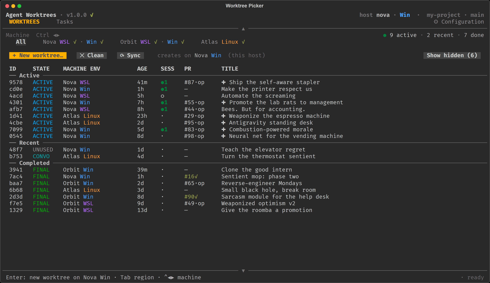

# copilot-extensions

A general-purpose [Copilot CLI](https://docs.github.com/copilot/how-tos/use-copilot-agents/use-copilot-cli)
toolkit for **assembling your own agent harness**. Select plugins for local
worktree sessions, planning, continuity, live agent communication, durable
task queues, remote venues, and authenticated tools.

This repository supplies reusable components—not a preconfigured operator
harness. You own your repositories, workflow policy, accounts, credentials,
and deployment topology. A local capability does not require a machine fleet,
and installing the marketplace does not adopt your repositories.

## Quick Start

Start with a capability you need. For a **deliberate user-global installation**
of the customization skills:

```bash
copilot plugin marketplace add ThomasMichon/copilot-extensions
copilot plugin install customizing-copilot@copilot-extensions
```

Restart Copilot CLI and verify the plugin's skills are available. Follow
[installation](docs/installation.md) for repository-scoped settings,
activation/trust and extension scope, runtime prerequisites, and first-use checks.
For isolated local git sessions, add
[agent-worktrees](plugins/agent-worktrees/docs/getting-started.md); its
standalone path does not require bridge, Codespaces, or container plugins.

**Payload is not runtime.** Skills, hooks, and extensions arrive through the
marketplace. Runtime-backed plugins also deploy a plugin-owned Python runtime
and, where applicable, a service. Use the selected plugin's setup guide rather
than installing the entire suite or assuming every enabled plugin needs a
daemon.

| Next question | Read |
|---------------|------|
| What can I compose, and what does it depend on? | [Capabilities](docs/capabilities.md) |
| How do I adopt a repo or grow a deployment? | [Adoption and hypothetical examples](docs/adoption.md) |
| Where do settings, credentials, and machine state belong? | [Configuration](docs/configuration.md) |
| How do the components actually relate? | [Architecture](docs/architecture.md) |
| Where is the complete reading map? | [Documentation index](docs/README.md) |

## Capability families

- **Workspace and source control:** isolated worktrees, repository adoption,
  lifecycle tracking, and explicitly addressed pull-request operations.
- **Coordination and continuity:** live session messaging, durable queued
  tasks, context handoffs, and opt-in remote drivability.
- **Execution venues and connectivity:** GitHub Codespaces, local Docker
  fleets, SSH profiles, and Windows/WSL setup guidance.
- **Evidence and retrieval:** structured session logs and configured indexing.
- **Harness design and policy:** customization, efforts, visions, attribution,
  conduct guidance, and optional private-knowledge binding.
- **Host integration:** MCP bridges, machine-state reconciliation, a local
  secret store, and offline budget posture.

These are selection categories, not installed bundles. See
[capabilities and support boundaries](docs/capabilities.md#support-and-dependencies)
before choosing a platform or enabling an integration.

## Plugin catalog

The canonical roster and versions live in
[the marketplace manifest](.github/plugin/marketplace.json). Follow a plugin's
README for its current scope and setup; this table is discovery, not a promise
that every feature or platform is supported by every component.

| Plugin | What to use it for |
|--------|--------------------|
| [agent-worktrees](plugins/agent-worktrees/) | Local worktree sessions, repo adoption, tracked lifecycle, and project commands |
| [agent-pull-requests](plugins/agent-pull-requests/) | Explicit `owner/repo` PR status/create/merge/wait without a local checkout; account resolution uses agent-worktrees |
| [agent-bridge](plugins/agent-bridge/) | Persistent live session communication across adopted boundaries |
| [agent-codespaces](plugins/agent-codespaces/) | GitHub Codespace lifecycle and optional bridge/credential-relay integration |
| [agent-containers](plugins/agent-containers/) | Local Docker fleet lifecycle, leases, and container dispatch |
| [agent-mcp](plugins/agent-mcp/) | Upstream HTTP/stdio MCP transport, host credential injection, catalog reshaping, and materialization |
| [agent-ssh](plugins/agent-ssh/) | Registry-based SSH profiles and connectivity verification |
| [agent-remote-driver](plugins/agent-remote-driver/) | Opt-in SDK extension for live session attach/send/steer/abort; not default-enabled |
| [efforts](plugins/efforts/) | Adopt and coordinate durable planned work |
| [visions](plugins/visions/) | Maintain standing intent separately from implementation progress |
| [agent-logger](plugins/agent-logger/) | Structured session logs, digests, and configured session synchronization |
| [context-handoff](plugins/context-handoff/) | Continuity policy, context awareness, and successor-session handoffs |
| [agent-dispatch](plugins/agent-dispatch/) | Durable task queues, claims, supervision, and declarative worker loops |
| [agent-index](plugins/agent-index/) | Configured indexing/retrieval with a lightweight client and optional managed host |
| [agent-machines](plugins/agent-machines/) | Reconcile explicitly declared machine requirements |
| [agent-vault](plugins/agent-vault/) | Local KeePassXC-backed secrets fetched on demand |
| [customizing-copilot](plugins/customizing-copilot/) | Author and diagnose skills, agents, plugins, MCP registrations, and harnesses |
| [copilot-extensions-harness](plugins/copilot-extensions-harness/) | Contribution and diagnosis guidance for this toolkit; not a supplied personal harness |
| [wsl-setup](plugins/wsl-setup/) | Windows WSL2 setup and troubleshooting |
| [harness-knowledge](plugins/harness-knowledge/) | Bind a stateless harness to a separately selected private knowledge repo |
| [ai-attribution](plugins/ai-attribution/) | Publication-policy guidance and attribution workflows |
| [delegation-guidance](plugins/delegation-guidance/) | Deprecated compatibility pointer; use agent-conduct-guidance |
| [budget-guidance](plugins/budget-guidance/) | Strict offline budget readings and attributable posture |
| [agent-conduct-guidance](plugins/agent-conduct-guidance/) | Modular delegation, headless-process, scratch-space, and secret-masking guidance |

## Concepts: the control-harness repo

A harness is a repository or configuration that gives agents a coherent
working context: instructions, selected plugins, workflow policy, and references
to the repositories they operate on. It can share a product repository or be a
separate control repo. Neither a private knowledge repo nor remote execution
is required for every adopter.

[Adoption](docs/adoption.md) explains the install/adopt boundary and shows
**hypothetical** small, split-state, and remote deployments. The
[harness runbook](docs/harness-runbook.md) is an opinionated assembly recipe,
not the only supported way to use an individual plugin.

## Architecture at a glance

The suite separates marketplace payloads from independently deployed runtimes.
Agent-facing commands resolve through attributable plugin command glossaries;
legacy management wrappers remain compatibility surfaces. Optional providers
compose with the bridge rather than becoming a mandatory central installation.
See [architecture](docs/architecture.md) and the
[install contract](docs/install-contract.md) for the real ownership boundaries.

<p align="center">
  
</p>

<p align="center"><em>The <strong>Worktree Picker</strong> — the front door to your fleet of
worktree-backed agents, at a glance across every machine.</em></p>

This existing preview is illustrative, not platform or build-provenance
evidence. Fresh preview capture remains tracked independently in
[adopter-material-refresh](efforts/active/adopter-material-refresh/README.md).
The optional standalone [Worktree Manager](worktree-manager/README.md) owns its
own installation; a complete Installer & Configurator bootstrap remains
[design intent](visions/installer/README.md), not the quick-start path above.

## Updating

For a deployment adopted by agent-worktrees, the management command
`agent-worktrees update` refreshes registered marketplace payloads and
reconciles runtimes. Payload-only CLI updates are not equivalent to updating an
already deployed runtime. Follow
[installation and maintenance](docs/installation.md#maintenance-and-recovery)
for the applicable owner and installation mode.

## Uninstalling / baseline reset

Use the selected plugin's uninstall/recovery procedure and inspect its
configuration-removal options first. Do not infer another plugin's purge
behavior or delete a managed worktree by hand.
[Installation](docs/installation.md#maintenance-and-recovery) links the
component owners and repository-level reset tools.

## Documentation

- [Adopter documentation index](docs/README.md): the primary reading path.
- [Reference index](docs/reference-index.md): deeper setup, command, design,
  and recovery references, including the references formerly listed here.
- [Contributing](CONTRIBUTING.md), [development guide](AGENTS.md), and
  [testing](TESTING.md): change and validate the toolkit itself.
- [Visions](visions/README.md): what should be, not a shipped-feature catalog.

If your clone predates the `main` history rewrite, follow
[the pipeline recovery procedure](docs/pipelines.md#if-mains-history-is-force-rewritten).
`dev` was not affected; the detailed record is in
[main-history-rewrite](efforts/done/main-history-rewrite/README.md).

## License

[MIT](LICENSE)
