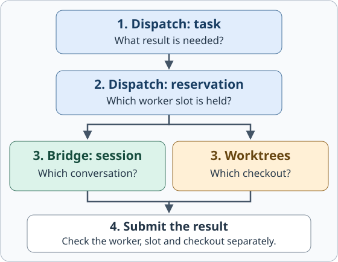

# How an automated task runs

Suppose a repository needs a review of pull request 12033. **Dispatch**
records the job and assigns a worker. **Bridge** connects that worker's
conversation. **Worktrees** tracks the checkout in which it inspects the change.
The review belongs to the task, not to the process that happened to write it.

**Start with the [PR review in snapshots](review-snapshots.md)** to see the
records before a worker exists, after it accepts, and while it waits for a slot.

| Follow the map | What the record can tell you |
|---|---|
| 1. [Task](dispatch.md#task) | Who owns the job? Has the worker accepted it, submitted a result, or received confirmation? |
| 2. [Reservation](dispatch.md#reservation) | Has Dispatch set aside capacity? Is the same attempt still allowed to start? |
| 3. [Bridge session](bridge.md) | Which conversation should receive the task? Is there a usable connection to it now? |
| 3. [Worktree](worktree.md) | Where is the checkout? Which conversation is its head? Would removal lose work? |
| 4. [Result and cleanup](verification.md) | Which observations prove success? Which failures can a simulation reproduce? |

### One run, four different answers

A **pool** is a configured group of workers; a **lane** limits which jobs may
use a particular slot or resource. When Dispatch can match the job, it records
the assignment. A supervisor arranges for a worker to run. The worker needs
both the right conversation and the right checkout; the two boxes marked **3**
are related resources, not consecutive status values. Existing workers can
also claim tasks: not every task causes a new checkout or process.

The worker inspects the requested PR revision, reports progress, and submits a
reference to its review. A tracker or evaluator can check it independently. A
worker saying “done” in chat is not a submission. Likewise, an accepted result
does not prove that the process exited, the reservation is free, or the branch
is safe to remove. A checkout can hold useful changes after the task ends.

### When a run stops moving

Find the **last fact an owner recorded** and the **next fact you need**.
A claimed task with no start record calls for inspection of the reservation
and worker startup, not another task. An idle session with no result calls for
inspection of delivery and the worker's submission, not Git cleanup. A
completed task with a dirty checkout calls for inspection of the files and
claims, not a second run.

[Trace the IDs across owners](trace.md) for a worked example. Each detail page
distinguishes stored state from observations and links to the source that
writes it. These pages describe the repository implementation, not a guarantee
that a particular installation has enabled or qualified every path.

[Back to the architecture overview](../architecture.md)
