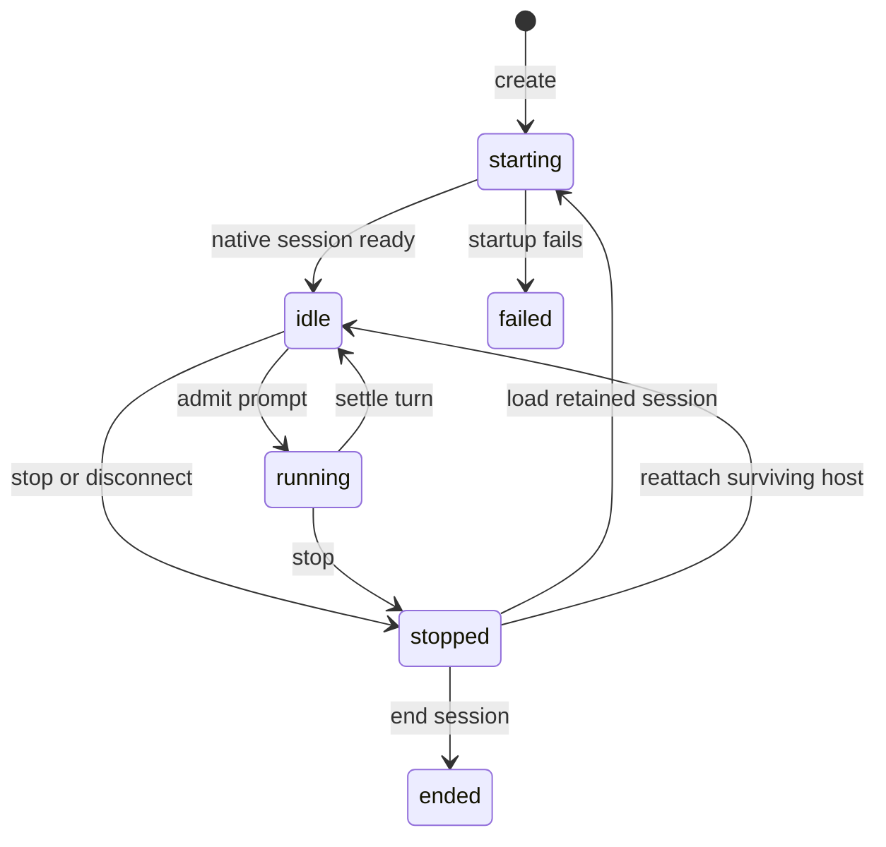

# Bridge: how the worker gets its task

[Run map](README.md) · [Task and reservation](dispatch.md) · [Worktree](worktree.md) · [Trace the IDs](trace.md)

**A conversation can exist without a running process. A process can exist
without a Bridge-owned session.** Ask which of these two paths the worker uses:

| Path | Who runs the process? | Where does the first prompt go? |
|---|---|---|
| **Hosted ACP** (Agent Client Protocol) | A Session Host owns the Copilot child and its input/output streams. The Bridge frontend connects to the Host. A Bridge control ID points to a separate native conversation ID. | Bridge admits a turn for the exact session, then sends it over ACP. A turn index is not the worker's result. |
| **Interactive CLI / mux** | Worktrees can launch the CLI in a terminal multiplexer. The running extension registers the native session with Bridge. A terminal name is neither the native session ID nor proof the CLI is ready. | Bridge puts a message in the addressed registration's inbox. SDK send, acknowledgement and observed consumption are separate steps. |

For [Dispatch acquisition](../../plugins/agent-bridge/src/agent_bridge/acquisition_runtime.py),
Bridge checks the original task generation and reservation, selects or starts
the conversation, and asks Dispatch to bind a receipt **before** keyed delivery.
The receipt identifies task, reservation, workspace, Bridge/native IDs, mode
and delivery. On the [CLI path](../../plugins/agent-bridge/src/agent_bridge/acquisition_plugins.py),
the expected registration must match the Worktrees head. An uncertain launch
or delivery is not permission to start a second worker.

## What can happen to a hosted session?

The arrows show common operations, **not a central state machine**. The
[eight status names](../../plugins/agent-bridge/src/agent_bridge/session_status.py)
are shared. The [database setter](../../plugins/agent-bridge/src/agent_bridge/db_sessions.py)
does not validate the previous status; each operation checks its own conditions.

| Operation | Allowed move and decision |
|---|---|
| [Create](../../plugins/agent-bridge/src/agent_bridge/session_start.py) | `created` is the new object's default. Normal creation first writes `starting`, calls `session/new`, retains its native ID and becomes `idle`. Failures can produce `failed` or `stopped`. |
| [Prompt](../../plugins/agent-bridge/src/agent_bridge/session_prompts.py) | Admit from `idle`, or resume from `stopped` when allowed. Record the turn before entering `running`. Normal completion or a reported turn error returns to `idle`; cancellation is settled by teardown or recovery. |
| [Resume](../../plugins/agent-bridge/src/agent_bridge/session_resume.py) | Accept `stopped`, disconnected `idle` with no live turn, or a narrowly qualified `failed` allocation. A warm reattach keeps the child and conversation; a cold load starts execution for the existing native ID. Failed load leaves `stopped`. Strict recovery cannot replace the conversation. Some legacy prompt-driven paths explicitly allow recreation. |
| [Stop / end](../../plugins/agent-bridge/src/agent_bridge/session_lifecycle.py) | Check background work and ownership. Stop preserves resumable metadata and can leave the Host alive. End retires execution, writes `ended` and normally removes metadata. Unconfirmed remote retirement keeps responsibility. `stopping` is a declared status, not a mandatory intermediate write. Ending a represented CLI registration does not kill its process. |
| [Recover after frontend restart](../../plugins/agent-bridge/src/agent_bridge/session_core.py) | Writable startup maps previously `starting`, `running` or `idle` rows to `stopped` and marks incomplete turns interrupted. [Reattachment](../../plugins/agent-bridge/src/agent_bridge/session_host_connection.py) is a separate check of the surviving Host, not a new conversation. |

**Do not read three different signals as one state.** An owned session has
the status above. A [live registration](../../plugins/agent-bridge/src/agent_bridge/db_live_sessions.py)
is `live`, `wedged`, `expired` or `taken-over`. The [foreground turn](../../plugins/agent-bridge/src/agent_bridge/live_turn_state.py)
can be `running` or `idle` independently. Dispatch's [simulated Bridge model](../../plugins/agent-dispatch/src/agent_dispatch/bridge_state_machine.py)
uses `absent`, `hydrating`, `running`, `suspended` and `ended`; those are not
the values to look for in Bridge's `sessions.status`.

## Where Bridge stores each fact

| Store | Key and useful fields | What it proves |
|---|---|---|
| `sessions` | Bridge `id` (primary key), `target_json`, `status`, `acp_session_id`, PID, recovery flags and predecessor/successor | Retained control metadata and target. A stored PID or `stopped` status alone says nothing conclusive about process lifetime. |
| `turns`, `events`, `pending_prompts` | Turns keyed by `(session_id, turn_index)`; events by `(session_id, event_id)`; pending prompts have their own ID. These reference the owned session. | Admitted work, ordered observations and queued follow-ups. A pending prompt is not a native reply. |
| `live_sessions`, `live_messages`, `cli_mode_reservations` | Registration keyed by native `session_id`, with worktree, venue, PID/birth, status, turn and heartbeat. Messages record target and delivery/consumption. CLI reservations are keyed by worktree. | Representation of an interactive CLI, **not** a foreign key to an owned `sessions` row. |
| `acquisition_attempts`, `acquisition_effects`, `acquisition_bindings`, `acquisition_launch_gates` | Attempt/effects keyed by delivery ID; `pending`, `completed` or `refused` attempt; binding keyed by Bridge session; one launch gate per worktree. | Which request may launch or deliver, with its original task and native identity. A matching completed request can return its receipt; missing evidence stays pending. |
| `workspace_embodiments`, `cold_outages` | Workspace creation keyed by creation-key digest, retaining allocation, reserved IDs and stage; outage keyed separately with original session, process evidence and reconnect outcome. | Creation and recovery are distinct from admission of a task prompt. |
| Session Host index and native history | Host record keyed by Bridge session ID; endpoint, Host/child process identity and current frontend claim. Copilot retains the native conversation itself. | Where to reconnect and which conversation to load. Relay buffers can survive a frontend loss because the Host is alive, not because they are a disk transcript. |

See the [SQLite definitions](../../plugins/agent-bridge/src/agent_bridge/db_core.py),
[acquisition schema](../../plugins/agent-bridge/src/agent_bridge/acquisition_custody_schema.py),
[launch gates](../../plugins/agent-bridge/src/agent_bridge/acquisition_store.py)
and [Host index](../../plugins/agent-bridge/src/agent_bridge/session_host/host_index.py).
These stores do not commit together and are not an API for other plugins to edit.

## Discovering a target is not starting it

The [target list](../../plugins/agent-bridge/src/agent_bridge/target_inventory.py)
combines managed sessions, registered Hosts, live extension registrations and
discovered worktrees. A listed workspace does not need an existing Bridge
row. Listing it does **not** create that row or start Copilot.
The [metadata operation](../../plugins/agent-bridge/src/agent_bridge/worktree_metadata.py)
can read the exact active worktree and native head and import a **stopped**
control record. Ambiguous owners, pending handoff, existing execution or
uncertain Host inventory block that import. Not all callers select targets
from the union; see [target inventory and its limits](../../plugins/agent-bridge/docs/target-inventory.md).

**Proposed diagnostic view, not a new stored state:** report “workspace
known / native head known / transport attached / first delivery acknowledged”
as separate facts, each with its record owner and an *unknown* value. That
shows the next missing observation without turning a missed heartbeat into a
decision to replace a conversation.

**Executable references:** [target discovery](../../plugins/agent-bridge/tests/test_target_inventory.py),
[metadata-only import](../../plugins/agent-bridge/tests/test_worktree_metadata.py),
[keyed ACP creation and reload](../../plugins/agent-bridge/tests/test_provider_creation_stdio.py)
and [real Copilot with an offline test provider](../../plugins/agent-remote-driver/tests/native/test_session_host_copilot.py).
