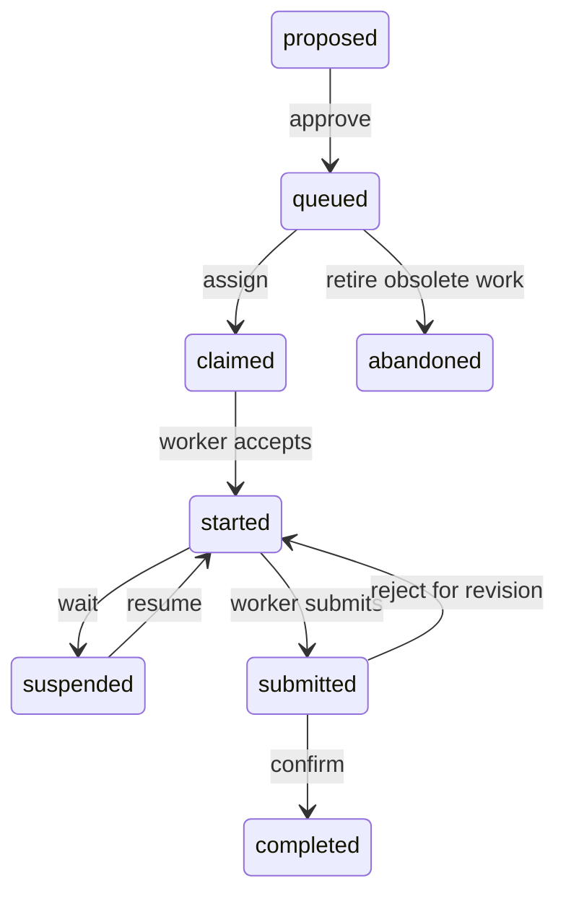
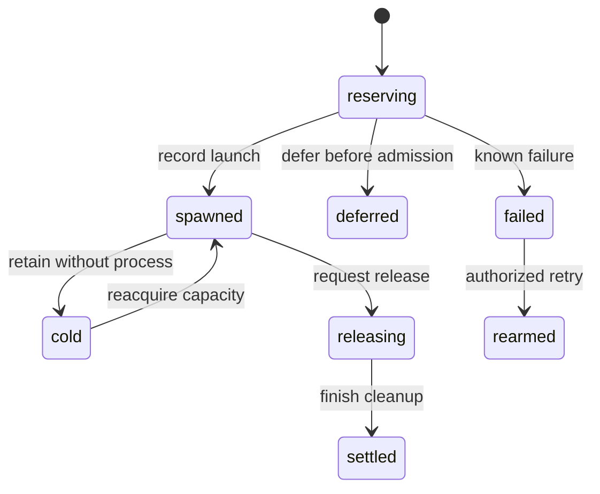

# Dispatch: work and capacity

[Run map](README.md) · [Session](bridge.md) · [Worktree](worktree.md) · [Trace the IDs](trace.md)

A **task** says what result is needed. A **spawn reservation** records an
attempt to provide a worker. They have separate lifetimes. In particular,
`claimed` does **not** mean Copilot is running, and `spawned` does **not** mean
the worker accepted the job.

Component references: [queue state model](../../plugins/agent-dispatch/README.md#state-model)
and [coordinator, supervisor and lanes](../../plugins/agent-dispatch/docs/spawn-supervisor.md#coordinator-supervisor-daemon-and-worker-lanes).

## Assignment is not a running slot

Dispatch tracks assignment independently of process capacity. The task's
flow supplies its completion condition; core Dispatch does not inspect PR
state or choose an inactivity timeout. The [PR reviewer](../../visions/plugins/agent-dispatch/reviewer/README.md#settle-and-release)
is one example of that generic contract:

| Event | Task and assignment | Worker and workspace |
|---|---|---|
| Pool accepts work | Record the pool, then bind the worktree it allocates. | A process need not be running yet. |
| Reviewer posts a verdict | `suspended`, still assigned. | Stop the worker and return its running slot to the pool. |
| PR is updated | Resume the same assignment, not a new task. | Reacquire capacity for the same worktree and conversation. |
| Landing is ready and policy assigns it to the reviewer | Resume the same task for landing; no new revision is needed. | Approval alone does not grant merge authority. |
| Reviewer verifies merge, abandonment or policy-defined staleness | On merge, wake the original reviewer for closeout. Submit only after the outcome and readiness checks pass. | Settle child claims and dispose of the review checkout; preserve the assigned driver workspace. |
| Result awaits evaluation | `submitted`, still assigned to the pool and worktree. | Cleanable on acceptance, resumable on rejection. Recreate child worktrees if needed. |
| Evaluator confirms, task is abandoned, or owner explicitly releases it | Unassignment is now permitted. | Preserve the assignment history. A move to `claimed` just to resume does not qualify as release. |

**Reading current state:** [pool placement](../../plugins/agent-dispatch/docs/pool-placement.md)
records the pool and reservation; workspace attachment comes later. The
[submission writer](../../plugins/agent-dispatch/src/agent_dispatch/queue_lifecycle.py)
clears the active `tasks.owner`, and the [closeout path](../../plugins/agent-dispatch/docs/relevance-closeout-worker.md)
settles a workspace claim before finalization. Neither a null execution owner
nor a settled claim proves that the logical assignment ended. The table
states the required lifetime, not a guarantee that every driver or historical
reservation already exposes both bindings through evaluation.

## Task

The [task record](../../plugins/agent-dispatch/src/agent_dispatch/queue_records.py)
defines eight current states for a finite job. The diagram shows ordinary
execution and review; the table includes alternate paths.

| From | Allowed destination and reason |
|---|---|
| New | Create `queued` by default, or `proposed` for later approval. |
| `proposed` | `queued` on approval; `abandoned` on permitted retirement. |
| `queued` | `claimed` by an eligible worker or the pool allocator. With no available slot, the task can stay queued; this is not a failed launch. A guarded reset can return it to `proposed`. |
| `claimed` | `started` only on affirmative worker acceptance. A permitted request for input can move it to `suspended`. Yield or exhausted startup can return it to `queued`; the latter retains old resource obligations and applies a cooldown. |
| `started` | `submitted` with a result; `suspended` to wait; `queued` on guarded yield/recovery. |
| `suspended` | `started` on accepted resume; `submitted` on completion; `queued` on explicit release or qualified recovery. Requesting a wake can leave it **suspended** until its worker actually resumes. |
| `submitted` | `completed` on confirmation; `started` if the original worker must revise the result; `queued` if reopened for reassignment. A task configured without required verification can submit and confirm in one transaction. |
| `completed`, `abandoned` | Terminal. `dead_letter` is a historical task value, not another current state. |

A permitted abandonment can retire any nonterminal task. Guarded reset can
return queued or owned work to `proposed`. Obsolete work with prior execution
or workspace responsibility needs **closeout**: notifying an owner is not
proof that its worktree was finalized. A standing worker charter is not a
finite task; it has a [separate enrollment and retirement lifecycle](../../plugins/agent-dispatch/src/agent_dispatch/queue_standing_charters.py).

**Fields, not states:** hold, waiting for input, requested resume, lease time,
retry limits, exclusions and cooldown. A task generation identifies an
assignment; it does not increment on every status update. The queue checks
the relevant state, generation and owner inside a write transaction and records
the event. See [claim admission](../../plugins/agent-dispatch/src/agent_dispatch/queue_claim_queries.py),
[worker transitions](../../plugins/agent-dispatch/src/agent_dispatch/queue_lifecycle.py),
[suspension](../../plugins/agent-dispatch/src/agent_dispatch/queue_suspend.py),
[rejection](../../plugins/agent-dispatch/src/agent_dispatch/queue_submission_rejection.py)
and [relevance checks](../../plugins/agent-dispatch/src/agent_dispatch/queue_relevance.py).

## Reservation

There are **two startup orders**. In the legacy path, the supervisor reserves
and launches while the task is still queued; the worker claims it. In the
[configured-pool path](../../plugins/agent-dispatch/src/agent_dispatch/supervisor_pool_allocator.py),
the allocator selects a matching registration, machine and environment with
available capacity. [One transaction](../../plugins/agent-dispatch/src/agent_dispatch/queue_pool_placement.py)
records the reservation, binds the pool and changes the task to `claimed`.
The worker and native session can still be unknown at commit. Only then does
the supervisor arrange the checkout, launch and first delivery. This path is
opt-in, not the startup order of every installation.

| Move | What must be true |
|---|---|
| New → `reserving` | No conflicting holder or unresolved prior effect blocks admission. An existing reservation is not permission to start twice. |
| `reserving` → `reserving` / `spawned` | Store the workspace and worker details as they become known. Publishing startup checks attempt identity and revision. |
| `spawned` ↔ `cold` | Cooling follows completed startup. Reactivation must acquire capacity again when the pool requires it. |
| Active attempt → `releasing` | Release is requested. A late reply can complete startup bookkeeping without cancelling release. |
| Active attempt → `failed` / `settled` | Record failure or settlement with the applicable startup and resource checks. `releasing` can finish as either after the required absence evidence. |
| `reserving` / `cold` → `deferred` | Known pre-admission deferral, or a revision-matched cold deferral for the same queued, unowned task. Not a failed launch. |
| `failed` → `rearmed` | Explicitly authorized, task queued and unowned, with no pending cleanup or uncertain send. A new attempt gets a new key. |

Pool capacity is **not a count of rows named `spawned`**. A cold conversation
may use no process slot; a historical attempt can still count because startup,
wake or retirement is unresolved. A legacy lane can also exhaust its failed
spawn budget while the task remains `queued`. Losing liveness at the **task**
attempt cap is a different outcome: guarded recovery can abandon the task.
See [reservation writes](../../plugins/agent-dispatch/src/agent_dispatch/queue_spawn_reservations.py),
[capacity accounting](../../plugins/agent-dispatch/src/agent_dispatch/queue_pool_accountability.py),
[startup and cooldown](../../plugins/agent-dispatch/src/agent_dispatch/queue_pool_startup.py)
and [conclusion](../../plugins/agent-dispatch/src/agent_dispatch/supervisor_conclusion.py).

## What is in the queue database?

The [queue](../../plugins/agent-dispatch/src/agent_dispatch/queue.py) uses
SQLite. These are logical joins, not cross-service SQL foreign keys.

| Table | Identity and useful fields | Question it answers |
|---|---|---|
| `tasks` | Primary key `id`; `repo`, `status`, `owner`, `owner_session_id`, `generation`, `attempts`, timing, verification and result fields. Active deduplication uses `(repo,dedup_key)`. | What work is current, and who may change it? |
| `task_events`, `task_progress`, `task_attachments` | Each has its own row ID and `task_id`. Events store transitions, progress stores reports, attachments record session/worktree/machine and attach/detach times. | What happened to this task across attempts? |
| `spawn_reservations` | Primary key `key` identifies task and attempt; holds state, exclusive key, startup revision, session handle, allocation and cleanup facts. A partial unique index prevents concurrent unreleased holders of the exclusive key. | What did this launch attempt reserve, create or leave behind? |
| `task_pool_assignments`, `pool_reservation_bindings` | One current assignment per task and unique reservation key; historical binding per reservation records registration, machine and environment. | Which slot was selected for this attempt? |
| `acquisition_receipts` | Reservation key, task generation, worktree ID, Bridge session ID, native session ID, mode and unique delivery ID. | Which conversation accepted this delivery? |
| `wake_outbox`, `task_steer` | Wake operation ID and unique `(task,generation,wake_seq)`; steering can have a task-scoped idempotency key and separate consumption marker. | Is a wake pending, delivering, delivered, failed or stale? Reading a steer does not prove that the worker acted on it. |

Sources: [schema and indexes](../../plugins/agent-dispatch/src/agent_dispatch/queue_schema_migrations.py),
[receipts](../../plugins/agent-dispatch/src/agent_dispatch/acquisition_receipts.py)
and [protected assignment relationships](../../plugins/agent-dispatch/src/agent_dispatch/queue_relationship_schema.py).

## Who advances the records?

The coordinator serves the queue and periodically checks wakes, verification
and liveness. The supervisor daemon manages configured worker lanes. A
[lane cycle](../../plugins/agent-dispatch/src/agent_dispatch/supervisor_cycle.py)
first reconciles outstanding work, then considers new candidates. Live event
notifications can wake it sooner; they are not the durable event log.
Transactions record intent before a slow external action. A wake or evaluation
runs outside that transaction, then settles against the original owner and
revision. A lost reply can leave an *unknown* send, not a second send permit.

**How much of the state engine is live?** Many task operations read the
[declared transitions](../../plugins/agent-dispatch/src/agent_dispatch/task_state_machine.py);
the [wiring test](../../plugins/agent-dispatch/tests/test_task_transition_wiring.py)
changes a declaration and checks that real queue behavior changes. Claims,
liveness recovery and specialized pool paths also have their own guarded SQL.
Reservation consistency checks use the model, but reservation writes are not
driven by one transition table. Dispatch's simulated Bridge states are not
Bridge's session writer. Thus a passing [simulation](../../plugins/agent-dispatch/src/agent_dispatch/simulation.py)
is useful but does not establish that the database, process and workspace all
moved together.
