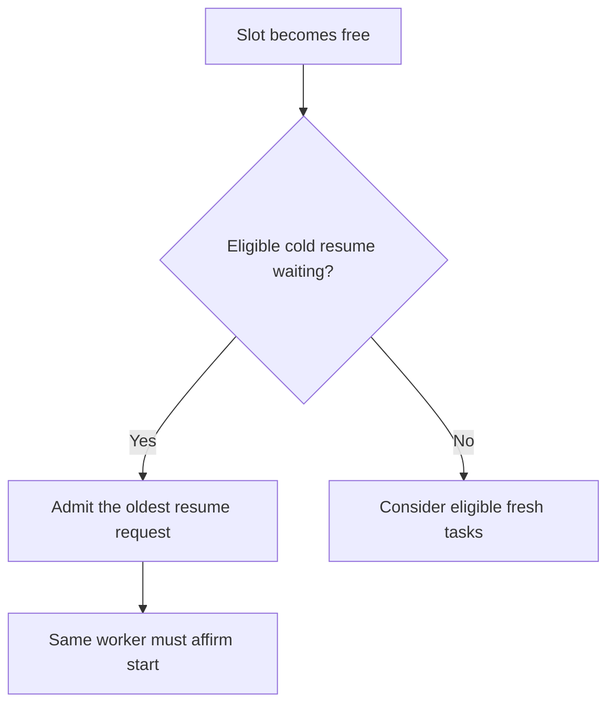

# Who gets the next worker slot?

[PR review snapshots](review-snapshots.md) · [Dispatch records](dispatch.md)

**In a configured pool, an eligible cold worker waiting to resume gets a
freed slot before a fresh queued task.** Its task stays `suspended` while it
waits. Dispatch neither preempts the running worker nor creates a second
claim for the suspended one.

Suppose one pool can run **one** worker. Review **A** (`review-pr-12033`) has
requested changes and its worker was parked. Review **B** is running. Task
**C** (`review-pr-12034`) is queued, eligible for this same pool. A new
revision arrives for A; the existing owner is asked to review it.

| Snapshot | A: task / reservation | B: occupies slot? | C: fresh task |
|---|---|---|---|
| Before the new revision | `suspended / cold`; no resume request | Yes | `queued`, no reservation |
| A asks to resume | Still `suspended / cold`; `resume_requested=1`, assignment `lane_wait_since=t1`, `recovery_requested_at=null`. No new wake is enqueued simply to wait. | Yes | Still `queued` |
| B frees the slot | A's eligible waiter already counts against fresh placement. Recovery records `recovery_requested_at` and advances `recovery_revision`; if requested it queues a wake for the same owner. | No, once B's capacity obligations are clear | Cannot take A's slot in the gap between release and recovery |
| A's worker is reachable again | The same reservation can return to `spawned`; `suspended` remains correct even after wake delivery. | No | Still waiting if A uses the only slot |
| A explicitly accepts the new work | `started / spawned` in this example. Start checks the current recovery revision, generation and native identity; `resume_requested` clears. | No | Can be placed when capacity next permits |

**Order is per pool instance**, identified by registration, machine and
environment. Among eligible cold waiters, compare `(lane_wait_since, task_id)`;
the earlier request wins, not necessarily the older task. With several slots,
each waiter consumes one place in this calculation. A task that is merely
suspended, with no request to resume, has no such priority. If the worker was
never parked, it normally still holds its own slot. A hold, pending operator
input, release, retirement, disabled pool or unavailable catalog changes
eligibility. There is no global queue that all machines must drain in order.

For **fresh** work, the [lane supervisor](../../plugins/agent-dispatch/src/agent_dispatch/supervisor.py)
filters due finite tasks for its lane and sorts the candidates it retrieved
by creation time, oldest first. Selection is bounded, filtered and subject to
other supervisors racing; it is not strict global FIFO. Pool matching,
affinity, exclusions, exclusive resources, cooldown and current capacity
still apply. [Placement](../../plugins/agent-dispatch/src/agent_dispatch/queue_pool_placement.py)
rechecks capacity in the transaction. An unresolved historical startup or
send can still consume a slot even if an observer counts zero running PIDs.

**Check the rule in code:** [`_wait_for_lane` and `request_recovery`](../../plugins/agent-dispatch/src/agent_dispatch/queue_pool_recovery.py)
write the waiting fields; `pool_lane_load` counts them ahead of fresh claims.
The [queue tests](../../plugins/agent-dispatch/tests/test_pool_suspended_recovery.py)
include `test_reactivation_waits_for_a_lane_then_outranks_fresh_placement` and
`test_waiting_reactivations_take_freed_lanes_in_request_order`. They check
the database and wake queue, not a real worker process.
