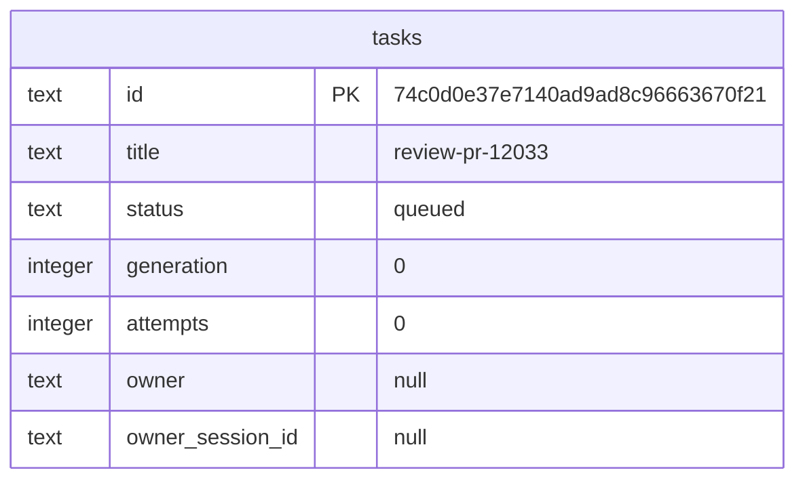
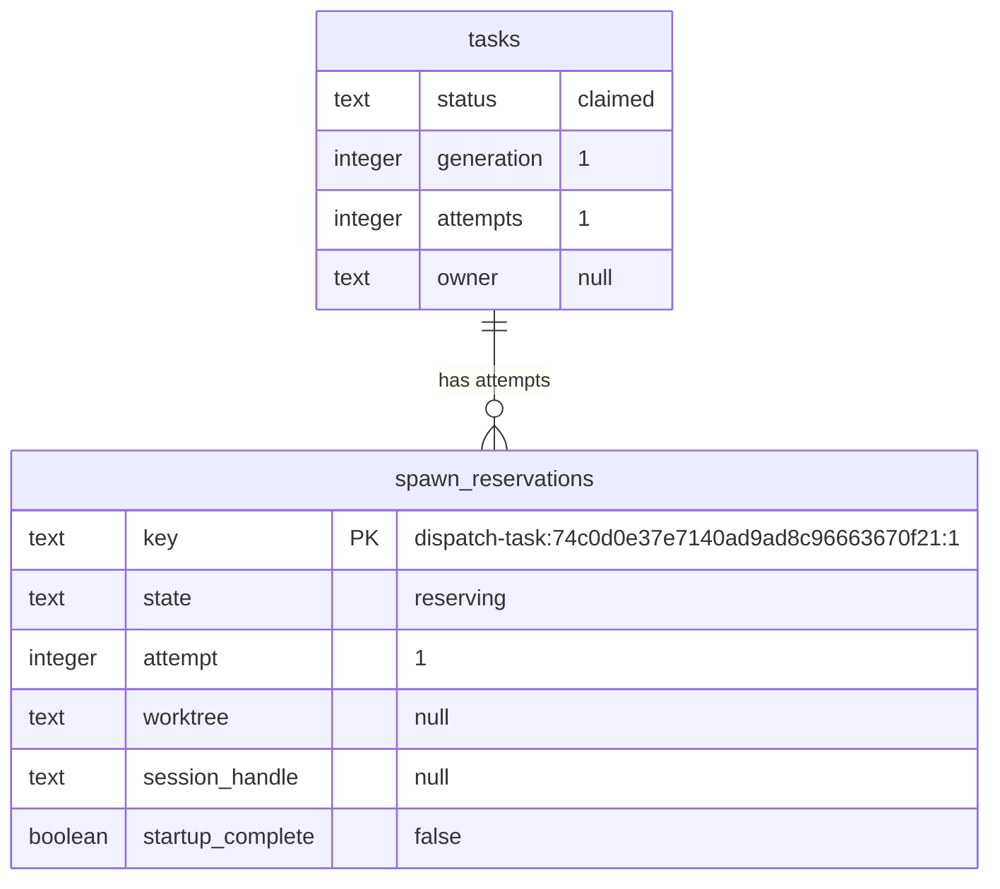
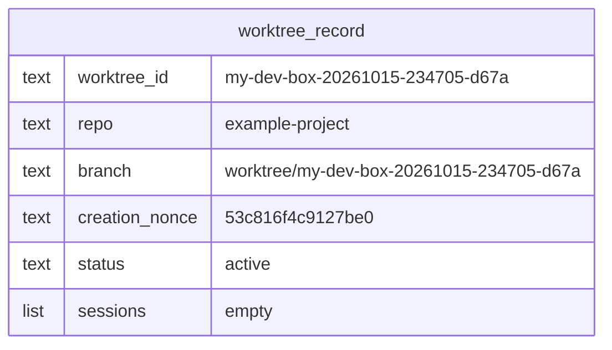
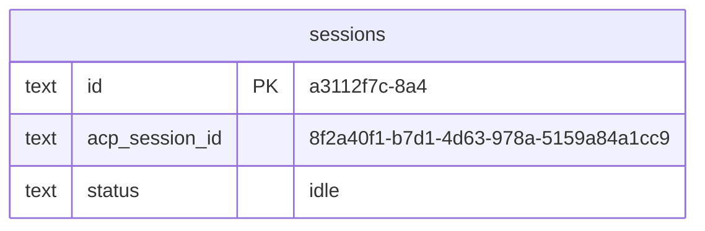
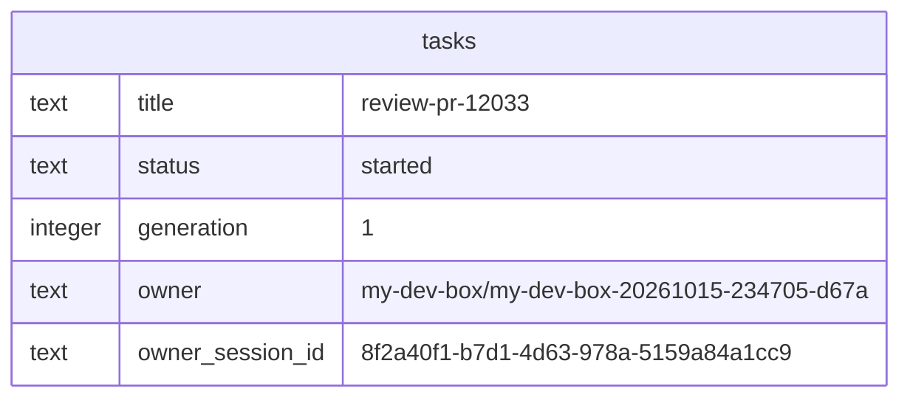

# One PR review in snapshots

The job is to review PR 12033 at head `a7139c4` and return a reference to
that review. Dispatch tracks **the job** in a task row and **one attempt to
run its worker** in a spawn reservation. A spawn reservation is always tied
to a task. This example asks for a review reference on one revision. In a
[PR-lifetime reviewer loop](dispatch.md#assignment-is-not-a-running-slot),
posting that reference is progress: the task suspends between rounds. An
update, a ready reviewer-owned landing action, or a merge wakes it for the
next step. It submits only after closeout, not after each verdict.

| Event in this example | Task status | Reservation state |
|---|---|---|
| Producer requests the review | `queued` | No row |
| Allocator commits a slot | `claimed`, no worker yet | `reserving` |
| Supervisor records startup | `claimed`, worker has not accepted | `spawned` |
| Reviewer accepts | `started` | `spawned` |
| Reviewer submits; verification is required | `submitted` | `spawned` |
| Evaluator rejects that submission | `started`, same reviewer | `spawned`, same attempt |
| Evaluator confirms a corrected submission | `completed` | No change from confirmation itself |

These are snapshots of a **fresh local checkout in a configured pool**, not
every legal combination or a production dump. The IDs are fictional but use
the formats written by the components. Each card shows selected fields and
example values. `null` means the row exists but the field is empty.

## 1. A producer creates the task

`review-pr-12033` is the title, not the key. [Dispatch records creation](../../plugins/agent-dispatch/src/agent_dispatch/queue_storage.py)
in `task_events`. The reviewers' pool already exists. There is no reservation,
checkout, process or conversation for this job yet.

## 2. Dispatch commits the slot before it calls a launcher

In the same [placement transaction](../../plugins/agent-dispatch/src/agent_dispatch/queue_pool_placement.py),
`task_pool_assignments` links generation 1 to the reservation and the pool
`reviewers / my-dev-box / linux`; `pool_reservation_bindings` keeps that
attempt's pool identity. **No process was started.** If the slot is full,
the fresh job stays `queued` without spending an attempt. In the legacy
reservation-first path, the task stays queued until a worker claims it.

## 3. Worktrees allocates the checkout

This card is the **Worktrees YAML record**, not a SQL table. Its
`dispatch_attempt` points back to the task ID, reservation key and attempt 1.
For [keyed creation](../../plugins/agent-worktrees/src/agent_worktrees/creation_requests.py),
`workspace-creation.sqlite3` records `pending` before allocation and `complete`
after successful creation. Git can already contain the checkout while that
journal is pending. On return, Dispatch records the worktree ID, project,
path and `worktree_ownership=created` on its reservation. The task is still
`claimed`; there need not be a conversation. See [checkout creation](../../plugins/agent-worktrees/src/agent_worktrees/worktree_creation.py)
and [startup boundaries](startup-boundaries.md) for pairing and preparation.

## 4. Bridge connects a conversation

| Observation | Hosted ACP | Interactive CLI in a mux |
|---|---|---|
| Before native identity | Bridge assigns its own control ID, `a3112f7c-8a4`, and writes a `starting` session for the checkout. The native ID is still unknown. | Bridge reserves CLI mode for the checkout. Worktrees starts the CLI in a mux. No ACP control row is required. |
| Process tracking | Session Host runs the child and writes a private `host-…json` state file. Bridge's Host-state `index.json` maps the control ID to that file, endpoint and Host/child process identities. | Manager records the mux incarnation and pane in `mux-mapping.json`. The CLI hook reports the native ID to Worktrees; the Bridge extension registers it in `live_sessions` with worktree, PID/birth and heartbeat. |
| First task delivery | The ordinary worker path records the returned identities before a separate keyed send. An admitted prompt creates a `turns` row. | The job goes into `live_messages` for the native ID. SDK send, inbox acknowledgement and observed consumption are separate steps. |

In this ACP snapshot, **Copilot returned the native GUID** in the
[`session/new` response](../../plugins/agent-bridge/src/agent_bridge/acp_client.py).
Bridge did not choose it. Both IDs are known before the first task prompt;
there can be zero turns. For the interactive CLI, `copilot --session-id <uuid>`
can select a UUID for a new conversation or resume an existing one. The
[Worktrees headed seed launcher](../../plugins/agent-worktrees/src/agent_worktrees/launch_seed_native.py)
can supply that flag for an eligible new interactive launch. A requested ID
is not a registration: [CLI acquisition](../../plugins/agent-bridge/src/agent_bridge/acquisition_plugins.py)
waits for the live native ID to match the Worktrees head.

## 5. The reviewer accepts the job

An illustrative exchange, shortened from the [pool-worker guidance](../../plugins/agent-dispatch/src/agent_dispatch/embody_prompts.py)
and the [ordinary startup seed](../../plugins/agent-dispatch/src/agent_dispatch/ordinary_invocation.py):

> **Task:** Review PR 12033 at head `a7139c4`. Submit a reference to the review on that head.
>
> **Dispatch guidance in the first prompt:** The task is already claimed by the
> allocator at generation 1. Use the original coordinator. Read the operating
> procedures, the worker charter and the task. Check for duplicate work. Do
> not claim it again. If you accept, start it with your own workspace identity
> and the retained native session ID.
>
> **Worker action:** Read the task, verify the PR head, then call `start` with
> generation 1 and native GUID `8f2a40f1-b7d1-4d63-978a-5159a84a1cc9`.
> If the head has changed or the assignment cannot be accepted, report the blocker
> instead of reviewing a different head.

The worker's `start` changes the task row. It does not create another
reservation, conversation or checkout.

**Task and reservation are coupled by checks, not by matching status names.**
Normally the reservation is `spawned` once the supervisor publishes startup. The
[initial-start guard](../../plugins/agent-dispatch/src/agent_dispatch/queue_pool_placement.py)
also permits `reserving` if the exact worker, native, workspace, assignment
and other guards already match. `start` is the worker's acceptance, not a
reservation state. If the reviewer suspends to wait for an author, the task
can be `suspended` while the reservation is still `spawned`. Parking the
process is a separate step that can make the reservation `cold`; see
[pool wake order](pool-wake-order.md).

## 6. The evaluator checks the submitted review

The worker submits its review reference. Dispatch writes `submitted`, clears
the active `owner`, and keeps `completed_by`, `owner_session_id` and the
result. Because this task requires verification, the [Dispatch supervisor](../../plugins/agent-dispatch/src/agent_dispatch/supervisor.py)
does **not** release the worker just because it submitted.

| Evaluator decision | Task after the decision | Latest reservation after the decision |
|---|---|---|
| Reject: the review covers the wrong PR head | `started`; same task ID, generation, submitting worker and native GUID | Still `spawned`. No release, new attempt or new allocation. |
| Reject, but the latest reservation is `cold`, `releasing`, or already marked for release or conclusion | Rejection refused. The still-current submission remains `submitted`; no rejection feedback or wake is written. | Unchanged. Dispatch does not reverse retirement to make rejection succeed. |
| Confirm: the review covers the requested head | `completed` | Confirmation alone does not change it. The supervisor settles outstanding assignment responsibility, then requests release. |

[Rejection](../../plugins/agent-dispatch/src/agent_dispatch/queue_submission_rejection.py)
is one queue transaction. Dispatch checks the exact submission, restores the
submitter and lease, moves the previous result into `verification_rejection`
feedback, clears the task's current result fields, and queues a wake for the
same conversation. A stale evaluation, hold or worker/session already assigned
elsewhere also blocks the change. A directly claimed task **without** a spawn
reservation can pass these checks; rejection does not create one.

**Model boundary:** `started / spawned` describes both a reviewer that just
accepted and one whose submission was rejected but whose wake is still
pending. To tell those apart, read `task_events`, `task_steer` and the wake
outbox. A successful rejection means *revision is assigned*, not *the worker
has read the feedback*. The [rejection tests](../../plugins/agent-dispatch/tests/test_submission_rejection.py)
exercise the transaction, replay and the race with retirement.

After confirmation, **Session Host** reports its ACP child's exit to Bridge;
on the mux path **Worktrees and Manager** observe the native activation and
pane, not just a terminal detach. **The Dispatch supervisor** uses the
driver's retirement evidence to settle the reservation. **Worktrees** checks
Git content, claims and activity before finalizing or removing a managed
checkout. A confirmed review can therefore coexist with a reservation still
`releasing` and a checkout still on disk.

[Run map](README.md) · [Task and reservation states](dispatch.md) · [Workspace closure](worktree.md)
