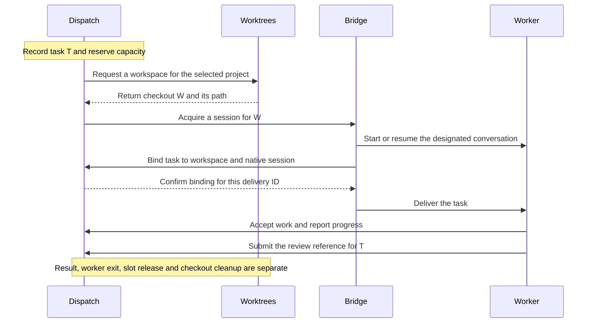

# Trace one task across the three owners

[Run map](README.md) · [Task and reservation](dispatch.md) · [Session](bridge.md) · [Worktree](worktree.md)

Use the task ID as the start of an investigation, **not** as the identity of
every object. One task can have several attempts. A conversation can survive
several process launches. A checkout can hold a sequence of conversations.
There is no transaction that commits all three services at once.

### A worked example

These are illustrative names, not real IDs. Suppose task `T` asks for the
review of a change to `README.md` in PR 12033. The worker pool accepts tasks from queue `Q`,
but runs workers in project `P`. The queue name need not be the project name,
and neither proves which repository's files the worker is supposed to read.

For field values at each boundary, follow the [PR review snapshots](review-snapshots.md).
The arrows show responsibilities on a local, worktree-backed path, not an RPC
trace common to every provider. Bridge can compose workspace creation itself.
A provider-managed container can supply its own workspace instead. A worker
that claims an existing task does not need Dispatch to allocate it a new one.

| Follow this identity | Look for | Do not substitute |
|---|---|---|
| Task `T` and its current assignment | Dispatch's task state, owner, generation and event history | An old claim for the same task |
| Reservation `R` for `T` | Admission to a pool and a recorded startup attempt | A reserved slot for proof that an agent is running |
| Workspace `W` | Worktrees' returned project, worktree ID, path and creation identity | A path guessed from the task name, queue or code target |
| Bridge session `B` and native conversation `N` | The session's target and native ID; compare `N` with the worktree's head | A PID, terminal name or most recent heartbeat |
| Delivery of the job | This attempt's recorded delivery or acknowledgement | The key for creating `W`, a live connection or an unrelated turn |
| Result for `T` | Submitted data and any independent confirmation | “Done” in a transcript, or an exit code |

### What a missing reply means

If creating `W` succeeded but its reply was lost, retrying *delivery* does
not justify creating another checkout. Consult the creation record for the
same request. If the conversation loaded but the caller lost the response,
read the session owner's evidence before asking for another load. A timeout
alone distinguishes neither “nothing happened” nor “it finished.”

Start with the [cross-entity diagnostic playbook](../patterns/entity-relationship-model.md#diagnostic-playbook)
for the supported reads from a task, session, worktree or claim. Those reads
are observations at different times. If two disagree, retain both IDs, the
observations and their owners. Don't fix the discrepancy by writing directly
to a sibling's database.

### Maintain this guide

When changing a transition, update the affected component page and its linked
source or test in the same change. Update the run map only if responsibility
moves between components. A proposed transition belongs in a design discussion
until an implementation writes it. The [allocation and acquisition pattern](../patterns/workspace-allocation-and-session-acquisition.md)
explains why creating a workspace and delivering a prompt use different keys.
See the [Worktrees allocation reference](../../plugins/agent-worktrees/docs/worktree-allocation.md)
for destination-specific support; a local example is not evidence that the
same remote venue can host the agent.
