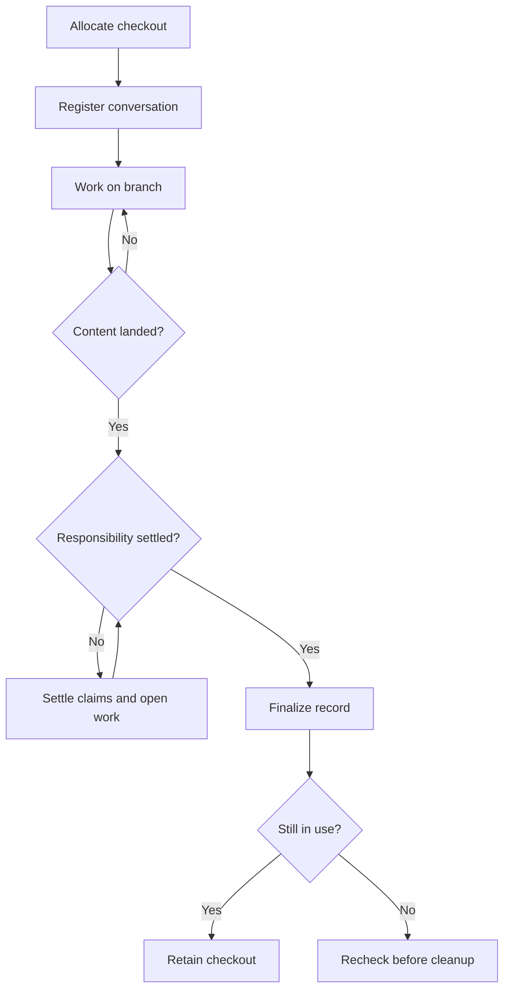

# Worktree: where the files live

[Run map](README.md) · [Task and reservation](dispatch.md) · [Session](bridge.md) · [Trace the IDs](trace.md)

Worktrees can create a checkout without starting Copilot. It records which
repository and branch own the files, which conversation is the current **head**,
and which responsibilities remain. Git answers a different question: whether
the checkout contains changes that have not landed upstream.

## What moves, and who moves it?

This is the normal source-work path, not a stored transition table. A read-only
job may have no source to publish. A session can stop and resume on the same
checkout at any point before retirement.

| Operation | Required evidence | What changes |
|---|---|---|
| [Create](../../plugins/agent-worktrees/src/agent_worktrees/worktree_creation.py) | A permitted project and source base; for keyed creation, the original request and matching facts | Allocate the branch, checkout and tracking record. A lost reply after allocation is pending recovery, not a fresh create. |
| [Register or resume](../../plugins/agent-worktrees/src/agent_worktrees/tracking_session_registration_write.py) | Valid worktree and session; a vacant/yielded head, matching handoff, or evidence that permits replacement | Record a session activation. A resumed conversation gets another interval, not a second conversation identity. |
| [Hand off](../../plugins/agent-worktrees/src/agent_worktrees/tracking_lifecycle.py) | Matching pending handoff and compatible predecessor/successor | Yield the old head; linking the successor advances the head revision. A candidate alone does not. Ending one activation does not conclude the conversation. |
| Publish and [reconcile the branch](../../plugins/agent-worktrees/src/agent_worktrees/pr_complete.py) | Provider result and actual Git history/content | Release the PR claim on confirmed closure; check content separately. `pr-complete` reconciles source, not the worktree's lifetime. |
| [Finalize](../../plugins/agent-worktrees/src/agent_worktrees/finalize.py) | Landed source, no blocking open PR or unsettled responsibility; recheck while holding the record and lifecycle locks | Move through `finalizing` to `finalized`. A checkout still in use can remain on disk. Settling the parent's claim is separate. |
| [Clean up](../../plugins/agent-worktrees/src/agent_worktrees/cleanup_gc_cli.py) | Recheck the exact workspace, execution, files, claims, follow-ups, sibling and retention rules before removal | Remove an eligible managed checkout and record retirement. Externally managed checkouts are not Worktrees' files to remove. |

### Why a clean checkout can still be WIP

The [tracking record](../../plugins/agent-worktrees/src/agent_worktrees/tracking.py)
accepts `active`, `complete`, `completed`, `pushed`, `finalizing`, `finalized`,
`orphaned` and `archived`. Its status setter is **not** a universal transition
validator. Operations enforce their own rules. A timestamp such as
`completed_at` does not prove a merge.

The [Git classifier](../../plugins/agent-worktrees/src/agent_worktrees/git_ops.py)
instead observes `active`, `wip`, `dirty`, `unused`, `convo`, `completed`,
`gone`, `orphan` or `unknown`. A saved commit clears local dirtiness but can
still contain work absent from upstream: that is WIP. A squash merge can land
the content without putting the original commit on the upstream branch.
Worktrees uses patch/content comparison as well as commit counts. A monitor
refresh can change the displayed classification; it does not perform the merge.

`MERGED` and `FINAL` are [closure labels](../../plugins/agent-worktrees/src/agent_worktrees/closure_descriptor.py).
Landed content with open responsibilities is not final. `CLEAN` is a cleanup
decision, not the next value written after `FINAL`. Neither a fetch-free view
nor a quiet terminal grants permission to delete a checkout.

For a previously finalized record, the [tracking override](../../plugins/agent-worktrees/src/agent_worktrees/worktree_git_facts.py)
can display a fresh WIP observation as completed. If new commits appeared
after finalization, inspect their upstream content separately. The
[Worktrees architecture](../../plugins/agent-worktrees/docs/architecture.md#the-worktree-record----single-writer-contract-invariant)
and [lifecycle reference](../../plugins/agent-worktrees/docs/worktree-lifecycle.md#worktree-states)
distinguish the saved record from its displayed classification.

## Where Worktrees stores each fact

| Store | Key and important data | Role |
|---|---|---|
| Project tracking directory, `worktrees/<id>.yaml` | `worktree_id`, `repo`, `worktree_path`, `branch`, `creation_nonce`, `status`; session entries, head revisions, handoffs, PR associations, claims and follow-ups | Canonical record. A nonce distinguishes this allocation from an older checkout with the same name. Nested records are validated by their owning operations, not SQL foreign keys. |
| [`workspace-creation.sqlite3`](../../plugins/agent-worktrees/src/agent_worktrees/creation_requests.py) | `creations(key_digest PRIMARY KEY, version, facts, status, worktree)`; `pending`, `refused`, `complete`, `terminal` | Creation journal. Save intent before Git effects; recover the same allocation after an interrupted reply. |
| [`worktrees-current.sqlite3`](../../plugins/agent-worktrees/src/agent_worktrees/worktrees_projection.py) | Elected writer and generation; one head per project; current row keyed by `(project, worktree_id)` | Fast roster for readers. A saved row is not a new resident's authoritative live observation. |
| [`worktree-status-cache.sqlite3`](../../plugins/agent-worktrees/src/agent_worktrees/worktree_status_cache.py) | `(project, worktree_id)` plus status bundle and observation times | Best-effort cache, not the tracking record or cleanup gate. |

The [resident write path](../../plugins/agent-worktrees/src/agent_worktrees/tracking_write.py)
uses named mutations and per-record locks. Losing the response to a sent write
is different from knowing that it was never sent. SQLite, YAML, Git operations
and parent/child claim updates do not share one transaction.

**Joining back to Dispatch:** a workspace created for Dispatch can carry a
[`dispatch_attempt`](../../plugins/agent-worktrees/src/agent_worktrees/dispatch_cohort.py)
with task ID, reservation key, attempt number, driver, supervisor and creating
machine; emitter and pool details are optional. That describes **birth**.
A [protected assignment claim](../../plugins/agent-worktrees/src/agent_worktrees/dispatch_worker_readiness.py)
instead links queue identity, task, assignment event and worker. Reusing the
checkout must not rewrite its birth record.

**Executable references:** [session and head transitions](../../plugins/agent-worktrees/tests/test_session_lifecycle.py),
[concurrent keyed creation](../../plugins/agent-worktrees/tests/test_creation_requests.py),
[prune decisions](../../plugins/agent-worktrees/tests/test_prune.py), and
[worker closeout](../../plugins/agent-worktrees/tests/test_dispatch_worker_closeout_integration.py).
