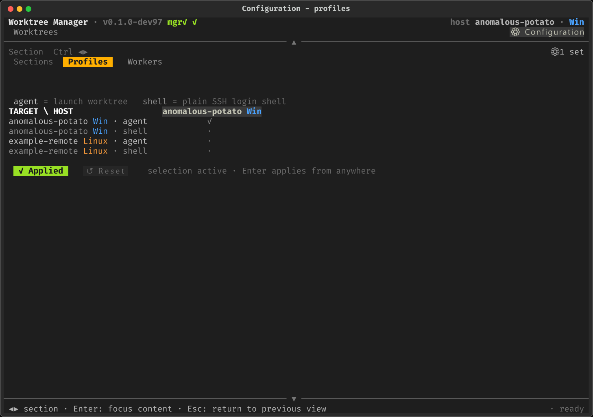
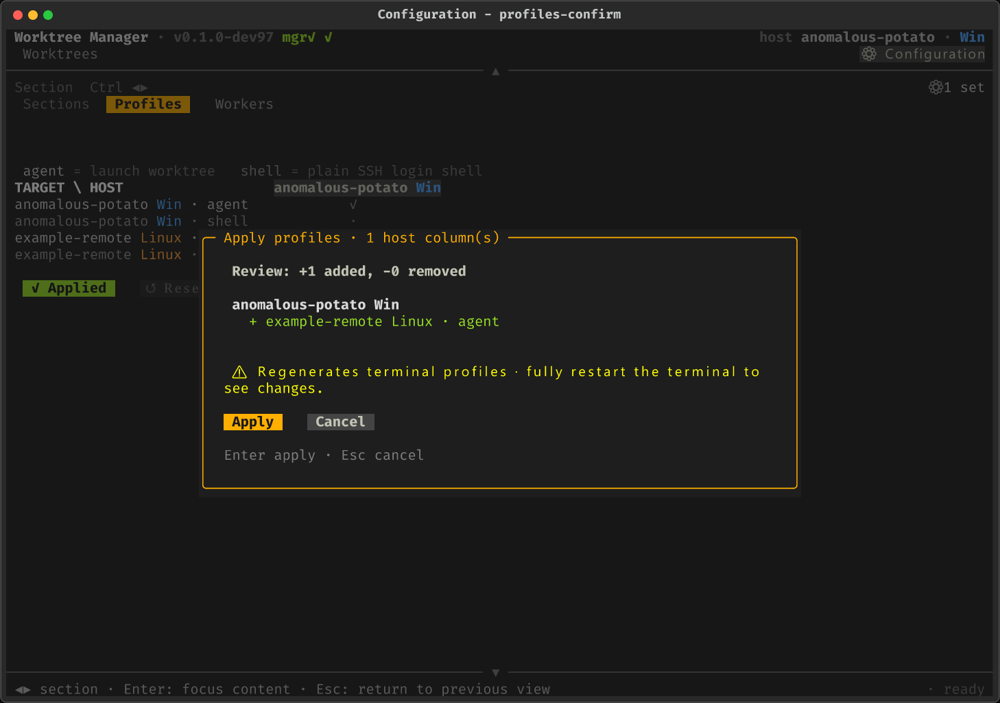
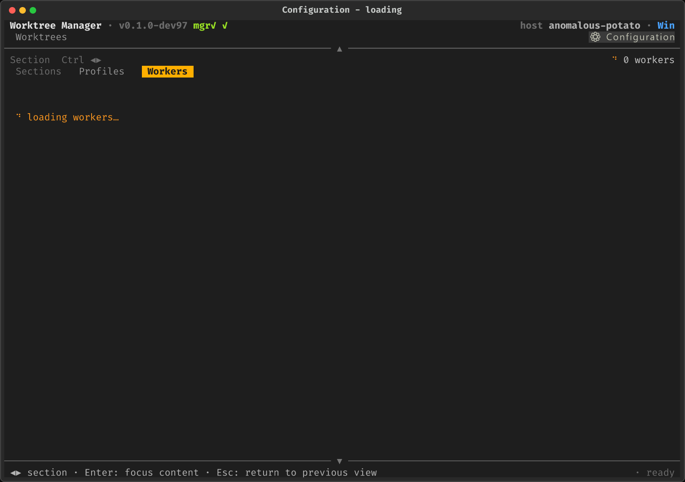
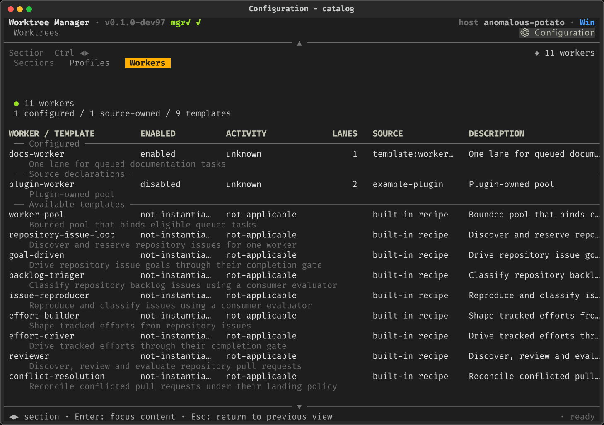
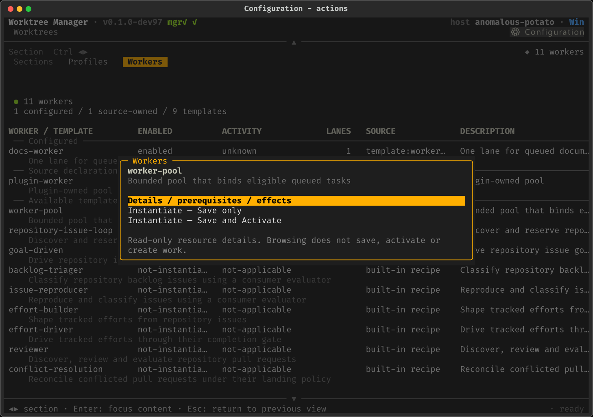
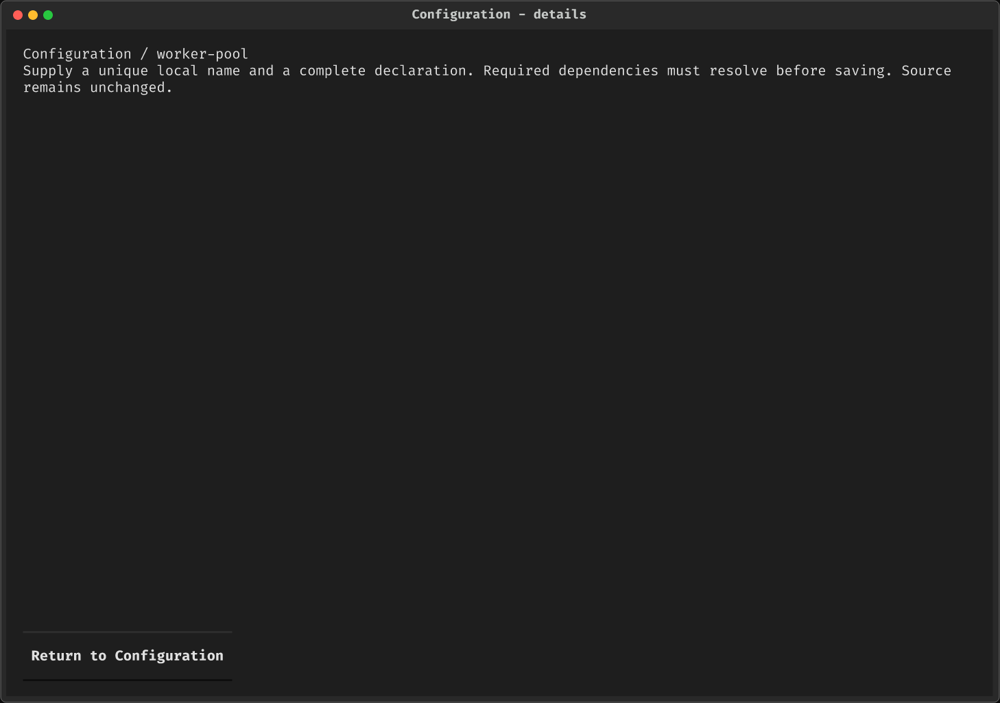
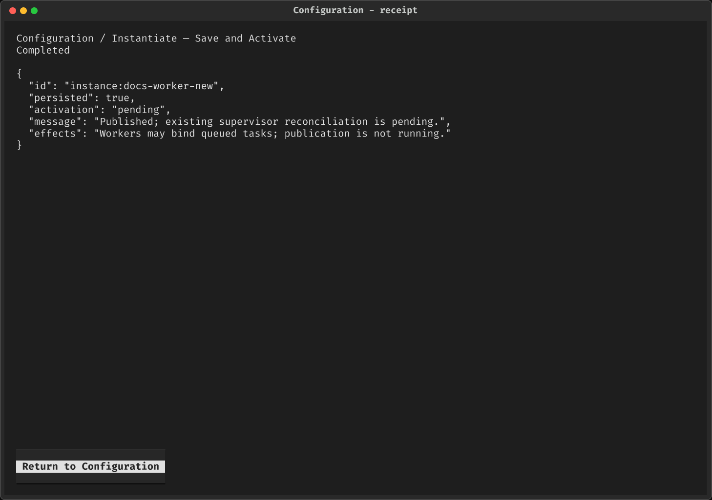
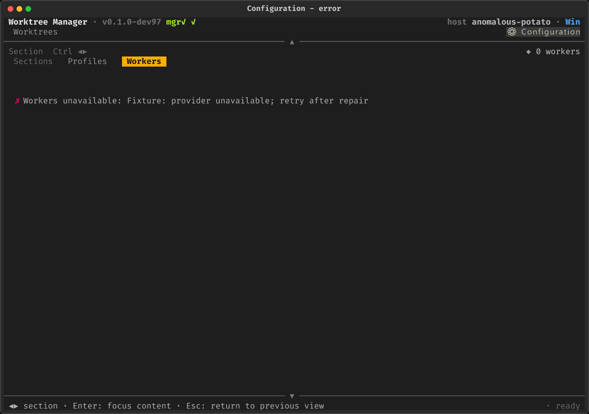
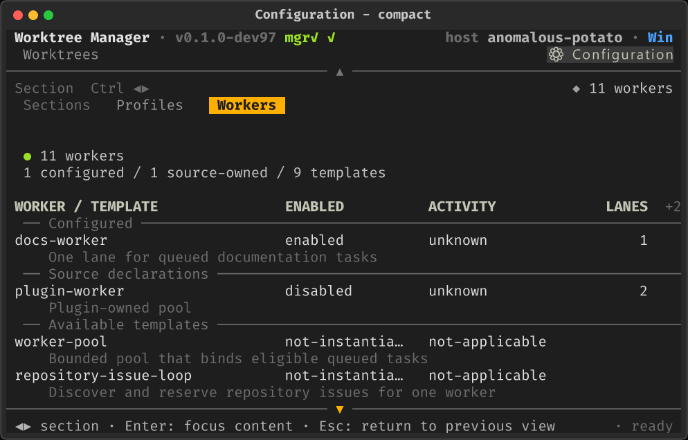

# Set up configurations in the Manager

Use **Configuration** in the Worktree Manager Picker to browse settings before
changing them. Its horizontal **Sections** band replaces Machines navigation;
Profiles and plugin-owned sections occupy the full content area. Entry and
section chrome render immediately, while each provider loads its content.

This walkthrough covers the built-in **Profiles** section and agent-dispatch's
**Workers** contribution. Install the Manager and the selected plugin first,
following [Installation](installation.md). Plugin enablement, runtime readiness,
and repository adoption remain separate steps. A section appears only when its
provider's pivot contribution is registered; a screenshot is not an installer.
See [Configuration ownership](configuration.md) for where settings belong.

All images below are synthetic UI examples, not this machine's configuration
or proof of running workers. They use the real Manager compositor and provider
scaffolds/effects with fixture-only discovery and receipts.

## 1. Enter Configuration and choose a section

Focus **Configuration** and press Enter. Use Left/Right on the Sections band
(or Ctrl+Left/Right) to select a section; Enter focuses its content. Escape from
the section returns to the previous operational view.



*Configuration opens on Profiles, with a target-by-host matrix rather than a
Machines selector. Available sections depend on installed contributions.*

## 2. Choose terminal Profiles

Profiles controls which target/agent or target/shell terminal profiles are
installed on each host. An agent profile launches a worktree; a shell profile
opens a plain SSH login shell. Move into the matrix, toggle the desired cells
with Space, and Apply. The locked self-agent cell remains selected.



*Review the host-specific additions and removals before applying. This is the
existing Profiles confirmation, not a plugin section's configuration home.*

Profiles does not instantiate Workers. Its exact persistence and platform
behavior belong to the [Manager reference](../worktree-manager/README.md).

## 3. Browse Workers before acting

Switch to **Workers**. Navigation remains usable while its catalog loads;
you do not have to wait for discovery to see where you are.



*The section is already mounted while its contents load.*



*At 118 columns the table includes enablement, activity, lane capacity,
provenance, and description. Templates are not instantiated or running.*

| Resource | What it is | What you can do here |
|----------|------------|----------------------|
| Configured | A user-local instance | Edit supported, revision-bound operator controls; Save only or Save and Activate |
| Source declaration | Repository/plugin-owned configuration | Read details; use supported local enable/disable controls, never edit its source here |
| Available template | A reusable recipe or worker-pool scaffold | Instantiate when its owner declares safe operator controls; otherwise use its advanced owning CLI |

**Enabled is not running.** A draft may be not-published; publication can be
pending; absent or stale supervisor evidence means activity is unknown.
LANES counts declared capacity, not completed tasks or measured throughput.

## 4. Inspect prerequisites and choose an action

Select a row and press Enter for its contextual actions. Choose
**Details / prerequisites / effects** before instantiating unfamiliar recipes.
Browsing and opening an editor do not create tasks, launch agents, or save
configuration.



*Actions distinguish inert browsing, draft persistence, and activation.*



*Details remains part of Configuration, not a configuration-home dialog.*

The worker-pool template is a complete starting scaffold with one headless
lane watching `work`, with bounded label, repository and capacity controls.
Other built-in recipes remain advanced-only and require more input: issue/effort
loops need repository context, labels, producer/reservation policy, and
referenced dependencies; reviewer recipes need emitter and evaluator policy.
Missing inputs and dependencies are refused before saving.

## 5. Instantiate a new local worker

Choose **Instantiate -- Save only** to create an inert draft, or
**Instantiate -- Save and Activate** when you intend to publish it to the
existing supervisor. Enter a unique instance name. New instances belong to the
invoking CLI's **local user/machine**, independent of the operational Machines
tab you previously selected.

*The editor retains section navigation. Escape cancels without writing;
changing section cancels unsaved edits.*

Move through the field tabs using Ctrl+Left/Right. Choose the **Watched task
label**, **Repository scope** and **Worker capacity** for the pool template.
Supply **Repository root** when the selected template requires an existing
absolute execution directory. Labels and short descriptions come from the
owner. Agent guidance, worker bodies and executable structure are not human
editable; changes belong upstream or in explicitly permitted agent addenda.

*Do not activate the default `work` watcher unchanged unless that is the queue
you mean to consume. Instance creation never changes the template.*

Exact schema, recipe composition, validation and command examples belong to
[Workers instances](../plugins/agent-dispatch/docs/worker-instances.md) and
[Registrar recipes](../plugins/agent-dispatch/README.md#recipes-loop-archetypes).

## 6. Edit an existing configuration

Select a **Configured** row and choose **Edit -- Save only** or
**Edit -- Save and Activate**. Existing values are restored; retain the instance
name. A stale edit baseline is refused instead of overwriting a newer edit.
Safe editing also requires the exact original template revision and verified
saved parameter binding. Changed or unavailable providers and legacy/raw-edited
instances remain advanced-only; they are never silently migrated.

*Save-only edits the draft; an already published version remains unchanged
until explicit activation.*

Source-owned rows are read-only. Disable masks them locally; Enable clears the
mask but neither starts a daemon nor establishes that a worker is running.

## 7. Review effects, then submit

The final confirmation shows the submitted values and provider effects.
**Cancel is selected initially.** Review the parameter values and target before
choosing the named action.

*Save and Activate may start/restart worker processes and bind queued work
through the existing supervisor. Loop templates may create agentic tasks.*

**Save only** writes a draft without publishing, starting a service, creating
tasks, or launching agents. **Save and Activate** publishes that version and
clears its disable masks. No second supervisor is started. If no supervisor is
running, activation remains pending; do not interpret it as a running claim.

## 8. Read the result, not just the heading

The result view appears before the command finishes and retains the provider's
complete receipt. Return to Configuration to reload the catalog.



*Completed means the command returned, not that workers are running. The
example saved and published its configuration, but reconciliation is pending.*

A failed publication can leave `persisted: true` and `activation: failed`;
fix the stated cause and retry the same instance. Retry-safe identity prevents
creating another worker accidentally.

## Troubleshooting and compact terminals

On Windows, generated plugin commands run through their matching PowerShell
entry point without a batch-file hop, preserving declaration JSON, multiline
values, and empty arguments. These forms require **PowerShell 7 (`pwsh`)** on
PATH. Without it, simple legacy commands remain available, but a form requiring
literal argument preservation reports an explicit error rather than saving
corrupted values. A missing, unreadable, or mismatched generated launcher also
reports a command failure; repair the plugin installation before retrying.



*Read the explicit failure, repair the provider, and refresh/retry. Switching
sections remains available; an empty result is not silently treated as success.*



*At 80x24 the table hides lower-priority columns and shows their count. Use
Details for complete provenance, prerequisites, and effects; scroll for more
rows. Do not confuse hidden columns with missing provider data.*

## Reproduce the images

The field-editor PNGs from the former advanced JSON form are not shown: they
do not represent the operator-safe controls above. The current fixture and its
native compositor tests exercise those controls, including confirmation, without
depending on the rasterizer.

The source revision is the Git revision containing these PNGs and their fixture,
not whichever Manager/provider happens to be installed on the rendering host.
Use `git log -1 --format=%H -- docs/assets/configuration-workbench` to resolve
that revision, then regenerate from its checkout. The committed fixture is
`worktree-manager/scripts/picker-snapshot/configuration.py`; it reads the
current manifest, not a second UI implementation. Keep it aligned when the
surface changes.

From the repository root, using a Python environment containing the Manager's
dependencies and the provider's Python dependencies, regenerate all images:

```powershell
python .\worktree-manager\scripts\picker-snapshot\render.py .\docs\assets\configuration-workbench --configuration-guide --zoom 1
```

The standing [picker-snapshot instructions](../worktree-manager/scripts/picker-snapshot/README.md)
describe the Node dependency and required Fira Code fonts. The default render
size is 118x40; the compact scenario is 80x24. This command uses fixture-only
reads/submissions: it does not configure the operator's machine or activate
workers.
