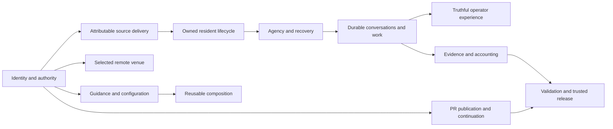

# Initial backlog graph

This is the public overview of the first [graph-first sweep](graph-sweep.md)
under [Backlog Reconciliation](README.md), not a live queue, product
architecture or closure authorization. The structured operational graph retains
per-issue evidence, provenance, constraints and candidates; authoritative
requirements remain in their issues and actual receiving objectives.

## Snapshot and boundaries

The initial inventory contained 942 open issues: 695 eligible research identities
and 247 excluded-author issues. The same four researchers received disjoint
primary scopes of 170, 187, 169 and 169.

- All 695 initial identities are accounted for: 694 complete available
  original/discussion records and one changed-closed, metadata-only #8672.
  Empty #8689 was read but remains semantically unclassified.
- #8670 was independently closed despite its initial open snapshot; its recorded
  semantics confer no campaign closure credit. #8672's stale body was not read
  after its current closed-state change.
- 128 per-track outcome-family records preserve their distinct acceptance and
  ownership. These are not 128 approved consolidations.
- 580 interpreted relationship assertions normalize to 556 directional typed
  edges. All 24 duplicate assertions and their evidence variants are retained.
- 2,629 raw routing/mention candidates remain a separate unreviewed layer.
  Shared words, mentions, connected components and transitivity do not establish
  duplicate outcomes.
- 128 effort references resolve to 127 unique effort identities: one Active
  entry is also referenced by an archived supersession record. Both references
  are retained; no duplicate Active-index row or second effort was invented.
  An effort reference can be Draft, Blocked or Done, not a qualified receiver.

The fixed whole-queue checkpoint remains 729, including excluded authors and
new inflow. Subsequent eligible inflow enters explicit graph-delta research;
this initial snapshot does not claim to cover later arrivals.

## Capability layers

The synthesis traces all 128 family records through twelve research layers.
Membership can overlap: these are outcome relationships, not additive counts
or a replacement for existing implementation and resource ownership.

| Layer | Organizing outcome |
|-------|--------------------|
| Identity and policy | Reach the intended actor, repository, execution space and authority |
| Source delivery | Construct and select an attributable complete runtime from governed inputs |
| Resident lifecycle | Preserve actual serving ownership, readiness and safe transition |
| Agency and recovery | Retain unfinished responsibility, original history and resource custody |
| Remote venues | Prepare and operate the selected target without displacement |
| Conversations and work | Distinguish storage, delivery, consumption, turn completion and steering |
| Operator experience | Present current owned facts and responsive actions truthfully |
| Evidence and accounting | Preserve attributable records, useful diagnostics and explicit uncertainty |
| Guidance and configuration | Deliver current owned guidance and preserve intended settings |
| Assurance | Qualify exact consumers and candidates without false green or unsafe execution |
| Composition and maintainability | Compose declared capabilities without duplicated ownership or obsolete contracts |
| PR continuation | Keep the separately coordinated publication/landing family and its protected tokens visible |

The condensed view below illustrates those layers, not all 78 interpreted
cross-layer links or a proposed component dependency architecture:

The protected coordination issue #7556 is not a clustering hub. Its many
provenance mentions are not evidence that unrelated issues belong together.
References outside the admitted initial scope remain UNKNOWN placeholders until
their own eligibility and scope are verified.

## First delivered consolidation

The first coherent publication unit considered sixteen PR-workflow issues.
Eleven redundant coordination wrappers were superseded into **OPEN #4130**:
#2927, #4699, #4801, #5079, #5401, #5404, #5838, #6088, #6387, #6749 and #7197.
These are administrative consolidations, not eleven implemented fixes.

The complete 54-clause map was received directly in the canonical issue body
before any source supersession. Its entire 9,343-byte incumbent prefix, all
seventeen original unchecked rows, five operations and complete #4210/#4384
intakes survive unchanged. The additive acceptance contains 39 Plan rows,
39 paired Validation rows, seven continuing Coordination rows and four explicit
unresolved policy/design choices: 89 new unchecked rows, 106 total.

Thirteen mapped dependency clauses remain reference-only. **#5990, #6692,
#6815 and #8656 remain separate OPEN source/effect/deferred tokens**; the
receiver does not acquire their implementation custody. Original alternatives,
backups, leases, provider facts, finite qualification and historical narrow
progress remain distinct. Neither administrative closure nor this graph resolves
the four recorded design choices or authorizes product work.

All sixteen public bodies/states/reasons and the complete receiver were audited
after publication. The whole-queue census then recorded **931 open issues at
2026-10-24 15:24:36 PDT**, still 202 above the fixed checkpoint. The campaign
remains Active.

## Second delivered consolidation

Batch 92 considered eleven issues and superseded six redundant trackers only
after complete direct receiving acceptance and readback:

| Unfinished outcome | Superseded tracker | Existing receiving home |
|--------------------|--------------------|-------------------------|
| Native title composition and full asserted-title fidelity | #3588, #4413 | OPEN #3581, preserving all eight inherited #3583 rows |
| Component-aware activity-first subtitle truncation | #5962 | OPEN #5912, preserving the actual title/claim relationship |
| Installer preservation of explicit launch-setting choices | #5853 | OPEN #5952, retaining both original failed-read fidelity paths |
| Complete Python and Python-less report verdicts | #5921 | Active test-portfolio ROOT and OPEN #1303 |
| Honest repository activation-contribution authority | #7179 | Active Configuration ROOT and OPEN #6379 |

The two ROOT contracts actually merged through reviewed #8737; #8742 adds
the Configuration section's standard transfer anchor without changing its
requirements. Local and actual global Validation, continuing Coordination
and dated Journals are direct in the existing ROOTs. Every incumbent byte,
checked row, historical journal, alternative and custodian remains.
The three numeric bodies were delivered and fully read back before closure.
No implementation, native qualification, release or rollout was completed.

All eleven public bodies/states/reasons and the five receiving contracts were
audited before the next census: **928 whole-queue open at 2026-10-24
16:25:32 PDT**, comprising 769 original-cohort and 159 inflow issues.
There are 681 eligible open issues and 247 untouched excluded-author issues;
the fixed checkpoint is still 199 away.

The operational graph preserves the original 695 identities and seven later
eligible identities: **702 historical identities, not 702 current-open issues**.
Twenty initial identities are no longer open; #8709 also changed closed before
current body admission and receives no campaign credit. #8702 and #8715 have
admitted semantic deltas but retain their explicit source claims. #8715's
author-reported source delivery does not establish release, rollout or headed
acceptance. At that snapshot, four arrivals remained metadata-only pending admission.
The original research layers and all provenance remain unchanged.

## Third delivered consolidation

Batch 93 considered eleven succession and session-reader issues. Six redundant
trackers were superseded into **OPEN #84** only after complete additive
receiving delivery and full current-body readback:

| Direct unfinished outcome | Superseded tracker |
|---------------------------|--------------------|
| Native predecessor/successor render noncollision | #4126 |
| Explicit owning-project selection for both session commands | #4134 |
| Honest exclusive-consume versus durable-promotion results, including all six inherited #4131 rows | #5684 |
| Ledger-only anchor session registration and ordinary readers | #5997 |
| Read-only historical chain planning and explicit partial outcomes | #6144 |
| Authoritative-head agreement in actual JSON and ordinary resume selection | #6279 |

The entire 4,817-byte incumbent prefix and all five direct #112 rows survive.
The final 23,849-byte body adds 52 unchecked Plan, Validation and continuing
Coordination rows: 57 total. The original finite command/fixture, native and
installed-adoption tiers remain distinct. A native render case does not add
an every-host gate to a deterministic reader case.

**#912, #3000, #3584 and #6579 remain independently OPEN.** Their original
nonexpiring claim, 31-row arbitration contract, nine-row ground-admission
contract and actual assignment respectively are not transferred to #84.
The existing #5997 contributor/provider path also remains intact. No product
completion, source/resource handoff, token operation or runtime action occurred.

All eleven public bodies/states/reasons, unchanged original discussions and
actual custody were audited before the next census: **923 whole-queue open
at 2026-10-24 16:55:09 PDT**, comprising 763 original-cohort and 160 inflow
issues. There are 676 eligible open issues and 247 untouched excluded-author
issues, still 194 above the fixed checkpoint.

The graph now retains **703 historical eligible identities**, not 703 current
open issues. Its initial research layers remain unchanged. Four previously
pending arrivals, #8729, #8733, #8735 and #8736, have complete original/current
discussion admission and 23 finite acceptance clauses. Their credential
authority, same-process search consistency, scheduled accounting and promotion
source/control responsibilities remain independently claimed. Six new
source-supported discovery links do not establish receiving acceptance or
independently verify reported providers. New #8754 is metadata-only pending
its own admission.

## Fourth delivered consolidation

Batch 94 considered ten repository-intent and tracking-integrity issues.
Eight redundant trackers were superseded only after actual complete
receiving acceptance and current readback:

| Unfinished outcome | Superseded tracker | Existing receiving home |
|--------------------|--------------------|-------------------------|
| Late-target resolution, contribution posture, complete startup workflow guidance, local-only sync and legacy shadow-state alternatives | #2095, #2562, #4089, #4228, #5299 | OPEN #4173 |
| Honest unreadable-record evidence, complete cross-project protective queries and approved exact-record integrity repair | #2558, #2706, #7097 | Active authoritative-daemon ROOT and OPEN #3761 |

The ROOT intake actually merged through reviewed #8764, including direct
local and actual global Validation, continuing Coordination and a dated
Journal. All incumbent bytes, 29 checked rows, prior #4120 acceptance and
inline/linked history survive. The complete current ROOT was read back.
The same PR reviewed the full numeric draft; actual #4173 delivery and
whole-body/discussion readback separately preserved its exact 89-byte prefix,
34 unchecked rows and five transfer markers. No product implementation,
native qualification, release or rollout was completed.

**#3585 and all six inherited #3558 rows remain independently OPEN** under
the existing head-succession Phase 2 owner. Its complete daemon dependency
reference does not transfer discovery/root-report custody or add a daemon
completion gate. #4173 retains its entire authoritative-model decision;
#3761 and all independently assigned, claimed and installed-acceptance
responsibilities remain.

All ten public dispositions, original discussions, receiving contracts and
actual custody were audited before the next census: **913 whole-queue open
at 2026-10-24 17:41:35 PDT**, comprising 755 original-cohort and 158 inflow.
There are 666 eligible open issues and 247 untouched excluded-author issues,
still 184 above the fixed checkpoint.

The historical graph union remains **703 identities**. Thirty-seven are now
closed: 31 audited graph-scope supersessions and six external changes with
no credit. Newly closed #8332/#8754 were confirmed metadata-only; their
current bodies were not read, and #8754 closed before semantic admission.
No new eligible arrival was observed. The initial research layers remain
unchanged; actually delivered transfers are a separate operational layer,
not deductions from thematic edges. Six numeric and three existing ROOT
intakes have now been received through this graph-first campaign.

## Fifth delivered consolidation

Batch 95 considered fourteen serving-reality and state-publication issues.
Four redundant trackers were superseded only after complete direct numeric
receiving delivery and full actual-body/discussion readback:

| Unfinished outcome | Superseded tracker | Existing receiving home |
|--------------------|--------------------|-------------------------|
| Windows task/start/recovery, retained legacy launcher/worker classification and mode-qualified POSIX native availability | #4048, #5800, #5938 | OPEN #6389 |
| Ordinary non-mux hook consumer demand and absent-resident recovery | #8388 | OPEN #3761 |

The final #6389 body contains 32,787 bytes and 78 unchecked rows; #3761
contains 16,554 bytes and 38 unchecked rows. Every original body byte,
incumbent transfer, checkbox state and existing discussion remains, with a
prominent disclosure before the original text. New direct Plan rows have
paired Validation and continuing Coordination. This is planned work, not
implementation, native qualification, rollout or transferred resource custody.
No effort ROOT was amended or substituted for this numeric receiving.

**#6274, #6947, #7305, #918, #2619, #6748, #7937 and #7946 remain
independently OPEN**, as do both receivers. Their actual claims, all
inherited acceptance, different metrics, finite qualification tiers and
source-publication holds survive. #5800's explicitly released new-spawn
slice is not reopened. #5938's original availability and native
update/rollback contract is not weakened by a new recovery alternative.

All fourteen public bodies/states/reasons, all 86 original comments and
current custody were audited before the census: **918 whole-queue open
at 2026-10-24 18:14:24 PDT**, comprising 752 original-cohort and 166 inflow.
There are 671 eligible open issues and 247 untouched excluded-author issues,
still 189 above the fixed checkpoint. Four closures did not offset ten
new arrivals and one unrelated external closure.

The graph now retains **713 historical eligible identities**: 671 currently
open and 42 closed. Those closures comprise 35 audited graph-scope
supersessions and seven external changes with no credit. Newly closed #8678
was confirmed metadata-only; its current body and technical completion were
not independently admitted. Ten arrivals, #8773-#8781 and #8787, remain
explicitly metadata-only pending their own author/custody/body admission.
Eight numeric and three existing ROOT intakes have now been received.
Initial research layers and discovery provenance remain unchanged.

## Sixth delivered consolidation

Batch 96 considered ten acquisition issues. Only **#6887 was superseded
into OPEN #6076**, after complete direct Plan, paired Validation and continuing
Coordination delivery and full actual-body/discussion readback. The final
12,912-byte body preserves its entire 1,830-byte original, all discussion,
seventeen unchecked rows and one new transfer marker. The accepted rejection
of an empty-owner-ledger/missing-receipt waiver survives; the safe routine-retry
outcome remains planned, not completed.

The other nine tokens remain OPEN. In particular, #4125's all-creator
active/recent discovery and #5843's generic carrier uncertainty are broader
than this Dispatch acquisition intake; their conditional scope extensions
were not accepted or partially transferred. Actual legacy/native/installed
custody and the whole nine-case #7116 report remain independent.
See the [dated checkpoint](<journal/2026/10.24 acquisition-family-96.md>).

The audited census records **920 whole-queue open at 2026-10-24
18:49:14 PDT**: 751 original-cohort, 169 inflow, 673 eligible and 247 untouched
excluded-author issues, still 191 above the fixed checkpoint. Three new
arrivals outweighed this unit's one administrative closure.

The graph retains **716 historical eligible identities**: 673 open and
43 closed, comprising 36 audited graph supersessions and seven external
changes with no credit. The previously pending #8773-#8781 and #8787 now have
37 finite clauses and 31 typed discovery links, with no receiving or
completion credit. New #8796, #8797 and #8802 remain metadata-only.
Nine numeric and three existing ROOT intakes have been received; the original
research layers and provenance remain unchanged.

## Seventh delivered consolidation

Batch 97 considered thirteen CodeSpace lifecycle and durable-relay issues.
Eight redundant trackers were administratively superseded only after complete
direct receiving delivery and full actual-body/discussion readback:

| Unfinished outcome | Superseded tracker | Existing receiving home |
|--------------------|--------------------|-------------------------|
| Structured occupied-target refusal, provisioning truth and credential consistency, complete managed-SSH fallback mode, exhaustive checkout protection and precreation rejoin authorization | #4012, #5760, #5762, #5774, #5837 | OPEN #2709 |
| Recreated remote-binding cardinality, shared provider relay with actual demand lifetime and reboot/resumed-child listener publication | #4011, #4030, #7046 | OPEN #4309 |

The actual #2709 body has 32,671 bytes and 81 unchecked rows; #4309 has
23,647 bytes and 45 unchecked rows. Both preserve every incumbent raw byte,
all 85 earlier unchecked rows, transfer markers, eligible comments and actual
custody. The additional direct Plan rows have paired Validation and continuing
Coordination. Original alternatives, optional improvements and distinct
source/native qualification remain intact; no ROOT was amended or substituted.

**#4303, #3442 and #8551 remain independently OPEN**, as do both receivers.
Generic existing-requested-branch alignment spans more than a CodeSpace-only
lifecycle. Both-provider credential modes, presentation and long-duration
authenticated continuation are not merely transport ownership. The account-relay
issue's explicit implementation claim is protected, not expired by an empty
assignee list. See the [dated checkpoint](<journal/2026/10.24 lifecycle-and-relay-family-97.md>).

All thirteen public dispositions, original bodies, 23 original comments and
current custody were audited before the census: **913 whole-queue open
at 2026-10-24 19:16:49 PDT**, comprising 743 original-cohort and 170 inflow
issues. There are 666 eligible open issues and 247 untouched excluded-author
issues, still 184 above the fixed checkpoint. One new arrival partly offset
the eight administrative closures.

The graph retains **717 historical eligible identities**: 666 open and
51 closed, comprising 44 audited graph supersessions and seven external
changes with no credit. New #8811 and earlier #8796, #8797 and #8802 remain
metadata-only pending their own admission. Eleven numeric and three existing
ROOT intakes have been received; original research layers and provenance
remain unchanged.

## Eighth delivered consolidation

Batch 98 considered fourteen process-authority and settlement issues.
Three redundant trackers were administratively superseded into **OPEN #4136**
only after complete direct receiving delivery and full actual-body/discussion
readback:

| Direct unfinished safety/adoption case | Superseded tracker |
|---------------------------------------|--------------------|
| All three POSIX own-unit stop guards and independently contained manager/helper tests | #2554 |
| Supported update-while-active preservation, action-time identity/activity authority, defer OR exact consent and original installed/native qualification | #4135 |
| All four configured-command cleanup consumers, exited-root pipes, incarnation safety and caller-group isolation | #5510 |

The actual receiver contains 18,123 UTF-8 bytes, codepoints and UTF-16 units,
with 46 unchecked rows. All incumbent original bytes remain contiguous after
the single top disclosure; all seven refined acceptance rows, check states and
existing discussion survive. New direct Plan rows have paired Validation and
continuing Coordination. Failed or unconfirmed cleanup retains exact custody
and literal errors, but is not successful settlement or an alternative that
satisfies the original full-tree requirement. No implementation, resource
ownership or native qualification is completed by tracking consolidation.

**#1742, #3942, #4195, #5006, #5716, #5954, #7643, #7650 and #8403
remain independently OPEN**, as do #3963 and #4136. The process-slot keeper
#3963 receives none of the proposed CWD, Proactor, multi-forward cleanup or
external-mapping cases: those complete outcomes exceed its established scope.
Contributor claims, actual lifecycle owners, original alternatives and finite
qualification tiers remain. See the [dated checkpoint](<journal/2026/10.24 deliberate-reap-family-98.md>).

All fourteen public dispositions, original bodies, 31 original comments and
current custody were audited before the census: **909 whole-queue open
at 2026-10-24 20:12:45 PDT**, comprising 740 original-cohort and 169 inflow
issues. There are 662 eligible open issues and 247 untouched excluded-author
issues, still 180 above the fixed checkpoint. The intervening external closure
of #8656 was observed metadata-only and receives no campaign or technical
completion credit; its earlier OPEN description remains historical.

The graph retains **717 historical eligible identities**: 662 open and
55 closed, comprising 47 audited graph supersessions and eight external
changes with no credit. The four previously pending arrivals, #8796, #8797,
#8802 and #8811, now have 21 finite clauses and eleven typed discovery links.
All four remain independently claimed; timeline references to closed PRs
establish neither verified merges nor completion or claim release. No
metadata-only arrivals remain at this snapshot. Twelve numeric and three
existing ROOT intakes have been received; initial research layers and
provenance remain unchanged.

## Ninth delivered consolidation

Batch 99 considered twelve mesh, venue-input and supervisor-control issues.
Five redundant trackers were administratively superseded only after complete
direct numeric receiving and ENTIRE actual-body/discussion/custody readback:

| Unfinished outcome | Superseded tracker | Existing receiving home |
|--------------------|--------------------|-------------------------|
| Bounded in-module SSH validation, delegated obsolete-pin retirement and all-alias validation before transactional refresh | #1438, #4184, #5477 | OPEN #63 |
| Faithful actual attached-Container seed input through the shared reader | #5926 | OPEN #954 |
| Durable registration upgrade/reconciliation AND non-erasing safety-option placement | #4232 | OPEN #2793 |

The actual receivers contain 18,077, 13,348 and 6,291 UTF-8 bytes, with
33, 23 and five unchecked rows respectively. All incumbent bytes remain
contiguous after the new top disclosure; all 35 earlier checklist rows,
check states, markers and original comments survive. Each case has direct
Plan, Validation and continuing Coordination. No ROOT was changed.

**#1414, #4227, #6189 and #7206 remain independently OPEN**, as do all
three receivers. The specific affected-P3 mapping condition is unresolved;
client CWD routing exceeds supervisor settings; both transfer/emitter designs
and assigned connectivity convergence retain their complete scope.
#2793's whole-mapping ownership condition is obeyed by retaining that owner,
not waived or turned into a new leaf gate. See the
[dated checkpoint](<journal/2026/10.24 mesh-venue-supervisor-family-99.md>).

All twelve public dispositions, original bodies, forty original comments,
whole receiving bodies and current custody were audited before the census:
**904 whole-queue OPEN at 2026-10-24 20:42:13 PDT**, comprising 735
original-cohort and 169 inflow issues. There are 657 eligible open and 247
untouched excluded-author issues, still 175 above the fixed checkpoint.
No new arrival or external closure intervened.

The graph retains **717 historical eligible identities**: 657 open and sixty
closed, comprising 52 audited graph supersessions and eight external changes
with no credit. Fifteen numeric and three existing ROOT intakes have been
received. No metadata-only arrival is pending; initial research layers and
provenance remain unchanged. These are tracking outcomes, not implementation,
native qualification, source/resource transfers or parent completion.

## Tenth delivered consolidation

Batch 100 considered ten ordinary-guidance and independent-custody issues.
Four complete cases, **#4174, #5714, #6092 and #6817**, were received
directly in **OPEN #2173** before administrative source supersession.
The ENTIRE actual 31,590-byte body and original discussion/custody were
read back. All 40 incumbent unchecked rows and earlier bytes survive;
sixteen Plan, ten Validation and eight Coordination rows add the four
complete finite cases, for 74 unchecked rows total. No ROOT was amended.

The cases preserve optional legacy-registry documentation, actual target-local
raw-provider instruction ordering, declared-version governed reconciliation of
the SAME consumer with a small actual hook check, and all three explicit
disabled/enabled/control native-resolver cases plus isolated actual loading.
**#5063 remains independent** for ordinary missing-baseline/unknown-descendant
cleanup diagnostics. **#1508, #2256, assigned #5993 and narrow #6814**
retain complete independent recovery, conformance, admission/rollout and
qualified installed-identity custody. No group signal, source/resource transfer,
custom aggregator, universal service or new all-host/native-every-leaf gate
is authorized. See the
[dated checkpoint](<journal/2026/10.24 ordinary-guidance-family-100.md>).

All ten public dispositions, original bodies, 21 original comments and whole
receiver were audited before the census: **900 whole-queue OPEN at
2026-10-24 21:05:38 PDT**, comprising 731 original-cohort and 169 inflow
issues. There are 653 eligible open and 247 untouched excluded-author issues,
still 171 above the fixed checkpoint. No arrival or external closure intervened.

The graph retains **717 historical eligible identities**: 653 open and 64
closed, comprising 56 audited graph supersessions and eight external changes
without credit. Sixteen numeric and three existing ROOT intakes have been
received. No metadata-only arrival is pending; initial research layers and
provenance remain unchanged. Batch 100 and 738 campaign closures are not
the fixed whole-queue checkpoint or parent completion.

## Eleventh delivered consolidation

Batch 101 considered ten lifecycle/materialization issues. Only **#5417 was
administratively superseded into OPEN #5472**, as a complete still-unresolved
conditional signing-policy question, not an adopted policy or implemented
upgrade. Five direct Plan rows, five paired Validation rows and three
continuing Coordination rows were delivered before supersession. I read back
the ENTIRE actual 14,270-byte receiver; all ten incumbent unchecked rows,
original bytes, inherited #777/Logger #5468 acceptance, fifty existing
comments and current bounded ownership survive. There are 23 unchecked rows.
No effort ROOT was amended.

The original contention-induced unsigned fallback is repaired. The remaining
question concerns a genuinely unsigned initial runtime followed by later
signed-Python availability. Pursuit or decline stays with the existing owner;
equivalent provenance may replace a suggested marker, and successful adoption
requires a distinct healthy immutable generation, never retained failure as
an alternative success. Current Slot/control-ABI and narrow guardian scope
remain distinct from client, constructor, listener, source and native owners.

**#3444, #3654, #3905, #4122, #4163, #5851, #6369 and #6564 remain
independently OPEN**, as does the receiver. #3654 receives no extra case:
shared-library materialization is not a generic native input, fingerprint or
post-build cleanup umbrella. Explicit source-install and concurrency claims,
finite actual consumers and original qualification remain protected.
See the [dated checkpoint](<journal/2026/10.24 lifecycle-materialization-family-101.md>).

All ten exact public dispositions, original bodies, 77 original comments,
whole receiver and custody were audited before the census: **899 whole-queue
OPEN at 2026-10-24 21:28:16 PDT**, comprising 730 original-cohort and 169
inflow issues. There are 652 eligible open and 247 untouched excluded-author
issues, still 170 above the fixed checkpoint. No arrival or external closure
intervened.

The graph retains **717 historical eligible identities**: 652 open and 65
closed, comprising 57 audited graph supersessions and eight external changes
without credit. Seventeen numeric and three existing ROOT intakes have been
received. No metadata-only arrival is pending; initial research layers and
provenance remain unchanged. Neither this unresolved question's transfer nor
739 campaign closures completes the parent objective.

## Registry/account observation and action authority

The next ten-issue unit considered **#69, #1043, #3434, #4199, #4756,
#5791, #5904, #5963, #6184 and #6187**. Their common boundary is that an
observation does not silently confer execution, activation, consent or cleanup
authority. This is a research/publication group, not a new implementation
parent or proof that all ten outcomes are interchangeable.

Only **#3434** was superseded into existing **OPEN #1043**, whose Dispatch
registrar/doctor family now directly carries its entire unfinished report-only
declaration-migration outcome: four Plan rows, four paired Validation rows and
continuing source coordination. Reliable schema/migration evidence, actual
target-machine venues, valid no-charter profiles, unknown-versus-invalid
classification and exact file/pool/value/correction reports all remain.
No YAML rewrite, invented venue or retrospective blocker on #3338 is introduced.

The ENTIRE actual 11,894-byte receiving body was read before administrative
not-planned supersession. All incumbent bytes, both #396 unchecked rows,
six original comments and the managed SSH claim survive, alongside explicit
common/family continuations. The receiver has 26 unchecked rows and remains
OPEN. #5791 receives nothing; **the other nine issues remain OPEN**, including
#5904's distinct present-unknown-ownership cleanup requirement. Its earlier
atomic publication repair is credited without treating serialization or a
tolerant reader's `None` as unlink permission.
See the [dated checkpoint](<journal/2026/10.24 registry-account-authority-family-102.md>).

All ten exact public dispositions, original bodies, twenty original comments,
whole receiver and current custody were audited before census: **898
whole-queue OPEN at 2026-10-24 21:56:47 PDT**, comprising 729 original-cohort
and 169 inflow issues. There are 651 eligible open and 247 untouched
excluded-author issues, still **169 above the fixed whole-queue checkpoint**.
The original cohort reaching 729 does not satisfy that checkpoint.
No arrival or external closure intervened.

The historical graph union remains **717 eligible identities**: 651 open and
66 closed, comprising 58 audited graph supersessions and eight external
changes without credit. Eighteen numeric and three existing ROOT intakes
have been received. Initial research layers and provenance remain unchanged;
no metadata-only arrival is pending. The parent remains Active, not completed
by this unit or by 740 campaign closures.

## Continuing work

Target capability preparation, declaration composition and the next wider
per-track families still have receiving-fit and custody obligations, not
automatic closure lists. The same four researchers have selected coherent
next families from their completed graph partitions rather than repeating
the sweep; their proposals still require complete direct receiving admission.
In particular, #5922's scenario-axis contract and #8511's concurrent artifact
allocation remain independent rather than becoming optimistic reduction credit.

Continue complete receiving acceptance and live author/custody checks, then
audited publication and a whole-queue census between units. Keep newly arrived,
unclassified, independently held and incompatible nodes visible. See the
[parent Plan and completion gate](README.md) and [journal](journal.md).
