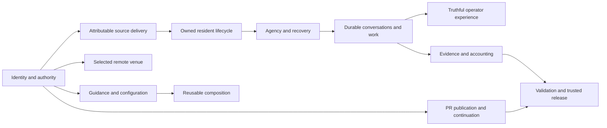

# Initial backlog graph

This is the public overview of the first [graph-first sweep](graph-sweep.md)
under [Backlog Reconciliation](README.md), not a live queue, product
architecture or closure authorization. The structured operational graph retains
per-issue evidence, provenance, constraints and candidates; authoritative
requirements remain in their issues and actual receiving objectives.

## Snapshot and boundaries

The initial inventory contained 942 open issues: 695 eligible research identities
and 247 excluded-author issues. The same four researchers received disjoint
primary scopes of 170, 187, 169 and 169.

- All 695 initial identities are accounted for: 694 complete available
  original/discussion records and one changed-closed, metadata-only #8672.
  Empty #8689 was read but remains semantically unclassified.
- #8670 was independently closed despite its initial open snapshot; its recorded
  semantics confer no campaign closure credit. #8672's stale body was not read
  after its current closed-state change.
- 128 per-track outcome-family records preserve their distinct acceptance and
  ownership. These are not 128 approved consolidations.
- 580 interpreted relationship assertions normalize to 556 directional typed
  edges. All 24 duplicate assertions and their evidence variants are retained.
- 2,629 raw routing/mention candidates remain a separate unreviewed layer.
  Shared words, mentions, connected components and transitivity do not establish
  duplicate outcomes.
- 128 effort references resolve to 127 unique effort identities: one Active
  entry is also referenced by an archived supersession record. Both references
  are retained; no duplicate Active-index row or second effort was invented.
  An effort reference can be Draft, Blocked or Done, not a qualified receiver.

The fixed whole-queue checkpoint remains 729, including excluded authors and
new inflow. Subsequent eligible inflow enters explicit graph-delta research;
this initial snapshot does not claim to cover later arrivals.

## Capability layers

The synthesis traces all 128 family records through twelve research layers.
Membership can overlap: these are outcome relationships, not additive counts
or a replacement for existing implementation and resource ownership.

| Layer | Organizing outcome |
|-------|--------------------|
| Identity and policy | Reach the intended actor, repository, execution space and authority |
| Source delivery | Construct and select an attributable complete runtime from governed inputs |
| Resident lifecycle | Preserve actual serving ownership, readiness and safe transition |
| Agency and recovery | Retain unfinished responsibility, original history and resource custody |
| Remote venues | Prepare and operate the selected target without displacement |
| Conversations and work | Distinguish storage, delivery, consumption, turn completion and steering |
| Operator experience | Present current owned facts and responsive actions truthfully |
| Evidence and accounting | Preserve attributable records, useful diagnostics and explicit uncertainty |
| Guidance and configuration | Deliver current owned guidance and preserve intended settings |
| Assurance | Qualify exact consumers and candidates without false green or unsafe execution |
| Composition and maintainability | Compose declared capabilities without duplicated ownership or obsolete contracts |
| PR continuation | Keep the separately coordinated publication/landing family and its protected tokens visible |

The condensed view below illustrates those layers, not all 78 interpreted
cross-layer links or a proposed component dependency architecture:

The protected coordination issue #7556 is not a clustering hub. Its many
provenance mentions are not evidence that unrelated issues belong together.
References outside the admitted initial scope remain UNKNOWN placeholders until
their own eligibility and scope are verified.

## First delivered consolidation

The first coherent publication unit considered sixteen PR-workflow issues.
Eleven redundant coordination wrappers were superseded into **OPEN #4130**:
#2927, #4699, #4801, #5079, #5401, #5404, #5838, #6088, #6387, #6749 and #7197.
These are administrative consolidations, not eleven implemented fixes.

The complete 54-clause map was received directly in the canonical issue body
before any source supersession. Its entire 9,343-byte incumbent prefix, all
seventeen original unchecked rows, five operations and complete #4210/#4384
intakes survive unchanged. The additive acceptance contains 39 Plan rows,
39 paired Validation rows, seven continuing Coordination rows and four explicit
unresolved policy/design choices: 89 new unchecked rows, 106 total.

Thirteen mapped dependency clauses remain reference-only. **#5990, #6692,
#6815 and #8656 remain separate OPEN source/effect/deferred tokens**; the
receiver does not acquire their implementation custody. Original alternatives,
backups, leases, provider facts, finite qualification and historical narrow
progress remain distinct. Neither administrative closure nor this graph resolves
the four recorded design choices or authorizes product work.

All sixteen public bodies/states/reasons and the complete receiver were audited
after publication. The whole-queue census then recorded **931 open issues at
2026-10-24 15:24:36 PDT**, still 202 above the fixed checkpoint. The campaign
remains Active.

## Continuing work

The next candidate families concern title fidelity, literal clean-room verdicts,
target capability preparation, declaration composition and configuration truth.
They have receiving-fit and custody obligations, not automatic closure lists.
In particular, #5922's scenario-axis contract and #8511's concurrent artifact
allocation remain independent rather than becoming optimistic reduction credit.

Continue complete receiving acceptance and live author/custody checks, then
audited publication and a whole-queue census between units. Keep newly arrived,
unclassified, independently held and incompatible nodes visible. See the
[parent Plan and completion gate](README.md) and [journal](journal.md).
