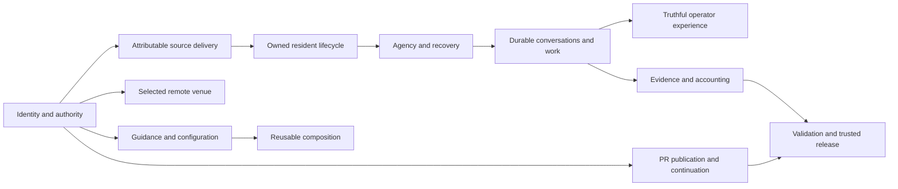

# Initial backlog graph

This is the public overview of the first [graph-first sweep](graph-sweep.md)
under [Backlog Reconciliation](README.md), not a live queue, product
architecture or closure authorization. The structured operational graph retains
per-issue evidence, provenance, constraints and candidates; authoritative
requirements remain in their issues and actual receiving objectives.

## Snapshot and boundaries

The initial inventory contained 942 open issues: 695 eligible research identities
and 247 excluded-author issues. The same four researchers received disjoint
primary scopes of 170, 187, 169 and 169.

- All 695 initial identities are accounted for: 694 complete available
  original/discussion records and one changed-closed, metadata-only #8672.
  Empty #8689 was read but remains semantically unclassified.
- #8670 was independently closed despite its initial open snapshot; its recorded
  semantics confer no campaign closure credit. #8672's stale body was not read
  after its current closed-state change.
- 128 per-track outcome-family records preserve their distinct acceptance and
  ownership. These are not 128 approved consolidations.
- 580 interpreted relationship assertions normalize to 556 directional typed
  edges. All 24 duplicate assertions and their evidence variants are retained.
- 2,629 raw routing/mention candidates remain a separate unreviewed layer.
  Shared words, mentions, connected components and transitivity do not establish
  duplicate outcomes.
- 128 effort references resolve to 127 unique effort identities: one Active
  entry is also referenced by an archived supersession record. Both references
  are retained; no duplicate Active-index row or second effort was invented.
  An effort reference can be Draft, Blocked or Done, not a qualified receiver.

The fixed whole-queue checkpoint remains 729, including excluded authors and
new inflow. Subsequent eligible inflow enters explicit graph-delta research;
this initial snapshot does not claim to cover later arrivals.

## Capability layers

The synthesis traces all 128 family records through twelve research layers.
Membership can overlap: these are outcome relationships, not additive counts
or a replacement for existing implementation and resource ownership.

| Layer | Organizing outcome |
|-------|--------------------|
| Identity and policy | Reach the intended actor, repository, execution space and authority |
| Source delivery | Construct and select an attributable complete runtime from governed inputs |
| Resident lifecycle | Preserve actual serving ownership, readiness and safe transition |
| Agency and recovery | Retain unfinished responsibility, original history and resource custody |
| Remote venues | Prepare and operate the selected target without displacement |
| Conversations and work | Distinguish storage, delivery, consumption, turn completion and steering |
| Operator experience | Present current owned facts and responsive actions truthfully |
| Evidence and accounting | Preserve attributable records, useful diagnostics and explicit uncertainty |
| Guidance and configuration | Deliver current owned guidance and preserve intended settings |
| Assurance | Qualify exact consumers and candidates without false green or unsafe execution |
| Composition and maintainability | Compose declared capabilities without duplicated ownership or obsolete contracts |
| PR continuation | Keep the separately coordinated publication/landing family and its protected tokens visible |

The condensed view below illustrates those layers, not all 78 interpreted
cross-layer links or a proposed component dependency architecture:

The protected coordination issue #7556 is not a clustering hub. Its many
provenance mentions are not evidence that unrelated issues belong together.
References outside the admitted initial scope remain UNKNOWN placeholders until
their own eligibility and scope are verified.

## First delivered consolidation

The first coherent publication unit considered sixteen PR-workflow issues.
Eleven redundant coordination wrappers were superseded into **OPEN #4130**:
#2927, #4699, #4801, #5079, #5401, #5404, #5838, #6088, #6387, #6749 and #7197.
These are administrative consolidations, not eleven implemented fixes.

The complete 54-clause map was received directly in the canonical issue body
before any source supersession. Its entire 9,343-byte incumbent prefix, all
seventeen original unchecked rows, five operations and complete #4210/#4384
intakes survive unchanged. The additive acceptance contains 39 Plan rows,
39 paired Validation rows, seven continuing Coordination rows and four explicit
unresolved policy/design choices: 89 new unchecked rows, 106 total.

Thirteen mapped dependency clauses remain reference-only. **#5990, #6692,
#6815 and #8656 remain separate OPEN source/effect/deferred tokens**; the
receiver does not acquire their implementation custody. Original alternatives,
backups, leases, provider facts, finite qualification and historical narrow
progress remain distinct. Neither administrative closure nor this graph resolves
the four recorded design choices or authorizes product work.

All sixteen public bodies/states/reasons and the complete receiver were audited
after publication. The whole-queue census then recorded **931 open issues at
2026-10-24 15:24:36 PDT**, still 202 above the fixed checkpoint. The campaign
remains Active.

## Second delivered consolidation

Batch 92 considered eleven issues and superseded six redundant trackers only
after complete direct receiving acceptance and readback:

| Unfinished outcome | Superseded tracker | Existing receiving home |
|--------------------|--------------------|-------------------------|
| Native title composition and full asserted-title fidelity | #3588, #4413 | OPEN #3581, preserving all eight inherited #3583 rows |
| Component-aware activity-first subtitle truncation | #5962 | OPEN #5912, preserving the actual title/claim relationship |
| Installer preservation of explicit launch-setting choices | #5853 | OPEN #5952, retaining both original failed-read fidelity paths |
| Complete Python and Python-less report verdicts | #5921 | Active test-portfolio ROOT and OPEN #1303 |
| Honest repository activation-contribution authority | #7179 | Active Configuration ROOT and OPEN #6379 |

The two ROOT contracts actually merged through reviewed #8737; #8742 adds
the Configuration section's standard transfer anchor without changing its
requirements. Local and actual global Validation, continuing Coordination
and dated Journals are direct in the existing ROOTs. Every incumbent byte,
checked row, historical journal, alternative and custodian remains.
The three numeric bodies were delivered and fully read back before closure.
No implementation, native qualification, release or rollout was completed.

All eleven public bodies/states/reasons and the five receiving contracts were
audited before the next census: **928 whole-queue open at 2026-10-24
16:25:32 PDT**, comprising 769 original-cohort and 159 inflow issues.
There are 681 eligible open issues and 247 untouched excluded-author issues;
the fixed checkpoint is still 199 away.

The operational graph preserves the original 695 identities and seven later
eligible identities: **702 historical identities, not 702 current-open issues**.
Twenty initial identities are no longer open; #8709 also changed closed before
current body admission and receives no campaign credit. #8702 and #8715 have
admitted semantic deltas but retain their explicit source claims. #8715's
author-reported source delivery does not establish release, rollout or headed
acceptance. At that snapshot, four arrivals remained metadata-only pending admission.
The original research layers and all provenance remain unchanged.

## Third delivered consolidation

Batch 93 considered eleven succession and session-reader issues. Six redundant
trackers were superseded into **OPEN #84** only after complete additive
receiving delivery and full current-body readback:

| Direct unfinished outcome | Superseded tracker |
|---------------------------|--------------------|
| Native predecessor/successor render noncollision | #4126 |
| Explicit owning-project selection for both session commands | #4134 |
| Honest exclusive-consume versus durable-promotion results, including all six inherited #4131 rows | #5684 |
| Ledger-only anchor session registration and ordinary readers | #5997 |
| Read-only historical chain planning and explicit partial outcomes | #6144 |
| Authoritative-head agreement in actual JSON and ordinary resume selection | #6279 |

The entire 4,817-byte incumbent prefix and all five direct #112 rows survive.
The final 23,849-byte body adds 52 unchecked Plan, Validation and continuing
Coordination rows: 57 total. The original finite command/fixture, native and
installed-adoption tiers remain distinct. A native render case does not add
an every-host gate to a deterministic reader case.

**#912, #3000, #3584 and #6579 remain independently OPEN.** Their original
nonexpiring claim, 31-row arbitration contract, nine-row ground-admission
contract and actual assignment respectively are not transferred to #84.
The existing #5997 contributor/provider path also remains intact. No product
completion, source/resource handoff, token operation or runtime action occurred.

All eleven public bodies/states/reasons, unchanged original discussions and
actual custody were audited before the next census: **923 whole-queue open
at 2026-10-24 16:55:09 PDT**, comprising 763 original-cohort and 160 inflow
issues. There are 676 eligible open issues and 247 untouched excluded-author
issues, still 194 above the fixed checkpoint.

The graph now retains **703 historical eligible identities**, not 703 current
open issues. Its initial research layers remain unchanged. Four previously
pending arrivals, #8729, #8733, #8735 and #8736, have complete original/current
discussion admission and 23 finite acceptance clauses. Their credential
authority, same-process search consistency, scheduled accounting and promotion
source/control responsibilities remain independently claimed. Six new
source-supported discovery links do not establish receiving acceptance or
independently verify reported providers. New #8754 is metadata-only pending
its own admission.

## Continuing work

Target capability preparation, declaration composition and the next wider
per-track families still have receiving-fit and custody obligations, not
automatic closure lists. The same four researchers have selected coherent
next families from their completed graph partitions rather than repeating
the sweep; their proposals still require complete direct receiving admission.
In particular, #5922's scenario-axis contract and #8511's concurrent artifact
allocation remain independent rather than becoming optimistic reduction credit.

Continue complete receiving acceptance and live author/custody checks, then
audited publication and a whole-queue census between units. Keep newly arrived,
unclassified, independently held and incompatible nodes visible. See the
[parent Plan and completion gate](README.md) and [journal](journal.md).
