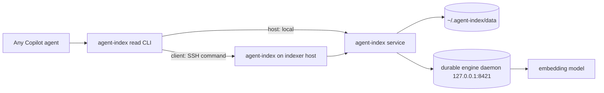

# agent-index architecture

`agent-index` is a runtime service plugin for local, repo-scoped retrieval. This
document describes the code that ships today. Vision documents remain intent;
implemented architecture lives here.

## Implemented state today

The current plugin includes:

- a Python package and `agent-index` CLI;
- a loopback FastAPI service with zdd routing and legacy rendezvous discovery;
- lightweight client runtime slots under `~/.agent-index/versions/<version>`;
- versioned host `[store,server]` slots selected by the plugin's own installer/cutover;
- durable service data under `~/.agent-index/data/`;
- a durable embedding-engine venv/daemon under `~/.agent-index/engine`;
- source connectors for local git, GitHub issues/PRs, and Azure DevOps work
items/PRs;
- chunkers for code, Markdown, YAML, and fallback text;
- LanceDB content/vector stores, path state, task queue, GC/repair, and
similarity-cluster artifacts;
- CLI (the agent-facing surface), HTTP, and an optional stdio MCP adapter
requiring explicit `[stdio-mcp]` opt-in on either role (absent from base and host profiles);
- host/client role routing for read commands over SSH.

That means the old "Phase 1 service shell only" description is stale. Future
work still exists, but indexing and retrieval are present in the shipped code.

## Incremental connector and reuse contracts

The shared engine exposes additive, round-local
[work counts](work-counts.md) for measured acquisition, chunk/checkpoint,
embedding, primary row-upsert and maintenance work. Unmeasured provider work
remains explicitly unavailable; these counters are not coverage authorities.
Each successful source publication also reports one mutation summary from
participating outer writer commits, after cursor save and pending-journal
completion. Observation does not hold a store fence over embedding calls.
Legacy counts remain unavailable, failed attempts emit no success summary,
and replay counts only work performed in the current attempt.

Native multi-model source application uses
[durable prepared embeddings](prepared-application.md) subordinate to that
same acquisition journal. Model calls finish outside the reader/writer fence,
then one source-aware writer boundary publishes the delta with at most one
logical-generation transition. Existing effect uncertainty and
store-before-checkpoint ordering remain; this is not cross-store rollback.

Participating source stores can explicitly prepare
[bounded chunk-ID point reads](chunk-id-index.md). This additive Python path
also owns explicit whole-table-budgeted scalar consolidation when ordinary
ingestion reaches its segment ceiling. It does not migrate legacy stores or
run corpus-sized maintenance automatically.

An in-process connector may opt into `DeltaSourceConnector.discover_delta()`,
returning a version-1 `SourceDelta` with changed `FileEntry` values, explicit
`DeletedFile` tombstones, its target checkpoint and complete-acquisition status.
The engine validates the result and canonical source family before writes.
Incomplete/incompatible deltas fail the source; they are not converted into
an empty success or inferred whole-corpus deletion.

This path does not call `current_commit()`, `list_paths()` or read all stored
paths: the connector owns coherent base-to-target coverage. Full reindexing and
legacy connectors retain the snapshot/discovery path, with stored-path
reconciliation limited to the connector's exact canonical family in either
storage layout. The opt-in Python
protocol is independent of the external provider CLI wire format. External
providers can opt into the separately negotiated contract below.

In-process connectors can additionally advertise
`discover_delta_page.acquisition_page_versions = (1,)`. The method receives
`(last_commit, cursor, *, cancel_check=None)` and returns an `AcquisitionPage`:
one validated `SourceDelta` plus a nonsecret opaque continuation string, or
`None` for completion. All units keep one target checkpoint; duplicate/conflicting
identities, changed targets and non-progressing cursors refuse. The shared
engine commits each complete unit and its continuation to the **same**
`pending_crawls` row before requesting another. Nothing reaches indexing or
source checkpoint publication until the complete manifest is durably ready.
Each new acquisition receives a unique generation, retained across resumed
units and included in progress/promotion/discard comparisons. Discard followed
by an identical provider plan cannot let a worker from the old generation
publish into or discard the new acquisition.
There is a finite 128-unit invocation budget; exhaustion fails visibly and a
retry continues the saved plan instead of restarting acquisition. A phase-2
journal envelope is intentionally incompatible with v1-only readers, which
refuse it rather than interpreting partial acquisition as a complete manifest.
Finish pending work before rollback or switching to hints, full reconciliation
or a connector without paged support. An explicit caller-authorized
`indexing.paged_crawl.discard_acquisition` repair may instead abandon only an
**unapplied v2 or v4** acquisition. It requires the original actual connector,
configuration scope, path database and exact observed payload; the owning
journal compares those under its existing SQLite transaction before removing
the row. Concurrent progress or promotion to a complete v1 manifest refuses
discard. Conversely, an in-flight unit cannot publish after its observed intent
was discarded. Committed source state, path checkpoints and canonical data
remain untouched, so the caller can separately request reconciliation from
the unchanged checkpoint. A 404, stale item or exhausted budget never invokes
discard automatically and never becomes a tombstone. Completed v1 manifests
remain mandatory replay, not eligible for this operation. Expanded v3 completed
manifests carrying polling-refresh generations are likewise mandatory replay,
never eligible for acquisition discard; ordinary manifests retain v1 encoding.
This adds no external-provider CLI flag;
CLI delta-v1 providers retain their existing complete-result contract unless
they additionally negotiate the full-snapshot capability below.

Full reconciliation has a separate opt-in Python contract:
`discover_snapshot_page.snapshot_page_versions = (1,)`. The method receives
`(snapshot, cursor, *, cancel_check=None)`; both inputs are `None` initially.
Its `SnapshotPage` selects a bounded, nonsecret immutable snapshot token,
returns at most 256 `FileEntry` values and a target checkpoint, and uses a
terminal cursor only when the **entire canonical family, including descendant
streams**, is covered. Every continuation receives and must retain that token
and target. A mutable API offset or a delta's `complete=True` is not snapshot
evidence. Expired snapshots fail visibly; they never become empty coverage.

The shared engine saves these units under the same journal key, configuration
scope, generation and compare-and-save guard. Only after terminal provider
coverage does it compare stored identities in keyset-ordered pages of at most
256. A full invocation has a separate 128-unit budget counting both provider
and comparison pages. Retry resumes the provider cursor or comparison keyset;
it never re-enumerates acknowledged provider pages. Partial full work uses v4,
which older readers reject. It cannot reach indexing or source-state publication
until promotion to the existing completed v1/v3 envelope; retained hinted files
and history are explicitly covered before v3 promotion and acknowledged only
after durable state publication. Changing mode, account, family or base
checkpoint refuses pending full work. Explicit discard leaves canonical data
and source state untouched.

This bounds acquisition/comparison units, **not** whole-manifest memory,
serialization bytes or wall time: the journal still accumulates a complete
manifest. Connectors without full-snapshot support retain the existing legacy
full path. Built-in Git revision snapshots use this journal as described below.
External providers can opt into this same journal through the negotiated
bridge below; no production provider is implicitly upgraded. There are no new
state cursor owners, source locks or automatic full repairs.

GitHub ordinary polls use a fresh, **single page of at most 100 identities**
updated since their committed timestamp, replaying the existing 60-second
overlap. The immutable captured work plan binds repository/account/base/target;
each subsequently acquired issue/PR and its complete comments form one durable
unit. Retry may refetch the interrupted item, not the original listing or
completed items. Hints and polling reuse the same fresh item, repository,
minimum-revision and complete-comment validation. The target is the maximum of
the previous timestamp and observed item revisions; an empty page retains the
timestamp. No poll enumerates stored paths, infers unseen-item tombstones or
uses a mutable provider page offset as a recovery cursor. A missing/invalid
timestamp or a `next` link fails with an explicit reconciliation request; it
never silently starts a full crawl or advances past an oversized window.
GitHub's list API is not an immutable snapshot or a deleted-item feed. This
polling path does not prove complete reconciliation or capture edits invisible
to the provider's `updated_at` semantics. Explicit full discovery retains the
legacy reconciliation path and captures a timestamp **before** discovery.
The shared full-reconciliation contract above does not implement a pinned
GitHub snapshot. GitHub full acquisition and durable
recovery within one item's comment pages remain separate adapter work; they are
not supplied by this bounded polling contract.

An external provider's existing `content-current-commit --source SOURCE` reply
may add `source_delta` with contract `agent-index.source-delta`, explicit
`versions`, canonical `family`, stable nonsecret `account` and effective
`target`. One connector instance captures one negotiation snapshot from the
actual executed provider; package or manifest versions do not imply support.
Missing or valid future-only declarations retain logged legacy reconciliation
with unchanged verbs and flags. Malformed declarations fail visibly.
Only advertised version 1 enables
`content-discover-changed --source SOURCE [--last-commit CURSOR] --delta-version 1`.
Its response requires `version`, `upserts`, `deletions`, `commit`, `complete`
and a `source_delta` echo of the acquisition process's actual scope. The echo
must still support v1 and exactly match the negotiated family/account/target,
so retargeting between metadata and acquisition cannot cross a recovery fence.
The delta's own cursor owns coverage; metadata cursors and incomplete output
never authorize tombstones. Invalid replies or process failures do not trigger
an effectful legacy retry.
Without an additional snapshot capability, full reconciliation retains the old
syntax and accepts canonical descendant sources within the invoked subtree.
Once v1 is negotiated, full
`content-discover`, legacy-shaped `content-discover-changed` and
`content-list-paths` responses must also include the same executing-scope echo.
It is checked before entries or paths are returned, protecting snapshot-derived
tombstones as well as explicit deltas. These calls introduce neither new flags
nor additional metadata probes; direct non-negotiated calls retain the legacy
baseline. Old callers can ignore the additive echo and metadata; new callers
handle supported rollback without guessing new syntax. Provider
hint consumption remains unadvertised. These providers must retain the baseline
through the consumer-upgrade and provider-rollback window; retirement requires
a separate contract revision.

For complete immutable full acquisition, the same `source_delta` declaration may
add `"snapshot_versions": [1]`. This is an optional capability, independent of
package versions, and requires delta v1's existing scope contract. Omission,
`[]` or supported-future-only snapshot versions retain the legacy full syntax;
malformed declarations refuse negotiation. A capable new caller uses the existing
`content-discover --source SOURCE --snapshot-version 1` verb and appends
`--snapshot=TOKEN --cursor=CURSOR` on continuation. Attached values preserve
opaque tokens that begin with `-`. It does not send these flags
to a provider that has not advertised support and never retries legacy syntax
after a failed negotiated call.

Each reply explicitly contains `version: 1`, `snapshot`, `upserts`, `commit`,
`cursor` and `source_delta`. `upserts` has at most 256 ordinary file-entry objects.
`snapshot` and non-null `cursor` are bounded nonempty nonsecret strings without
NUL characters (the subprocess argument boundary cannot represent them); `commit`
is a NUL-free string or null. `cursor: null` alone certifies terminal coverage of the
entire negotiated family, including descendants. The scope echo must match
family/account/target and still advertise snapshot v1. The shared journal checks
stable snapshot/target, rejects repeated cursors, and infers no deletions before
terminal coverage. Retry under a fresh connector passes the last acknowledged
snapshot/cursor even if metadata's informational commit changed. Expiry,
retargeting, malformed pages and withdrawn capability fail visibly without
discarding pending acquisition or advancing source state. Providers must supply
genuinely immutable coverage, not reinterpret mutable API offsets as snapshots.

Providers expanding this capability retain all four baseline verbs and their
old syntax/output for old consumers and the supported rollback window. No flag
or baseline is retired here. The contract/process tests exercise old/new callers,
old/new receivers, strict unknown-flag rejection, interrupted replay, scope drift,
and two-model native engine composition in both store layouts. This bridge does
not implement provider-side snapshot storage, other built-in snapshots, or
bounded whole-manifest memory.

Ordinary external deltas can independently opt into
`"acquisition_page_versions": [1]` in the same declaration. Delta v1 support
remains required. Omission, `[]` or future-only page versions preserve flat
`--delta-version 1` discovery; malformed arrays refuse negotiation. A capable
caller invokes the existing
`content-discover-changed --source SOURCE --delta-version 1 --acquisition-page-version 1`,
adding `--last-commit=BASE` when a base exists and `--cursor=CURSOR` only on
continuation. Attached opaque values preserve leading `-`; NUL cannot cross
the subprocess boundary. A connector instance negotiates once with its actual
executed provider, not a package version, and exposes the optional Python
`discover_delta_page` method only after positive negotiation.

Each response contains the flat delta fields (`version: 1`, `upserts`,
`deletions`, `commit`, `complete: true`, `source_delta`) plus
`acquisition_page_version: 1` and an explicit `cursor`. There are at most 256
upserts and tombstones **combined** per unit. `complete: true` certifies that
unit, not the whole acquisition; only `cursor: null` completes the delta.
Non-null cursors are bounded nonempty nonsecret strings, and cursors/checkpoints
must be NUL-free. The executing scope echo must match family/account/target and
still advertise page v1. Every unit retains the same target checkpoint and
providers must bind opaque continuations to the original base and effective
scope; mutable API offsets alone are not coverage evidence.

The existing pending-crawl v2 journal persists each accepted unit before the
next call, pins base/target/scope, rejects repeated cursors and duplicate or
contradictory identities, then promotes terminal work to the existing complete
manifest. The 128-unit invocation budget is unchanged; retry resumes from its
last acknowledged cursor. No indexing, inferred tombstones or source checkpoint
advancement occurs during acquisition. Process failure, malformed/incomplete
output, expiry, scope drift or rollback withdrawing support refuses visibly and
preserves progress; it never silently retries flat or full acquisition. Before
work is pending, a supported provider rollback still selects its negotiated
flat delta or logged legacy baseline.

Expand providers before advertising support, then migrate callers
conditionally; retain flat deltas and all four baseline verbs through the
consumer-upgrade **and provider-rollback** window. This change retires no old
form and upgrades no production provider. The real-process controls cover both
directions of version skew, exact argv, strict unknown-flag rejection,
interrupted continuation and native one-/two-model engine replay in both
layouts. This bounds accepted identities per unit, not response bytes,
whole-manifest memory/serialization or overall runtime. The existing per-call
timeout remains; there is no new cursor owner, lock, discard authority or
automatic full repair.

Git revision sources use this seam for pinned base-to-target raw diffs and
bounded new-commit history, without listing unchanged tracked paths, stored
paths or all historical commits. Renames produce an old-path tombstone and
new-path upsert; files becoming non-indexable retire their previous content.
Blob reads use immutable object IDs and enforce the size bound before loading
content. A missing/unavailable cursor or rewritten history explicitly requests
a full reindex rather than silently performing an unlimited repair.
Full reindexing remains the initial reconciliation path.
For immutable Git revision sources, explicit full reconciliation now opts into
the shared snapshot journal. The token pins a peeled commit object, not a branch
name; file blobs and the complete `:commits` stream retain that commit even when
a retry constructs a fresh connector after the configured ref moves. File
pages traverse one immutable directory object at a time using a durable
component-stack/byte-offset cursor, advancing at most 128 new raw tree records
per page, including non-indexable entries. Components are stored once per
level, avoiding quadratic growth from repeated ancestor paths. Restored offsets
are validated against actual record boundaries, so a mode-like substring in a
filename cannot become an invented entry. Each directory object is limited to
16,000,000 bytes, checked before loading; exceeding it fails visibly rather
than silently dropping a directory. Immutable blob reads retain the existing
file-size/text filters. History pages return at most 128 entries with explicit
topological ordering against the pinned commit. Their continuation carries the
last acknowledged commit identity as well as the ordinal. A resumed native log
window reads that predecessor plus at most 128 new entries (129 total), and
must match the predecessor before accepting a terminal result. Out-of-range
ordinals or shifted ordinal/identity pairs cannot certify empty history.
A terminal page certifies both
streams, after which the existing bounded stored-identity comparison can infer
tombstones. Missing objects and unavailable coverage retain pending progress
without advancing state or falling back to an empty snapshot.
Before returning from a child directory, the restored parent offset must point
immediately after that child's tree record. An inconsistent parent/child stack
therefore cannot silently skip a sibling and complete authoritative coverage.
This return check reads at most one additional bounded parent object.
Both full snapshots and ordinary discovery use the resolver's peeled commit
identity, so an unchanged annotated-tag source does not flip its checkpoint
between a commit object and a tag object.

Git replacement refs are disabled at the connector's one Git invocation owner,
consistently across full snapshots, deltas, hints and old direct discovery
methods. This deliberately indexes canonical objects rather than a mutable
local replacement overlay; otherwise a snapshot could use one tree view and a
following poll silently advance over changes in another. The effective recovery
identity includes `git-objects:canonical-v1`. Checkpoints from before this policy
therefore require explicit full reconciliation before ordinary acquisition,
even when no replacement refs currently exist; their old object view was not
recorded. Finish pending acquisition under its original binding before upgrade
or use the existing explicit repair flow. No upgrade implicitly starts a full
crawl or rewrites an old journal.

Shallow repositories and mutable history grafts refuse this snapshot path because
pinning only a commit cannot freeze those external graph boundaries. Normal
working-tree fallback retains its legacy discovery path, as do old consumers
calling the unchanged `discover` methods; the canonical-object policy above
applies to their Git history reads too. No new CLI flag, source journal,
checkpoint or provider storage is introduced.

These are **result-page and tree-object bounds**, not a whole-source
CPU/I/O/time guarantee: a resumed directory page rereads its bounded tree
object and reparses its acknowledged prefix to validate the offset, native
`log --skip` may revisit ancestors internally, and commit
messages and the accumulated journal manifest are not byte-bounded here.
Git full acquisition's traversal-cost qualification remains open; this is not
evidence that a 100,000-item full repair has constant work.
Connectors whose current mode cannot prove delta coverage can expose
`delta_available=False`; Git's working-tree fallback retains its existing
snapshot path and logs that legacy reconciliation selection. Remote/ref reads
remain pinned even if the named ref moves during discovery.
Git paths are decoded per NUL-framed record. Non-UTF-8 paths are explicitly
logged and excluded in both full and incremental discovery rather than
inventing lossy stored identities or blocking unrelated items. Commit fields
and records use NUL framing, so control characters in commit messages remain
content rather than accidental record boundaries.

Presented files use bounded, exact checkpoint lookups. A normal round reuses
only complete file fingerprints covering text, language, metadata, chunker
policy and configured embedding profiles. `IndexConfig.chunker_revision` and
`ModelProfile.revision` are explicit programmatic invalidation inputs; a chunker
or model change that preserves its name must advance the corresponding revision.
Legacy content-only fingerprints deliberately miss once when a file is next
presented. Full reindexing still forces work, while its retries can reuse
compatible writes committed within the task window.

Existing file reuse is revoked before mutations begin, including forced rewrites
at an unchanged fingerprint. Each file checkpoint is published only after all
its content/vector writes and stale-chunk cleanup succeed. Chunking and deletion
failures retain the source cursor for
idempotent replay; legacy vector deletion precedes content deletion so retry can
still discover canonical chunk IDs. Transactional SQLite triggers maintain
per-source chunk totals as file checkpoints change, including deletions and
replayed batches. Existing path databases receive a one-time aggregate backfill;
ordinary rounds read only these source totals, not unchanged file rows.

Before mutating a nonempty acquired delta, the engine journals its complete
manifest and target in the existing path-index SQLite database. A retry first
finishes that pinned acquisition, atomically publishes and flushes the existing
JSON source cursor, then clears the journal and acquires fresh changes. This
prevents a newer net delta from omitting an item partially written by an
interrupted older delta (for example, a file changed and then reverted).
Source/account configuration changes refuse replay rather than applying old
work under a new scope. Completed checkpoints also retain the existing
`recovery_scope` hash in `SourceState.acquisition_scope`, alongside their cursor
and canonical family. On disk, accepted scopes live in the additive top-level
`acquisition_scopes` map so legacy readers can still construct their three-field
source records. The reader also accepts the previously published nested
`acquisition_scope` encoding; conflicting dual encodings, malformed scopes and
identities without a corresponding source refuse. A legacy writer can drop the
additive map, but that loss never grants a newer reader acquisition authority.
A missing or mismatched checkpoint identity requires an
explicit full reindex before any new acquisition, in either storage layout;
a new target cannot reuse an old target's cursor even after its journal clears.
Successful application and atomic checkpoint publication bind the accepted
scope, including empty full snapshots with a null cursor. Failed application
or publication restores the prior in-memory checkpoint and retains any pending
acquisition for replay. Older state files still load, but their unbound cursors
require full reconciliation. An already-admitted pending journal with a matching
scope may finish and bind its checkpoint before fresh acquisition; complete
manifest envelopes remain v1. No additional identity or credential authority is
introduced. The same constructed connector supplies both acquisition
and its canonical/effective recovery identity: delta connectors declare a
nonsecret `recovery_identity` tuple. Built-in Git binds the resolved checkout,
remote target and selected ref, including environment/registry resolution;
GitHub binds the actual HTTP client's API/repository target, configured initial
window and authenticated account ID (one cached `/user` metadata probe, so user
token renewal preserves identity). Installation tokens cannot call `/user`;
after verifying `/installation/repositories`, their recovery scope conservatively
binds an opaque credential fingerprint. GitHub exposes no installation ID through
that token's identity API, so a rotated installation token refuses an existing
journal rather than guessing that repository ownership proves the same principal.
Complete pending crawls before rotation; no token bytes are persisted or logged.
Authentication failures never become anonymous identity. Azure DevOps binds its effective
HTTP-client endpoint, authenticated account and resolved work-item/pull-request queries.
Expected permission-only `/user` denials do not incur retry backoff; quota,
secondary-rate-limit and transient failures retain bounded HTTP retries.
Legacy CLI providers bind their registered command. Providers remain responsible
for stable backend identity.
Credential-bearing URL components are excluded, except SSH usernames remain
part of the target because they select remote home directories.
Ambiguous query/fragment target
semantics refuse recovery rather than silently selecting an identity.
The journal is not another checkpoint authority.
Another crawl alias cannot acquire or mutate an overlapping canonical family
(including ancestor/descendant scopes) while acquired
work remains pending. Source garbage collection also defers before deletion or
cursor retirement and reports the pending sources as failures. Restore the
original source configuration and complete its pending crawl before retiring
or retargeting it. Only the explicit exact-payload repair above may discard an
unapplied v2 acquisition; manual journal deletion is not a supported recovery path.
Pending work must finish through a journal-capable engine before rolling back
to an older engine; old runtimes do not implement this recovery contract.

When a presented file misses its complete fingerprint, chunk/model selection
uses derived `embedding_coverage` receipts in the same path-index database.
Each receipt binds a physical model table and chunk ID to the raw embedding
text/model policy and a float32 vector digest. Bounded, strict reads must find
the matching vector before reuse: an absent vector, changed input/profile or
legacy writer's overwrite requires embedding again. Metadata, language and
routing changes alone do not invalidate an otherwise required pair; new model
routes backfill only their missing pairs. A named model whose weights or
preprocessing change must advance `ModelProfile.revision`.

The content-first pipeline delegates routing and vector publication to the
shared `indexing.embedding_batch.embed_and_store_pairs` helper. Its direct
stored-content path performs no canonical writes and returns actual vector
rows upserted, not the content-first caller's logical processed-chunk total.
The opt-in [prepared pair path](chunk-id-index.md#stored-content-pair-writer)
checks current canonical input before engine readiness and under vector-writer
exclusion; the caller still owns discovery and source/account/profile progress.

The [bounded content snapshot reader](chunk-id-index.md#bounded-canonical-snapshot-reader)
captures local incarnation/version/row-count metadata and reads finite
version-relative logical offsets through an independent handle. It strictly
refuses incomplete input, unavailable versions and before/after identity changes,
without creating storage or pinning the current writer's handle. Its conservative
directory-ctime identity can require repair after ordinary native mutations.
This is a discovery prerequisite, not a source/account/profile cursor or a
retention/operational-backfill authority.

Explicit [model backfill slices](chunk-id-index.md#explicit-resumable-model-backfill)
reuse that reader and the shared routed pair writer. They bind accepted source/
account identity, effective profile/routing/table policy and native versions in
the existing path database, retain verified coverage before a compare-and-save
offset, and never advance acquisition checkpoints or rewrite canonical content.
Canonical changes require an explicit restart; ordinary indexing stays active
between bounded writer slices. Existing GC guards retain unfinished intent;
operator-authorized exact-intent discard affects no canonical rows. This API
does not replace source leases or promise mixed-old-binary GC exclusion.

Ordinary writes revoke receipts before a potentially partial vector write.
Prepared pair writes retain old receipts through pre-effect refusal, then
invalidate after the vector commit and before explicitly budgeted preparation.
Old receipts still require actual input/vector matches before reuse.
New receipts publish only after the stored batch matches the returned embeddings. They survive
restart and unfinished stale cleanup, without publishing a completed file or
source cursor early. Obsolete receipts are pruned after that file's successful
reconciliation; removing a path removes its receipts transactionally. Old
databases start without coverage and conservatively embed each presented pair
once. These are optimization receipts, not new source-lock, checkpoint,
committed-reader or global missing-vector-repair authorities.

Engine readiness is deferred until missing-pair selection produces a nonempty
embedding plan. An empty delta, wholly reused file set or metadata-only update
with verified pair coverage does not start embedding engines. Full reindexing
forces pair writes, except for files already committed within its retry window.
Completed changed files reconcile against their explicit retained chunk IDs
before publishing checkpoints, including files that now produce no chunks.
Unchanged canonical rows keep their original physical write timestamp and table
version: bounded strict comparisons cover raw text and every persisted metadata
field, not only the normalized content hash. Failed or incomplete reads cannot
authorize rewrites or cleanup. Cleanup reads only that file's IDs and deletes
obsolete IDs in batches; vector deletion precedes canonical deletion for retry.
Logical processed chunk counts remain independent of actual content writes.
Identical canonical input records sharing an ID (for example same-line code
declarations) are coalesced before chunk accounting, embedding and storage.
Conflicting text or metadata at the same ID is rejected, not arbitrarily chosen.
Legacy exact stored copies are streamed in bounded batches and rewritten once
as a single canonical record; conflicting stored copies still fail visibly.
Cleanup deduplicates IDs only after proving complete physical row enumeration.
Pre-coalescing file fingerprints miss once when that file is next presented;
this upgrades unique-chunk accounting without scheduling a corpus scan or
discarding otherwise reusable chunk/model receipts.
Direct store calls still refresh timestamps by default for legacy callers;
`skip_identical=True` is opt-in and requires identity-based rather than
timestamp-based cleanup. Forced full rebuilds still write every presented row.
In the selected source layout, content updates change vector provenance only when source or
language actually differs, preserving vector table versions for metadata-only
updates. Global vector-gap repair remains owned by its existing mechanism.

## Process model

Python consumers can call the same `run_reindex` with their `IndexConfig`
subclass, explicit complete `SourceSpec` list and an optional
`EmbeddingRuntime` client/lifecycle policy. Connectors continue to use
`register_connector`; no alternate crawl/embed/checkpoint engine is needed.
An optional `SourceRetirementPolicy` separates the crawl selection from an
externally owned source inventory and supplies pure legacy-name classification
without replacing shared garbage collection or its pending-acquisition guards.
`run_worker` accepts an explicit config and indexing callable, retaining exact
callable hint negotiation, resume/progress/cancellation and terminal status.
An explicit worker config is forwarded to the default engine; a custom callable
owns binding its own matching config.

The [consumer migration recipe](consumer-migration.md) defines ownership,
compatibility and verification requirements. No CLI/provider negotiation is
implied by these in-process seams, and custom callable wrappers must not claim
hint support they do not actually preserve.

Retrieval facades retaining another canonical source naming scheme can override
the pure `ContentStore.repo_filter_sql` method. The shared FTS/currentness path
still executes that escaped prefilter before limiting candidates; the consumer
migration recipe covers matching its vector-side policy.



The service itself is machine-local. Clients do not open a public listener or
run a local indexer daemon; project-aware read commands execute the same
`agent-index` CLI on the designated indexer over SSH. The dynamic service port
stays on the host and is resolved there.

### Authenticated HTTP read endpoints

An explicitly configured HTTP client can use a provider-owned bearer credential
command without changing native hosting or SSH routing. Select the HTTP endpoint
in the repository's indexer designation, and put the credential reference only
in the client's machine-local `~/.agent-index/config.yaml`:

```yaml
role: client
endpoint: https://index.example.com/api/index
http_auth:
  endpoint: https://index.example.com/api/index
  installation_id: expected-remote-installation
  token_command:
    - /absolute/path/to/credential-provider
    - access-token
```

The command must emit only the credential on stdout; it owns provider selection
and noninteractive refresh. The CLI never starts a login, persists the token,
or reports provider output. Acquisition is headless with a 30-second deadline,
caller-owned process-tree cleanup, and capture-time limits of 16,386 stdout
bytes and 4,096 stderr bytes. Credentials are limited to 16,384 ASCII characters.
The exact endpoint binding, remote installation identity, HTTPS verification
(or explicitly selected loopback transport), disabled ambient proxies and
redirect refusal prevent credential forwarding to another destination.
Do not put a token in configuration or command arguments.

This mode supports the existing `/health`, `/status`, `/search`, `/similar`
and `/clusters` read contracts under the selected endpoint prefix. An adapter
may explicitly refuse unsupported reads; it must not fabricate an empty result.
Remote status checks the configured service identity, not local process custody.
Lifecycle operations cannot use the authenticated read client. This is not an
alternate path or fallback for the separate signed-grant scoped fleet protocol.

The focused native consumer test exercises an actual credential subprocess,
HTTP request and CLI process with isolated configuration. The optional Windows
desktop lane is selected with
`python tools/run-plugin-tests.py agent-index --allow-explicit-tiers --test-file tests/native/test_http_auth_windows.py`
and `COPILOT_EXTENSIONS_NATIVE_WINDOWS=1`. It observes two acquisitions from a
real windowless parent and refuses visible windows or foreground transitions.

## Install and runtime layout

| Area | Location | Owner |
|------|----------|-------|
| Runtime root | `~/.agent-index` | plugin installer |
| Client slots | Legacy `~/.agent-index/versions/<payload-version>`; namespaced profile-qualified slots | client installer |
| Client runtime marker | `~/.agent-index/current-version` | client installer selection only |
| Host runtime slots | `~/.agent-index/versions/<version>` or namespaced profile-qualified slots | plugin installer/cell reconciler selection, rollback, retention |
| zdd routing table | `~/.agent-index/active.json` | active service endpoint |
| Legacy rendezvous | `~/.agent-index/run/endpoint.json` | fallback diagnostics |
| Durable index/task data | `~/.agent-index/data/` | shared across service versions |
| Durable engine runtime | `~/.agent-index/engine/versions/<version-or-repair>` | independently selected, completed heavy embedding stack |
| Machine config | `~/.agent-index/config.yaml` or `AGENT_INDEX_CONFIG` | role, device, client endpoints |
| Repo config | Checked-in defaults: `<repo>/.agent-index/config.yaml`; repo-local overlay: `<repo>/.copilot-extensions/agent-index/config.yaml` | corpus defaults, optional local indexer designation, and additive corpus overlays |

Host service replacement follows
`../../../docs/patterns/graceful-daemon-cutover.md`, while the durable engine
split follows `../../../docs/patterns/durable-vs-versioned-runtime.md`.
Index data and queued work remain durable and outside service runtime slots.
The independent embedding engine is neither provisioned nor restarted during a
routine service update or host replacement.

## Activation, lifecycle, and supervision

Activation is repository-scoped and fail-closed:

1. One resolver builds the effective current-repository config using the same
precedence model documented for the rest of the ``.agent-*`` ecosystem (see
`docs/configuration.md` and
`plugins/agent-worktrees/docs/config-reference.md`): **machine-local**
`<repo>/.copilot-extensions/agent-index/config.yaml` wins over the conditional
**knowledge overlay** `<knowledge>/.agent-index/config.yaml`, which wins over
the checked-in **in-repo** base `<repo>/.agent-index/config.yaml`. An optional
marketplace overlay under
`.copilot-extensions/agent-index/marketplaces/<marketplace>/config.yaml`
remains above the repo-local machine overlay. For ordinary keys this is a
straight "highest precedence wins per key" deep merge, including list
replacement. `corpus.sources` is the one deliberate exception: because the
entries are independent corpus declarations rather than one replaceable setting,
the resolver unions them by source `name`, with the higher-precedence layer
keeping the winning definition on duplicate names and lower-precedence layers
contributing only missing names. If no local repo config exists, the resolver
preserves the earlier fail-closed fallback: it may adopt the bound knowledge
repo's own effective config as the only activator. A present invalid local
config, an unsafe path, a conflicting singular/plural indexer declaration, a
missing required binding for external-only activation, or an unavailable
resolver leaves the plugin inactive.
2. Session-start hooks emit retrieval guidance while that resolver reports
active, then stamp metadata and a callable binstub through the dependency-light
gate. Hooks never invoke install/ensure/provision, create venvs, acquire packages,
register autostart, or start/restart a service or engine. A stamp is not runtime
readiness; first admitted operational use owns provisioning, after explicit
repository opt-in and role/setup intent. Retrieval guidance belongs in the
exact-session guidance file when a session-file writer is present.
3. Every payload CLI entry runs the same resolver before installation-context
selection, runtime provisioning, or transport routing. `status` reports
structured `inactive` outside an opted-in repository; other commands are
refused.
4. In an active repository, admitted explicit commands may provision the light
service runtime locally. Setup writes the selected role without a second
role-specific engine provision. Noninteractive setup requires an explicit role
flag. The gate never executes a historical `payload-dir` installer as a
fallback, because that installer may retain obsolete host-install authority.
5. The installer-readiness probe is deliberately configuration-empty at session
start, including for opted-in repositories, so generic launch reconciliation
does not download packages or start services. Existing explicit installer and
runtime commands remain available.
6. The plugin's own installer/runtime lifecycle now builds, selects,
readiness-gates, replaces, rolls back, and retains the light host runtime. The
public `start` / `serve` entry points run the local service directly in the
selected interpreter, while installer `install` / `update` use `deploy` for
automatic zdd cutover when a live service is already serving. The durable
engine remains external to that runtime and is never rebuilt by an ordinary
service update.
7. Namespaced marker CAS, deploy-manifest publication, profile receipts, and
transaction recovery retain existing installation governance. Namespaced hosts
use the same local slot/cutover primitives as legacy mode. Compatibility
`ensure-service` compatibility hooks remain inert; `bootstrap-check` stamps only
metadata/binstubs. Previously completed receipts remain
diagnostic/ownership evidence, never permission to bypass runtime validation.

Client runtime selection requires the canonical exact four-field
`.install-complete.json`, the strict role/extras profile receipt, a valid
`pyvenv.cfg`, and a successful `import agent_index` from beneath the selected
slot. POSIX permits only the standard `bin/python` venv symlink after validating
its owned parent slot and resolved executable; all other linked/reparse runtime
artifacts remain rejected. A partial or corrupt slot is never dispatched.

The default durable tier now registers the same stable launchers with the
lowest-privilege host mechanism that satisfies "restart on next logon without a
live Copilot session": Windows writes HKCU Run entries for the service and
durable engine; POSIX registers systemd --user units when available. Windows
Scheduled Tasks remain an explicit per-machine upgrade tier for hosts that want
pre-login start, missed-trigger recovery, or task-owned restart policy. Explicit
independent engine commands retain their existing lifecycle outside the light
service runtime.

## Service HTTP surface

The service binds `AGENT_INDEX_HOST` (default `127.0.0.1`) and
`AGENT_INDEX_PORT` (default `0`, an OS-assigned ephemeral port). It exposes:

| Endpoint | Meaning |
|----------|---------|
| `GET /health` | `{status: "passive"|"ok"|"draining"}` plus installation, PID, and instance token |
| `GET /status` | plugin/version, drain state, index counts/sources, indexing runner state |
| `GET /search` | semantic + lexical search; degraded JSON if unavailable |
| `GET /similar` | nearest neighbours for an indexed chunk |
| `GET /clusters` | near-duplicate cluster artifact |
| `POST /reindex` | enqueue background indexing unless draining/deps missing |
| `POST /reindex/hints` | strictly validate and durably union version-1 acquisition hints |
| `POST /drain`, `/undrain` | zdd cutover drain gates; namespaced calls require the exact instance token |
| `POST /promote` | instance- and transaction-owned pre-route passive promotion |
| `POST /shutdown` | ownership-attested service shutdown used by CLI/cutover |
| `POST /adopt-relay` | compatibility stub; returns no relay |

Endpoint discovery is local: zdd `active.json` first, then legacy rendezvous.
See `../../../docs/patterns/local-endpoint-discovery.md`.

## CLI surface

Public CLI verbs are implemented in `src/agent_index/__main__.py`:

- `stop`, `status`, `version`
- `start` / `serve`, `restart`, `deploy [--recover]` manage the local service
- `index [--source S] [--full] [--change-hints-file FILE]`
- `search <query> [--source S] [--language L] [--repo R] [--limit N] [--json]`
- `similar <chunk_id> [--limit N] [--source S]`
- `clusters [--source S] [--bucket B] [--model M] [--exact-dupes-only] [--limit N]`
- `mcp` for the direct FastMCP HTTP-client toolset
- `engine status|start|stop|run`
- `setup`, `role`, and `capability`

`index-worker` is an internal subprocess entry point used by the task runner.
`__cell-start` remains an installation-cell-owned launcher seam that validates
ownership before serving from a namespaced runtime.

## Indexing pipeline

`agent-index index` and `POST /reindex` use the same durable indexing core:

1. Resolve source specs from `AGENT_INDEX_SOURCES`, grafted `corpus.sources`, or
the default `git` source.
2. Crawl full or incremental changes through the source connector.
3. Chunk files/items.
4. Ensure the configured embedding engine is reachable.
5. Store canonical content and per-model vectors in LanceDB.
6. Reconcile deletions/stale chunks and persist commit markers.
7. Refresh similarity clusters best-effort when clustering is enabled.

Indexing is incremental by default; full reindex is explicit. The task queue is
SQLite/WAL under `~/.agent-index/data/tasks.db`. Service-triggered reindexes run
in detached versioned worker subprocesses, so a service cutover does not kill an
in-flight indexing job; the successor service re-adopts live workers or marks
dead ones interrupted/resumable.

### Covered derived maintenance

An ordinary FTS update checks existing coverage before launching a builder.
Source-aware stores use their existing domain receipt and durable index;
legacy stores use Lance's actual unindexed-row metadata. Unknown coverage keeps
maintenance due. Explicit full builds still run, and new content versions remain
eligible for incremental maintenance and the existing failure/retry path.
The source-aware incremental child updates only the content FTS index through
the native index-only SDK, appending delta segments without compaction, version
cleanup or unrelated scalar-index consolidation. Full builds and legacy workers
retain their existing path. The ordinary selected-layout
[source publication](prepared-application.md) creates point/file indices only
on empty tables and maintains their budgeted delta tails under its existing
writer. Nonempty unprepared data and the segment ceiling require explicit
owner preparation/consolidation; FTS freshness alone proves neither.

Similarity clusters persist their coverage key and result counts in the same
SQLite transaction as the artifact. The key covers refreshed versions of the
configured content/vector tables, qualified local dataset identity, the existing
source-domain identity and clustering policy. Database triggers revoke coverage
on artifact-row mutations, including writes by workers from before the coverage
schema was introduced. A covered ordinary round checks
metadata without enumerating items, rewriting the artifact or starting an FTS
child. Changing inputs or policy invalidates coverage; computation verifies its
input key again before publishing. Explicit full indexing forces clustering.
Unqualified remote storage logs the limitation and runs an uncached pass.
Cluster construction uses complete, failure-propagating item/chunk/vector reads;
an unsuccessful read cannot publish partial output as covered input.

Participating source-aware writers also publish optional
`logical_projection` version-1 metadata in the **existing** clean source-layout
receipt. A logical generation advances once per outer committed write with
changed projection tables; nested content/vector writes share that commit.
Per-table generations identify content and individual model changes.
Changed-table counters use the monotonic commit generation, so removing and
recreating a table cannot resurrect its old coverage key. Strict
identical-content skips and canonical tombstones matching no current rows change
neither physical nor logical versions. A repeated tombstone therefore does not
invalidate current FTS or cluster coverage. Explicitly
annotated scalar-index preparation, FTS building and compaction preserve logical
generations for their existing tables. Each operation records its own physical
before/after transition under the existing writer; exemptions require a contiguous
chain from writer entry through the final witness. Raw changes before, after or
between maintenance operations cannot inherit an exemption. Other effects
conservatively count changed tables as logical changes, even when physical-only
maintenance also occurs.

Logical keys are reusable only while their physical table versions and local
directory identities match the receipt's witness. Missing, invalid, oversized or
stale optional metadata falls back to the physical key. A subsequent participating
commit starts a new epoch if an older writer retained a now-stale witness.
Unknown writers therefore cannot preserve an obsolete logical cache merely by
updating the source receipt's physical versions. An interrupted writer remains
dirty/uncertain under the existing recovery rules; no generation is published
before its successful clean commit. Receipt work scales with table count, not
stored items, and adds no source enumeration, row reads, processes or network
requests.
Every receipt publication, including intermediate effects and FTS handoffs,
evicts optional bucket metadata before table-level logical metadata if needed
to fit the existing 64 KiB reader
limit. Oversized mandatory receipt state is refused before replacing readable
state.

Legacy stores retain conservative physical-version coverage. These generations
are derived-artifact reuse evidence, not source cursors, checkpoint advancement,
new reader authority or locks. They describe committed store writes, not an
atomic whole-source delta. By default a real change still invokes the global
clustering pass.
The opt-in [prepared bucket/model item reader](bucket-item-reads.md) supplies
indexed, explicitly budgeted slice input without changing that default.
Its [witnessed bucket generations](bucket-item-reads.md#witnessed-bucket-generations)
track qualified content/vector mutations and canonical tombstones under the same
clean commit, with bounded sparse overrides and whole-table fallback for
unqualified transitions. The additive
[opt-in cluster-slice planner and storage seam](cluster-slices.md) connects
witnessed bucket keys, prepared selected-model input and transactional partial
publication. Its Python-only row budget defaults off; missing proof or unsafe
mixed-model totals request explicit repair, never an implicit global sweep.

### Durable acquisition hints (queue contract v1)

`indexing.change_hints.ChangeHints` is a typed, immutable version-1 acquisition
hint envelope. Its exact configured `source`, adapter-supplied
`canonical_family`, and opaque nonsecret `account_id` form the union scope.
Adapters own canonical-family selection and stable account identification; the
queue does not infer aliases, accounts or credentials. Item IDs, event IDs,
distinct base/target `RefRange` pairs and item-bound `MetadataRevision` pairs
are deterministically deduplicated and unioned without collapsing differing
targets or metadata revisions. These are acquisition hints only: no snapshot
completeness, tombstone, deletion or checkpoint authority is implied. Unknown
fields, unsupported versions, malformed typed values and corrupt persisted
JSON fail visibly rather than becoming an empty or full-snapshot request.

`TaskStore.enqueue(source=..., change_hints=...)` accepts these envelopes only
for a matching exact-source incremental task (`full=False`). The additive
nullable `tasks.change_hints` column retains payloads across restart, retry and
recovery. A `BEGIN IMMEDIATE` transaction atomically unions new deliveries into
one same-scope `queued_hints` row. Processing payloads are immutable; events
arriving during active work accumulate into a separate trailing row. Retrying
an older attempt can leave two pending rows; both payloads remain intact and
new deliveries union into the oldest matching pending row. Different configured
sources, families or accounts are never coalesced.

Hinted tasks remain conservatively separate from legacy full tasks, including
`source='all'`: a full task has no proven account/ref/event coverage and cannot
cancel or swallow hinted work. Unhinted tasks retain queued exact deduplication,
queued-full supersession, full-first dequeue ordering and the existing rule
that a processing full task never absorbs a trailing incremental. A capable
dequeue preserves full-first ordering and FIFO within each tier.

This is a **receiver-first expansion**. `dequeue_next()` retains legacy
selection; only an explicit `dequeue_next(accept_change_hints=True)` may claim
parked work. The runner opts in only when the exact engine callable selected in
this runtime advertises v1 support. It rechecks before launch; the worker checks
its own selected callable again before execution. A capability loss returns a
claimed hinted task to `queued_hints`, without calling the engine or advancing
its checkpoints. An unclaimed hinted task cannot be executed directly by the
new worker. The monitor preserves intentional re-parking after the worker
exits, publishes a queue update rather than a terminal failure, and allows
dequeue after worker capability can be revalidated without requiring a manual
retry. The worker records refusal atomically in the existing task error field
when re-parking. A runner retains that refusal against the selected interpreter
and immutable runtime version. While that selection remains unchanged, it excludes
hinted dequeue and continues serving ordinary queued tasks. A changed selection
allows a new worker attempt, whose own callable must still verify v1 support.
Time passing or another queue notification is not evidence of capability.
Worker registration uses the existing immutable runtime-version metadata.
A pending cancellation still cancels the parked row.

The execution seam is
`agent_index.indexing.engine.run_reindex(..., change_hints: ChangeHints | None = None)`.
The exact selected callable must explicitly publish
`run_reindex.change_hints_versions = (1,)` **only after** implementing those
semantics. A module constant, package version, registered forwarding wrapper,
permissive `**kwargs`, or newer payload does not establish execution support.
Replacing the callable with an unadvertised implementation removes support.
Plain tasks still use the legacy kwargs without `change_hints`. The transport
and worker preserve the envelope; the capable engine retains responsibility
for source/account admission, acquisition, checkpoints and all index mutations.

`GET /health` adds `indexing_contract` with stable identity
`agent-index.change-hints`, `intake_versions: [1]`, and separately computed
`execution_versions` (`[]` unless the selected callable advertises v1).
Advertising durable intake is not a claim that hinted execution is available.
`POST /reindex/hints` accepts only `source`, optional `full: false`, and required
`change_hints` containing the complete v1 envelope. It refuses unknown fields,
versions, duplicate JSON keys, mismatched scopes and oversized bodies before
queue effects. Ordinary runner/dependency/drain availability checks still apply.
Accepted responses include the stored task and its complete unioned payload.
SQLite admission runs off the service event loop. Request cancellation does
not release drain admission until the queue write and runner notification
settle; the service remains responsive while a database writer is contended.
The legacy `/reindex` source/full contract is unchanged, but extra properties
are rejected rather than silently discarding required hints.

`AgentIndexClient.reindex(change_hints=...)` negotiates intake support from the
running service's health response before posting to the dedicated hinted path.
A legacy or invalid advertisement refuses before a POST. A rollback between
discovery and submission yields an unsupported endpoint, never a source-only
fallback. An invalid accepted receipt is reported as an unknown acceptance
outcome and is not replayed. Source-only client calls do not need discovery.
The direct local CLI form `index --source S --change-hints-file FILE` strictly
reads the same v1 JSON and requires callable execution capability before
calling the engine; it never retries without hints. Older CLIs reject the new
option. With no hints file, the existing direct CLI execution path is retained.
Split-runtime forwarding makes relative hint-file paths absolute in the
caller's working directory before the hosted child changes directory. Both
`--change-hints-file FILE` and `--change-hints-file=FILE` retain that binding.
The intake DTO and transport additions retain the declared Python 3.10 floor,
using postponed concrete annotations rather than newer `typing` exports.

Deploy receivers before producers, and enable hinted execution only with a
qualified capable engine. The shared engine now advertises v1 execution and
preflights one exact configured source, the actual connector's
`discover_hints` callable capability, and its explicit
`hint_scope == (canonical_family, account_id)` before opening stores or embedding
clients. Aliases, synthesized sources and unsupported connectors are refused;
there is no source-only polling fallback. The same connector supplies recovery
identity and acquisition. Hinted failures propagate to a failed retryable task,
not terminal partial success. Acquired manifests retain existing replay and
store-before-checkpoint ordering.

An in-process connector opts in by advertising `change_hints_versions = (1,)`
on its actual `discover_hints(hints, last_commit, *, cancel_check=None)` callable.
It must return a complete validated `SourceDelta` and preserve `last_commit`
exactly, including `None`: targeted events do not prove coverage of intervening
poll changes. An unchanged or changed polling cursor is not inferred from event
IDs. Existing unadvertised workers still park hinted tasks after rollback.
External CLI providers do not yet support hinted acquisition.

Git implements ref-range hints with immutable full hexadecimal commit identities.
It requires the exact configured source and an explicit nonsecret `hint_account`;
configured gateway/relay Git credentials carry their existing account binding,
and static configured accounts retain that binding even when token resolution
temporarily fails. The separate `hint_credentials_available` flag then refuses
hinted acquisition, while ordinary polling retains its nonfatal credential
fallback and pending work can replay under the unchanged recovery identity.
Direct connector users must supply that binding themselves. It is not inferred
from the remote owner or credential bytes, nor is it a Git protocol principal
probe. Bound accounts participate in recovery identity. Finish pending work
before adding/changing this binding; old unbound polling cursors need explicit
reconciliation under the new scope. Unbound legacy Git remains usable for
ordinary discovery but refuses hints.

Distinct event ranges are retained, each base must precede its target, and
every event target must belong to the configured pinned ref's history. Missing,
rewritten or foreign history requests explicit reconciliation, not fallback
working-tree reads. The union of range diffs selects file candidates, read once
at the current pinned configured ref with literal paths and bounded immutable
blobs. Thus a stale delivery cannot restore stale bytes or delete a file restored
later in canonical history. Only current-ref absence/nonindexability authorizes
a candidate tombstone. Commit-history byproducts are deduplicated across the
event ranges, not obtained from a whole-history scan. Work-item IDs and metadata
revisions are refused; event IDs are annotations and require resolvable ranges.
The polling cursor remains unchanged, including on an empty range. Acquired
manifests use the existing pending-crawl replay before a retry observes newer
canonical content. Ordinary ref resolution/fetch policy is unchanged: a pinned
local remote-tracking ref is not proof of remote freshness.

Git also declares `hint_poll_refresh = True`: hinted file and commit-history
identities must remain candidates even after their pending manifest completes.
Otherwise an unhinted revert can disappear from the next net polling diff, or a
force-push can strand an indexed hinted commit while the polling cursor still
precedes both branches. The existing pending-crawl owner therefore transactionally
retains each hinted identity and a unique generation, keyed by source/kind/path
in the same path database **before** indexing effects. An ordinary
poll snapshots those candidates and unions them with its range diff, reading
each identity once at its pinned ref even when the net diff is empty. The actual
`discover_delta` callable advertises `poll_refresh_versions = (1,)` and accepts
`refresh_paths` and `refresh_commits`; unsupported replacements refuse instead of dropping candidates.
Hint preflight checks this support before opening stores/embedding clients.
This connector requirement survives wrappers around `discover_hints`.

Before acquiring polling content, Git verifies every retained history identity
is a canonical immutable commit path reachable from the pinned target, even
when the polling cursor equals that target. Missing or rewritten history
requires explicit full reconciliation; polling neither advances nor invents
tombstones. Empty commits retain the same obligation without file candidates.
Reachable history already in the ordinary range is read only once; older
retained commits outside the range use bounded one-commit reads, never a
whole-history walk.

The complete manifest records candidate generations. Only after canonical/
vector writes and source-state publication does the journal atomically clear
its pending manifest and the covered generations. A newer delivery's generation
survives an older poll's completion; interrupted state/completion replays pinned
work. Complete explicit reconciliation can cover the same candidates, including
already-deleted identities. Aliases, account/ref changes and source retirement
cannot bypass outstanding candidate ownership.

This is neither another polling cursor nor a source lock. Old readers reject
required v3 manifest metadata; v1 manifests without this metadata remain byte-
compatible. The unreleased v3 metadata requires both file and history maps
(either may be empty); its ledger distinguishes both kinds even if their path
strings collide. Finish both pending acquisition **and** outstanding Git candidate
refresh before rolling back to a reader that does not understand this expansion.
No automatic discard, broad rebuild or unscoped ledger cleanup is introduced.

GitHub implements targeted positive canonical decimal issue/PR numbers, unioned
from `item_ids` and `metadata_revisions.item_id`. For this connector, metadata
revisions are timezone-qualified API `updated_at` timestamps; an older item
response fails retryably. Event IDs are retained delivery annotations, not
fetch identities. Ref ranges and event-only envelopes with no resolvable item
are refused. The effective account uses the existing recovery identity probe;
anonymous access has the explicit key `anonymous`. Every unique selected item
and its complete issue-comment pages are fetched fresh, without ETag-only
304 suppression. Repository/item identity, comment counts and distinct comment
IDs must agree before the delta is usable. A 404 is not deletion authority.
This does not enumerate repository paths or history. A changed item may still
require all its comments; resumable hosted page acquisition remains separate
work, not a claim of this event-targeting contract.

The storage migration atomically installs durable SQLite triggers with the new
column. The triggers preserve `queued_hints` even when an older runtime's
retry, release or generic status update writes `queued`; older dequeue SQL
therefore cannot claim hinted work after rollback. Existing plain rows retain
their old defaults and behavior. New queue queries, pending counts, cancellation
and retry include parked rows. Older diagnostic/cancellation code may not list
or cancel parked work; use a capable TaskStore to manage it. Keep the nullable
column, parked status and rollback-fencing triggers throughout the supported
upgrade/rollback window; this expansion retires no legacy form. Existing source
locks, committed-reader state, checkpoints and vector-gap repair retain their
own authorities.

Step 6 has two independent GC passes. `gc_stale_sources` purges abandoned
crawler NAMING SCHEMES (a stale generation, e.g. an old `forge:*` variant) and
runs only on a full reindex, paired with post-GC compaction. `gc_unconfigured_sources`
purges a source that a user simply removed from the layered `corpus.sources`
config sometime after it was indexed -- distinct from an abandoned scheme, and
cheap enough (one `source_counts()` scan) to run on EVERY reindex, incremental
included, whenever the run covers the full configured set (`--source` is not
given). This is what lets a config change -- e.g. dropping a source from the
harness's checked-in defaults, a knowledge-repo overlay, or a personal
override -- take effect on the very next routine reindex tick (the ~30-minute
`agent-dispatch` maintenance schedule already runs an incremental `agent-index
index`), with no full reindex and no service restart required. Both passes
share the `AGENT_INDEX_REINDEX_GC=0` opt-out and an `AGENT_INDEX_GC_KEEP_SOURCES`
escape hatch for reviving a remote-ingest source without a code change.

## Sources and corpus config

Registered source prefixes are `git`, `github`, `ado`, and `azure-devops`.

- `git` indexes local tracked files plus commit-history entries. It prefers the
remote default branch when available and falls back to local HEAD/working tree.
- `github:<owner>/<repo>` indexes GitHub issues and pull requests through the
GitHub connector.
- `ado:<org>/<project>` / `azure-devops:<org>/<project>` indexes only the
operator-configured work-item queries and pull-request queries. No query means
that side indexes nothing, by design.

Corpus config is intentionally outside the runtime. A repository activates
agent-index by carrying a valid checked-in `<repo>/.agent-index/config.yaml`
or, during the compatibility window, a legacy
`<repo>/.copilot-extensions/agent-index/config.yaml`. Mere plugin enablement
leaves the capability inactive and does not start or probe a service. When both
repo files exist, the checked-in `.agent-index/config.yaml` is the shareable
in-repo base and `.copilot-extensions/agent-index/config.yaml` is the
machine-local override layer. For repositories that require an external state
root, the bound knowledge repo's checked-in `.agent-index/config.yaml` is the
middle knowledge-overlay tier. This follows the established layered naming and
precedence used by agent-worktrees and the other `~/.agent-*` configs:
machine-local > knowledge overlay > in-repo base. The one intentional
agent-index-specific exception is `corpus.sources`: unlike ordinary list-valued
keys, it unions by source name so repo defaults, knowledge-repo declarations,
and private overlays can compose, with the higher-precedence layer winning any
duplicate name. `indexer` / `indexers` and every other key still follow the
ordinary replace-wholesale rule. For multi-repo harness use, the runtime sweeps
effective layered repo configs from locally adopted projects via the sibling
agent-worktrees registry; machine-local `~/.agent-index/config.yaml` can add
supplemental sources. The session-start scope-binding hook reads the same
layered model, and the installed runtime module (`agent_index.config`) now uses
that same external-state-root-aware resolver for `read_indexers()`,
`read_corpus_sources()`, and transport role planning, so the advertised config
and the live host/client routing decision stay aligned in the common
adopted-knowledge-repo case.

## Embedding engine and query behavior

The default model profile is `jinaai/jina-embeddings-v2-base-code` on engine
port `8421`. By default:

- `AGENT_INDEX_ENGINE_MODE=external`: the service does not manage the model
process during indexing; the durable engine daemon owns it.
- `AGENT_INDEX_SEARCH_IN_PROCESS=0`: query embedding also goes through the engine
client. If the engine is unreachable, search attempts a lexical/BM25 fallback.
- `agent-index engine start|stop|status|run` manages the durable engine daemon.
- `install.ps1|sh engine-update` is the explicit path that rebuilds/restarts the
heavy engine runtime; normal service updates preserve the warm engine.

Operators can opt into `subprocess`, `systemd`, or `auto` engine modes, or
in-process CPU query embedding, but those are configuration choices rather than
the shipped default.

## Retrieval + MCP surfaces

Retrieval is agent-facing through the **`agent-index` read CLI**, and there is a
separate lower-level MCP surface:

1. **`agent-index` read CLI (the agent path)** — every agent calls
   `agent-index search` / `similar` / `clusters` / `status` **directly**;
   there is no sub-agent and no MCP-tool wrapper. agent-index is a uniform
   retrieval capability every agent may use, so how-to-search guidance is
   documented by the plugin skills and command catalog rather than delivered
   through aggregate sessionStart `additionalContext`. The CLI transport
   handles host/client SSH routing, so the same commands work on a host (local)
   or a client (over SSH).
2. **Direct `agent-index mcp`** — `src/agent_index/mcp_app.py` exposes HTTP-client
   FastMCP tools (`agent_index_search`/`find_similar`/`clusters`/`status`) plus
   `agent_index_reindex`. It resolves `AGENT_INDEX_ENDPOINT` first, then local
   endpoint discovery. This is a lower-level surface for embedding/automation, not
   the agent retrieval path. Its `[stdio-mcp]` extra is explicit opt-in, absent
   from both native `[store,server]` installations and the base CLI. It runs in
   the invoking runtime on either role, without forwarding into the host slot:
   it needs a reachable HTTP endpoint, not local store/server dependencies.

## Robustness and fail-loud behavior

Implemented safeguards include:

- versioned service slot activation with completion markers and garbage
collection that protects live PIDs;
- installer self-staging and watchdog bounds to avoid wedging the singleton
plugin payload;
- zdd active/passive service cutover with drain/undrain and breadcrumb recovery;
- atomic read admission: drain closes `search`, `similar`, and `clusters`
  admission before waiting for already-admitted reads;
- passive generations remain task-runner and shared-evidence inert until
  explicit promotion;
- durable marker+manifest transaction recovery for forward updates and
  historical rollback, with governance rechecks at both mutation boundaries;
- installation-scoped service-instance receipts and exact-token reconciliation
  that converge successful and recovered cutovers to one owned PID;
- durable queue + detached workers for reindex work across cutovers;
- engine reachability checks before vectorization so a source fails loudly rather
than committing unsearchable content;
- degraded JSON responses for unavailable search/cluster/status paths instead of
tracebacks;
- capability-aware embed batch sizing and configurable embed read timeout;
- FTS (BM25) index maintenance self-heals from a non-retryable incremental
  rebuild failure (e.g. a lancedb/lance-index panic against stale on-disk
  index state) by escalating once to a full `create_fts_index(replace=True)`
  rebuild in the same cycle, rather than backing off a failure that can never
  resolve on its own; a genuinely retryable commit conflict still uses the
  existing capped-backoff retry instead.

## Planned or not present

- Query-time trust-domain enforcement is not implemented; callers must scope
queries with `source`/`repo` when crossing trust domains.
- Cross-process source locks during a service cutover are not implemented; store
locking is relied on for the narrow overlap window.
- The plugin does not expose a public network listener, gateway, or relay.
- The read-only agent-facing CLI surface does not expose reindexing.
- There is no plugin-local clean-room scenario under `plugins/agent-index`; fresh
install/runtime changes should use the repo-level clean-room framework when
practical.