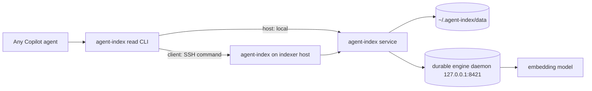

# agent-index architecture

`agent-index` is a runtime service plugin for local, repo-scoped retrieval. This
document describes the code that ships today. Vision documents remain intent;
implemented architecture lives here.

## Implemented state today

The current plugin includes:

- a Python package and `agent-index` CLI;
- a loopback FastAPI service with zdd routing and legacy rendezvous discovery;
- lightweight client runtime slots under `~/.agent-index/versions/<version>`;
- versioned host `[store,server]` slots selected by the plugin's own installer/cutover;
- durable service data under `~/.agent-index/data/`;
- a durable embedding-engine venv/daemon under `~/.agent-index/engine`;
- source connectors for local git, GitHub issues/PRs, and Azure DevOps work
items/PRs;
- chunkers for code, Markdown, YAML, and fallback text;
- LanceDB content/vector stores, path state, task queue, GC/repair, and
similarity-cluster artifacts;
- CLI (the agent-facing surface), HTTP, and an optional stdio MCP adapter
requiring explicit `[stdio-mcp]` opt-in on either role (absent from base and host profiles);
- host/client role routing for read commands over SSH.

That means the old "Phase 1 service shell only" description is stale. Future
work still exists, but indexing and retrieval are present in the shipped code.

## Incremental connector and reuse contracts

An in-process connector may opt into `DeltaSourceConnector.discover_delta()`,
returning a version-1 `SourceDelta` with changed `FileEntry` values, explicit
`DeletedFile` tombstones, its target checkpoint and complete-acquisition status.
The engine validates the result and canonical source family before writes.
Incomplete/incompatible deltas fail the source; they are not converted into
an empty success or inferred whole-corpus deletion.

This path does not call `current_commit()`, `list_paths()` or read all stored
paths: the connector owns coherent base-to-target coverage. Full reindexing and
legacy connectors retain the snapshot/discovery path, with stored-path
reconciliation limited to the connector's exact canonical family in either
storage layout. The opt-in Python
protocol is independent of the external provider CLI wire format. External
providers can opt into the separately negotiated contract below.

An external provider's existing `content-current-commit --source SOURCE` reply
may add `source_delta` with contract `agent-index.source-delta`, explicit
`versions`, canonical `family`, stable nonsecret `account` and effective
`target`. One connector instance captures one negotiation snapshot from the
actual executed provider; package or manifest versions do not imply support.
Missing or valid future-only declarations retain logged legacy reconciliation
with unchanged verbs and flags. Malformed declarations fail visibly.
Only advertised version 1 enables
`content-discover-changed --source SOURCE [--last-commit CURSOR] --delta-version 1`.
Its response requires `version`, `upserts`, `deletions`, `commit`, `complete`
and a `source_delta` echo of the acquisition process's actual scope. The echo
must still support v1 and exactly match the negotiated family/account/target,
so retargeting between metadata and acquisition cannot cross a recovery fence.
The delta's own cursor owns coverage; metadata cursors and incomplete output
never authorize tombstones. Invalid replies or process failures do not trigger
an effectful legacy retry.
Full reconciliation retains the old syntax and accepts canonical descendant
sources within the invoked subtree. Once v1 is negotiated, full
`content-discover`, legacy-shaped `content-discover-changed` and
`content-list-paths` responses must also include the same executing-scope echo.
It is checked before entries or paths are returned, protecting snapshot-derived
tombstones as well as explicit deltas. These calls introduce neither new flags
nor additional metadata probes; direct non-negotiated calls retain the legacy
baseline. Old callers can ignore the additive echo and metadata; new callers
handle supported rollback without guessing new syntax. Provider
hint consumption remains unadvertised. These providers must retain the baseline
through the consumer-upgrade and provider-rollback window; retirement requires
a separate contract revision.

Git revision sources use this seam for pinned base-to-target raw diffs and
bounded new-commit history, without listing unchanged tracked paths, stored
paths or all historical commits. Renames produce an old-path tombstone and
new-path upsert; files becoming non-indexable retire their previous content.
Blob reads use immutable object IDs and enforce the size bound before loading
content. A missing/unavailable cursor or rewritten history explicitly requests
a full reindex rather than silently performing an unlimited repair.
Full reindexing remains the initial reconciliation path.
Connectors whose current mode cannot prove delta coverage can expose
`delta_available=False`; Git's working-tree fallback retains its existing
snapshot path and logs that legacy reconciliation selection. Remote/ref reads
remain pinned even if the named ref moves during discovery.
Git paths are decoded per NUL-framed record. Non-UTF-8 paths are explicitly
logged and excluded in both full and incremental discovery rather than
inventing lossy stored identities or blocking unrelated items. Commit fields
and records use NUL framing, so control characters in commit messages remain
content rather than accidental record boundaries.

Presented files use bounded, exact checkpoint lookups. A normal round reuses
only complete file fingerprints covering text, language, metadata, chunker
policy and configured embedding profiles. `IndexConfig.chunker_revision` and
`ModelProfile.revision` are explicit programmatic invalidation inputs; a chunker
or model change that preserves its name must advance the corresponding revision.
Legacy content-only fingerprints deliberately miss once when a file is next
presented. Full reindexing still forces work, while its retries can reuse
compatible writes committed within the task window.

Existing file reuse is revoked before mutations begin, including forced rewrites
at an unchanged fingerprint. Each file checkpoint is published only after all
its content/vector writes and stale-chunk cleanup succeed. Chunking and deletion
failures retain the source cursor for
idempotent replay; legacy vector deletion precedes content deletion so retry can
still discover canonical chunk IDs. Transactional SQLite triggers maintain
per-source chunk totals as file checkpoints change, including deletions and
replayed batches. Existing path databases receive a one-time aggregate backfill;
ordinary rounds read only these source totals, not unchanged file rows.

Before mutating a nonempty acquired delta, the engine journals its complete
manifest and target in the existing path-index SQLite database. A retry first
finishes that pinned acquisition, atomically publishes and flushes the existing
JSON source cursor, then clears the journal and acquires fresh changes. This
prevents a newer net delta from omitting an item partially written by an
interrupted older delta (for example, a file changed and then reverted).
Source/account configuration changes refuse replay rather than applying old
work under a new scope. Completed checkpoints also retain the existing
`recovery_scope` hash in `SourceState.acquisition_scope`, alongside their cursor
and canonical family. A missing or mismatched checkpoint identity requires an
explicit full reindex before any new acquisition, in either storage layout;
a new target cannot reuse an old target's cursor even after its journal clears.
Successful application and atomic checkpoint publication bind the accepted
scope, including empty full snapshots with a null cursor. Failed application
or publication restores the prior in-memory checkpoint and retains any pending
acquisition for replay. Older state files still load, but their unbound cursors
require full reconciliation. An already-admitted pending journal with a matching
scope may finish and bind its checkpoint before fresh acquisition; its existing
envelope does not change. No additional identity or credential authority is
introduced. The same constructed connector supplies both acquisition
and its canonical/effective recovery identity: delta connectors declare a
nonsecret `recovery_identity` tuple. Built-in Git binds the resolved checkout,
remote target and selected ref, including environment/registry resolution;
GitHub binds the actual HTTP client's API/repository target, configured initial
window and authenticated account ID (one cached `/user` metadata probe, so user
token renewal preserves identity). Installation tokens cannot call `/user`;
after verifying `/installation/repositories`, their recovery scope conservatively
binds an opaque credential fingerprint. GitHub exposes no installation ID through
that token's identity API, so a rotated installation token refuses an existing
journal rather than guessing that repository ownership proves the same principal.
Complete pending crawls before rotation; no token bytes are persisted or logged.
Authentication failures never become anonymous identity. Azure DevOps binds its effective
HTTP-client endpoint, authenticated account and resolved work-item/pull-request queries.
Expected permission-only `/user` denials do not incur retry backoff; quota,
secondary-rate-limit and transient failures retain bounded HTTP retries.
Legacy CLI providers bind their registered command. Providers remain responsible
for stable backend identity.
Credential-bearing URL components are excluded, except SSH usernames remain
part of the target because they select remote home directories.
Ambiguous query/fragment target
semantics refuse recovery rather than silently selecting an identity.
The journal is not another checkpoint authority.
Another crawl alias cannot acquire or mutate an overlapping canonical family
(including ancestor/descendant scopes) while acquired
work remains pending. Source garbage collection also defers before deletion or
cursor retirement and reports the pending sources as failures. Restore the
original source configuration and complete its pending crawl before retiring
or retargeting it; deleting the journal is not a supported recovery path.
Pending work must finish through a journal-capable engine before rolling back
to an older engine; old runtimes do not implement this recovery contract.

Engine readiness is deferred until the first nonempty embedding batch; an empty
delta or wholly reused file set does not start embedding engines. Reused files
are excluded from timestamp-based stale cleanup. Metadata/model changes are
currently conservative whole-file invalidations: selective chunk/model reuse,
coverage backfill and metadata-only vector preservation remain subsequent
slices, not guarantees of the file-level checkpoint path.

## Process model



The service itself is machine-local. Clients do not open a public listener or
run a local indexer daemon; project-aware read commands execute the same
`agent-index` CLI on the designated indexer over SSH. The dynamic service port
stays on the host and is resolved there.

### Authenticated HTTP read endpoints

An explicitly configured HTTP client can use a provider-owned bearer credential
command without changing native hosting or SSH routing. Select the HTTP endpoint
in the repository's indexer designation, and put the credential reference only
in the client's machine-local `~/.agent-index/config.yaml`:

```yaml
role: client
endpoint: https://index.example.com/api/index
http_auth:
  endpoint: https://index.example.com/api/index
  installation_id: expected-remote-installation
  token_command:
    - /absolute/path/to/credential-provider
    - access-token
```

The command must emit only the credential on stdout; it owns provider selection
and noninteractive refresh. The CLI never starts a login, persists the token,
or reports provider output. Acquisition is headless with a 30-second deadline,
caller-owned process-tree cleanup, and capture-time limits of 16,386 stdout
bytes and 4,096 stderr bytes. Credentials are limited to 16,384 ASCII characters.
The exact endpoint binding, remote installation identity, HTTPS verification
(or explicitly selected loopback transport), disabled ambient proxies and
redirect refusal prevent credential forwarding to another destination.
Do not put a token in configuration or command arguments.

This mode supports the existing `/health`, `/status`, `/search`, `/similar`
and `/clusters` read contracts under the selected endpoint prefix. An adapter
may explicitly refuse unsupported reads; it must not fabricate an empty result.
Remote status checks the configured service identity, not local process custody.
Lifecycle operations cannot use the authenticated read client. This is not an
alternate path or fallback for the separate signed-grant scoped fleet protocol.

The focused native consumer test exercises an actual credential subprocess,
HTTP request and CLI process with isolated configuration. The optional Windows
desktop lane is selected with
`python tools/run-plugin-tests.py agent-index --allow-explicit-tiers --test-file tests/native/test_http_auth_windows.py`
and `COPILOT_EXTENSIONS_NATIVE_WINDOWS=1`. It observes two acquisitions from a
real windowless parent and refuses visible windows or foreground transitions.

## Install and runtime layout

| Area | Location | Owner |
|------|----------|-------|
| Runtime root | `~/.agent-index` | plugin installer |
| Client slots | Legacy `~/.agent-index/versions/<payload-version>`; namespaced profile-qualified slots | client installer |
| Client runtime marker | `~/.agent-index/current-version` | client installer selection only |
| Host runtime slots | `~/.agent-index/versions/<version>` or namespaced profile-qualified slots | plugin installer/cell reconciler selection, rollback, retention |
| zdd routing table | `~/.agent-index/active.json` | active service endpoint |
| Legacy rendezvous | `~/.agent-index/run/endpoint.json` | fallback diagnostics |
| Durable index/task data | `~/.agent-index/data/` | shared across service versions |
| Durable engine runtime | `~/.agent-index/engine/versions/<version-or-repair>` | independently selected, completed heavy embedding stack |
| Machine config | `~/.agent-index/config.yaml` or `AGENT_INDEX_CONFIG` | role, device, client endpoints |
| Repo config | Checked-in defaults: `<repo>/.agent-index/config.yaml`; repo-local overlay: `<repo>/.copilot-extensions/agent-index/config.yaml` | corpus defaults, optional local indexer designation, and additive corpus overlays |

Host service replacement follows
`../../../docs/patterns/graceful-daemon-cutover.md`, while the durable engine
split follows `../../../docs/patterns/durable-vs-versioned-runtime.md`.
Index data and queued work remain durable and outside service runtime slots.
The independent embedding engine is neither provisioned nor restarted during a
routine service update or host replacement.

## Activation, lifecycle, and supervision

Activation is repository-scoped and fail-closed:

1. One resolver builds the effective current-repository config using the same
precedence model documented for the rest of the ``.agent-*`` ecosystem (see
`docs/configuration.md` and
`plugins/agent-worktrees/docs/config-reference.md`): **machine-local**
`<repo>/.copilot-extensions/agent-index/config.yaml` wins over the conditional
**knowledge overlay** `<knowledge>/.agent-index/config.yaml`, which wins over
the checked-in **in-repo** base `<repo>/.agent-index/config.yaml`. An optional
marketplace overlay under
`.copilot-extensions/agent-index/marketplaces/<marketplace>/config.yaml`
remains above the repo-local machine overlay. For ordinary keys this is a
straight "highest precedence wins per key" deep merge, including list
replacement. `corpus.sources` is the one deliberate exception: because the
entries are independent corpus declarations rather than one replaceable setting,
the resolver unions them by source `name`, with the higher-precedence layer
keeping the winning definition on duplicate names and lower-precedence layers
contributing only missing names. If no local repo config exists, the resolver
preserves the earlier fail-closed fallback: it may adopt the bound knowledge
repo's own effective config as the only activator. A present invalid local
config, an unsafe path, a conflicting singular/plural indexer declaration, a
missing required binding for external-only activation, or an unavailable
resolver leaves the plugin inactive.
2. Session-start hooks emit retrieval guidance while that resolver reports
active, then stamp metadata and a callable binstub through the dependency-light
gate. Hooks never invoke install/ensure/provision, create venvs, acquire packages,
register autostart, or start/restart a service or engine. A stamp is not runtime
readiness; first admitted operational use owns provisioning, after explicit
repository opt-in and role/setup intent. Retrieval guidance belongs in the
exact-session guidance file when a session-file writer is present.
3. Every payload CLI entry runs the same resolver before installation-context
selection, runtime provisioning, or transport routing. `status` reports
structured `inactive` outside an opted-in repository; other commands are
refused.
4. In an active repository, admitted explicit commands may provision the light
service runtime locally. Setup writes the selected role without a second
role-specific engine provision. Noninteractive setup requires an explicit role
flag. The gate never executes a historical `payload-dir` installer as a
fallback, because that installer may retain obsolete host-install authority.
5. The installer-readiness probe is deliberately configuration-empty at session
start, including for opted-in repositories, so generic launch reconciliation
does not download packages or start services. Existing explicit installer and
runtime commands remain available.
6. The plugin's own installer/runtime lifecycle now builds, selects,
readiness-gates, replaces, rolls back, and retains the light host runtime. The
public `start` / `serve` entry points run the local service directly in the
selected interpreter, while installer `install` / `update` use `deploy` for
automatic zdd cutover when a live service is already serving. The durable
engine remains external to that runtime and is never rebuilt by an ordinary
service update.
7. Namespaced marker CAS, deploy-manifest publication, profile receipts, and
transaction recovery retain existing installation governance. Namespaced hosts
use the same local slot/cutover primitives as legacy mode. Compatibility
`ensure-service` compatibility hooks remain inert; `bootstrap-check` stamps only
metadata/binstubs. Previously completed receipts remain
diagnostic/ownership evidence, never permission to bypass runtime validation.

Client runtime selection requires the canonical exact four-field
`.install-complete.json`, the strict role/extras profile receipt, a valid
`pyvenv.cfg`, and a successful `import agent_index` from beneath the selected
slot. POSIX permits only the standard `bin/python` venv symlink after validating
its owned parent slot and resolved executable; all other linked/reparse runtime
artifacts remain rejected. A partial or corrupt slot is never dispatched.

The default durable tier now registers the same stable launchers with the
lowest-privilege host mechanism that satisfies "restart on next logon without a
live Copilot session": Windows writes HKCU Run entries for the service and
durable engine; POSIX registers systemd --user units when available. Windows
Scheduled Tasks remain an explicit per-machine upgrade tier for hosts that want
pre-login start, missed-trigger recovery, or task-owned restart policy. Explicit
independent engine commands retain their existing lifecycle outside the light
service runtime.

## Service HTTP surface

The service binds `AGENT_INDEX_HOST` (default `127.0.0.1`) and
`AGENT_INDEX_PORT` (default `0`, an OS-assigned ephemeral port). It exposes:

| Endpoint | Meaning |
|----------|---------|
| `GET /health` | `{status: "passive"|"ok"|"draining"}` plus installation, PID, and instance token |
| `GET /status` | plugin/version, drain state, index counts/sources, indexing runner state |
| `GET /search` | semantic + lexical search; degraded JSON if unavailable |
| `GET /similar` | nearest neighbours for an indexed chunk |
| `GET /clusters` | near-duplicate cluster artifact |
| `POST /reindex` | enqueue background indexing unless draining/deps missing |
| `POST /reindex/hints` | strictly validate and durably union version-1 acquisition hints |
| `POST /drain`, `/undrain` | zdd cutover drain gates; namespaced calls require the exact instance token |
| `POST /promote` | instance- and transaction-owned pre-route passive promotion |
| `POST /shutdown` | ownership-attested service shutdown used by CLI/cutover |
| `POST /adopt-relay` | compatibility stub; returns no relay |

Endpoint discovery is local: zdd `active.json` first, then legacy rendezvous.
See `../../../docs/patterns/local-endpoint-discovery.md`.

## CLI surface

Public CLI verbs are implemented in `src/agent_index/__main__.py`:

- `stop`, `status`, `version`
- `start` / `serve`, `restart`, `deploy [--recover]` manage the local service
- `index [--source S] [--full] [--change-hints-file FILE]`
- `search <query> [--source S] [--language L] [--repo R] [--limit N] [--json]`
- `similar <chunk_id> [--limit N] [--source S]`
- `clusters [--source S] [--bucket B] [--model M] [--exact-dupes-only] [--limit N]`
- `mcp` for the direct FastMCP HTTP-client toolset
- `engine status|start|stop|run`
- `setup`, `role`, and `capability`

`index-worker` is an internal subprocess entry point used by the task runner.
`__cell-start` remains an installation-cell-owned launcher seam that validates
ownership before serving from a namespaced runtime.

## Indexing pipeline

`agent-index index` and `POST /reindex` use the same durable indexing core:

1. Resolve source specs from `AGENT_INDEX_SOURCES`, grafted `corpus.sources`, or
the default `git` source.
2. Crawl full or incremental changes through the source connector.
3. Chunk files/items.
4. Ensure the configured embedding engine is reachable.
5. Store canonical content and per-model vectors in LanceDB.
6. Reconcile deletions/stale chunks and persist commit markers.
7. Refresh similarity clusters best-effort when clustering is enabled.

Indexing is incremental by default; full reindex is explicit. The task queue is
SQLite/WAL under `~/.agent-index/data/tasks.db`. Service-triggered reindexes run
in detached versioned worker subprocesses, so a service cutover does not kill an
in-flight indexing job; the successor service re-adopts live workers or marks
dead ones interrupted/resumable.

### Durable acquisition hints (queue contract v1)

`indexing.change_hints.ChangeHints` is a typed, immutable version-1 acquisition
hint envelope. Its exact configured `source`, adapter-supplied
`canonical_family`, and opaque nonsecret `account_id` form the union scope.
Adapters own canonical-family selection and stable account identification; the
queue does not infer aliases, accounts or credentials. Item IDs, event IDs,
distinct base/target `RefRange` pairs and item-bound `MetadataRevision` pairs
are deterministically deduplicated and unioned without collapsing differing
targets or metadata revisions. These are acquisition hints only: no snapshot
completeness, tombstone, deletion or checkpoint authority is implied. Unknown
fields, unsupported versions, malformed typed values and corrupt persisted
JSON fail visibly rather than becoming an empty or full-snapshot request.

`TaskStore.enqueue(source=..., change_hints=...)` accepts these envelopes only
for a matching exact-source incremental task (`full=False`). The additive
nullable `tasks.change_hints` column retains payloads across restart, retry and
recovery. A `BEGIN IMMEDIATE` transaction atomically unions new deliveries into
one same-scope `queued_hints` row. Processing payloads are immutable; events
arriving during active work accumulate into a separate trailing row. Retrying
an older attempt can leave two pending rows; both payloads remain intact and
new deliveries union into the oldest matching pending row. Different configured
sources, families or accounts are never coalesced.

Hinted tasks remain conservatively separate from legacy full tasks, including
`source='all'`: a full task has no proven account/ref/event coverage and cannot
cancel or swallow hinted work. Unhinted tasks retain queued exact deduplication,
queued-full supersession, full-first dequeue ordering and the existing rule
that a processing full task never absorbs a trailing incremental. A capable
dequeue preserves full-first ordering and FIFO within each tier.

This is a **receiver-first expansion**. `dequeue_next()` retains legacy
selection; only an explicit `dequeue_next(accept_change_hints=True)` may claim
parked work. The runner opts in only when the exact engine callable selected in
this runtime advertises v1 support. It rechecks before launch; the worker checks
its own selected callable again before execution. A capability loss returns a
claimed hinted task to `queued_hints`, without calling the engine or advancing
its checkpoints. An unclaimed hinted task cannot be executed directly by the
new worker. The monitor preserves intentional re-parking after the worker
exits, publishes a queue update rather than a terminal failure, and allows
dequeue after worker capability can be revalidated without requiring a manual
retry. The worker records refusal atomically in the existing task error field
when re-parking. A runner retains that refusal against the selected interpreter
and immutable runtime version. While that selection remains unchanged, it excludes
hinted dequeue and continues serving ordinary queued tasks. A changed selection
allows a new worker attempt, whose own callable must still verify v1 support.
Time passing or another queue notification is not evidence of capability.
Worker registration uses the existing immutable runtime-version metadata.
A pending cancellation still cancels the parked row.

The execution seam is
`agent_index.indexing.engine.run_reindex(..., change_hints: ChangeHints | None = None)`.
The exact selected callable must explicitly publish
`run_reindex.change_hints_versions = (1,)` **only after** implementing those
semantics. A module constant, package version, registered forwarding wrapper,
permissive `**kwargs`, or newer payload does not establish execution support.
Replacing the callable with an unadvertised implementation removes support.
Plain tasks still use the legacy kwargs without `change_hints`. The transport
and worker preserve the envelope; the capable engine retains responsibility
for source/account admission, acquisition, checkpoints and all index mutations.

`GET /health` adds `indexing_contract` with stable identity
`agent-index.change-hints`, `intake_versions: [1]`, and separately computed
`execution_versions` (`[]` unless the selected callable advertises v1).
Advertising durable intake is not a claim that hinted execution is available.
`POST /reindex/hints` accepts only `source`, optional `full: false`, and required
`change_hints` containing the complete v1 envelope. It refuses unknown fields,
versions, duplicate JSON keys, mismatched scopes and oversized bodies before
queue effects. Ordinary runner/dependency/drain availability checks still apply.
Accepted responses include the stored task and its complete unioned payload.
SQLite admission runs off the service event loop. Request cancellation does
not release drain admission until the queue write and runner notification
settle; the service remains responsive while a database writer is contended.
The legacy `/reindex` source/full contract is unchanged, but extra properties
are rejected rather than silently discarding required hints.

`AgentIndexClient.reindex(change_hints=...)` negotiates intake support from the
running service's health response before posting to the dedicated hinted path.
A legacy or invalid advertisement refuses before a POST. A rollback between
discovery and submission yields an unsupported endpoint, never a source-only
fallback. An invalid accepted receipt is reported as an unknown acceptance
outcome and is not replayed. Source-only client calls do not need discovery.
The direct local CLI form `index --source S --change-hints-file FILE` strictly
reads the same v1 JSON and requires callable execution capability before
calling the engine; it never retries without hints. Older CLIs reject the new
option. With no hints file, the existing direct CLI execution path is retained.
Split-runtime forwarding makes relative hint-file paths absolute in the
caller's working directory before the hosted child changes directory. Both
`--change-hints-file FILE` and `--change-hints-file=FILE` retain that binding.
The intake DTO and transport additions retain the declared Python 3.10 floor,
using postponed concrete annotations rather than newer `typing` exports.

Deploy receivers before producers, and enable hinted execution only with a
qualified capable engine. This transport expansion does not itself add engine
acquisition support; without that implementation hinted rows remain parked.

The storage migration atomically installs durable SQLite triggers with the new
column. The triggers preserve `queued_hints` even when an older runtime's
retry, release or generic status update writes `queued`; older dequeue SQL
therefore cannot claim hinted work after rollback. Existing plain rows retain
their old defaults and behavior. New queue queries, pending counts, cancellation
and retry include parked rows. Older diagnostic/cancellation code may not list
or cancel parked work; use a capable TaskStore to manage it. Keep the nullable
column, parked status and rollback-fencing triggers throughout the supported
upgrade/rollback window; this expansion retires no legacy form. Existing source
locks, committed-reader state, checkpoints and vector-gap repair retain their
own authorities.

Step 6 has two independent GC passes. `gc_stale_sources` purges abandoned
crawler NAMING SCHEMES (a stale generation, e.g. an old `forge:*` variant) and
runs only on a full reindex, paired with post-GC compaction. `gc_unconfigured_sources`
purges a source that a user simply removed from the layered `corpus.sources`
config sometime after it was indexed -- distinct from an abandoned scheme, and
cheap enough (one `source_counts()` scan) to run on EVERY reindex, incremental
included, whenever the run covers the full configured set (`--source` is not
given). This is what lets a config change -- e.g. dropping a source from the
harness's checked-in defaults, a knowledge-repo overlay, or a personal
override -- take effect on the very next routine reindex tick (the ~30-minute
`agent-dispatch` maintenance schedule already runs an incremental `agent-index
index`), with no full reindex and no service restart required. Both passes
share the `AGENT_INDEX_REINDEX_GC=0` opt-out and an `AGENT_INDEX_GC_KEEP_SOURCES`
escape hatch for reviving a remote-ingest source without a code change.

## Sources and corpus config

Registered source prefixes are `git`, `github`, `ado`, and `azure-devops`.

- `git` indexes local tracked files plus commit-history entries. It prefers the
remote default branch when available and falls back to local HEAD/working tree.
- `github:<owner>/<repo>` indexes GitHub issues and pull requests through the
GitHub connector.
- `ado:<org>/<project>` / `azure-devops:<org>/<project>` indexes only the
operator-configured work-item queries and pull-request queries. No query means
that side indexes nothing, by design.

Corpus config is intentionally outside the runtime. A repository activates
agent-index by carrying a valid checked-in `<repo>/.agent-index/config.yaml`
or, during the compatibility window, a legacy
`<repo>/.copilot-extensions/agent-index/config.yaml`. Mere plugin enablement
leaves the capability inactive and does not start or probe a service. When both
repo files exist, the checked-in `.agent-index/config.yaml` is the shareable
in-repo base and `.copilot-extensions/agent-index/config.yaml` is the
machine-local override layer. For repositories that require an external state
root, the bound knowledge repo's checked-in `.agent-index/config.yaml` is the
middle knowledge-overlay tier. This follows the established layered naming and
precedence used by agent-worktrees and the other `~/.agent-*` configs:
machine-local > knowledge overlay > in-repo base. The one intentional
agent-index-specific exception is `corpus.sources`: unlike ordinary list-valued
keys, it unions by source name so repo defaults, knowledge-repo declarations,
and private overlays can compose, with the higher-precedence layer winning any
duplicate name. `indexer` / `indexers` and every other key still follow the
ordinary replace-wholesale rule. For multi-repo harness use, the runtime sweeps
effective layered repo configs from locally adopted projects via the sibling
agent-worktrees registry; machine-local `~/.agent-index/config.yaml` can add
supplemental sources. The session-start scope-binding hook reads the same
layered model, and the installed runtime module (`agent_index.config`) now uses
that same external-state-root-aware resolver for `read_indexers()`,
`read_corpus_sources()`, and transport role planning, so the advertised config
and the live host/client routing decision stay aligned in the common
adopted-knowledge-repo case.

## Embedding engine and query behavior

The default model profile is `jinaai/jina-embeddings-v2-base-code` on engine
port `8421`. By default:

- `AGENT_INDEX_ENGINE_MODE=external`: the service does not manage the model
process during indexing; the durable engine daemon owns it.
- `AGENT_INDEX_SEARCH_IN_PROCESS=0`: query embedding also goes through the engine
client. If the engine is unreachable, search attempts a lexical/BM25 fallback.
- `agent-index engine start|stop|status|run` manages the durable engine daemon.
- `install.ps1|sh engine-update` is the explicit path that rebuilds/restarts the
heavy engine runtime; normal service updates preserve the warm engine.

Operators can opt into `subprocess`, `systemd`, or `auto` engine modes, or
in-process CPU query embedding, but those are configuration choices rather than
the shipped default.

## Retrieval + MCP surfaces

Retrieval is agent-facing through the **`agent-index` read CLI**, and there is a
separate lower-level MCP surface:

1. **`agent-index` read CLI (the agent path)** — every agent calls
   `agent-index search` / `similar` / `clusters` / `status` **directly**;
   there is no sub-agent and no MCP-tool wrapper. agent-index is a uniform
   retrieval capability every agent may use, so how-to-search guidance is
   documented by the plugin skills and command catalog rather than delivered
   through aggregate sessionStart `additionalContext`. The CLI transport
   handles host/client SSH routing, so the same commands work on a host (local)
   or a client (over SSH).
2. **Direct `agent-index mcp`** — `src/agent_index/mcp_app.py` exposes HTTP-client
   FastMCP tools (`agent_index_search`/`find_similar`/`clusters`/`status`) plus
   `agent_index_reindex`. It resolves `AGENT_INDEX_ENDPOINT` first, then local
   endpoint discovery. This is a lower-level surface for embedding/automation, not
   the agent retrieval path. Its `[stdio-mcp]` extra is explicit opt-in, absent
   from both native `[store,server]` installations and the base CLI. It runs in
   the invoking runtime on either role, without forwarding into the host slot:
   it needs a reachable HTTP endpoint, not local store/server dependencies.

## Robustness and fail-loud behavior

Implemented safeguards include:

- versioned service slot activation with completion markers and garbage
collection that protects live PIDs;
- installer self-staging and watchdog bounds to avoid wedging the singleton
plugin payload;
- zdd active/passive service cutover with drain/undrain and breadcrumb recovery;
- atomic read admission: drain closes `search`, `similar`, and `clusters`
  admission before waiting for already-admitted reads;
- passive generations remain task-runner and shared-evidence inert until
  explicit promotion;
- durable marker+manifest transaction recovery for forward updates and
  historical rollback, with governance rechecks at both mutation boundaries;
- installation-scoped service-instance receipts and exact-token reconciliation
  that converge successful and recovered cutovers to one owned PID;
- durable queue + detached workers for reindex work across cutovers;
- engine reachability checks before vectorization so a source fails loudly rather
than committing unsearchable content;
- degraded JSON responses for unavailable search/cluster/status paths instead of
tracebacks;
- capability-aware embed batch sizing and configurable embed read timeout;
- FTS (BM25) index maintenance self-heals from a non-retryable incremental
  rebuild failure (e.g. a lancedb/lance-index panic against stale on-disk
  index state) by escalating once to a full `create_fts_index(replace=True)`
  rebuild in the same cycle, rather than backing off a failure that can never
  resolve on its own; a genuinely retryable commit conflict still uses the
  existing capped-backoff retry instead.

## Planned or not present

- Query-time trust-domain enforcement is not implemented; callers must scope
queries with `source`/`repo` when crossing trust domains.
- Cross-process source locks during a service cutover are not implemented; store
locking is relied on for the narrow overlap window.
- The plugin does not expose a public network listener, gateway, or relay.
- The read-only agent-facing CLI surface does not expose reindexing.
- There is no plugin-local clean-room scenario under `plugins/agent-index`; fresh
install/runtime changes should use the repo-level clean-room framework when
practical.